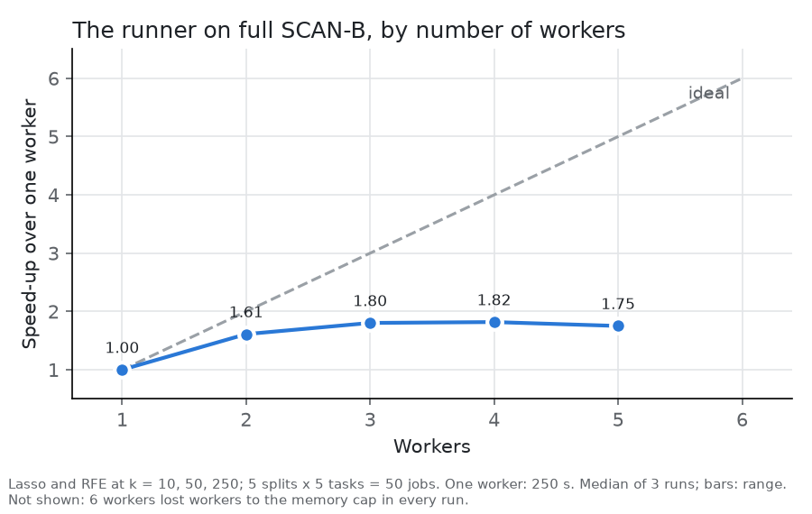

# 6. Making it fast (task 3)

[Back to contents](README.md) · Previous: [5. The software](05_the_software.md) · Next: [7. Results on SCAN-B](07_results_scanb.md)

Task 3 asks for infrastructure that speeds up feature selection. We worked
at two levels: the whole experiment (the runner) and each method (faster
algorithms, and a GPU).

The speed-ups of section 6.2 come from series of measurements on several
sizes. The comparison of section 6.1 is one grid at one size, run three
times. The few single timings in the text are marked as such. They
explain a design choice and claim no speed-up. All ran on one laptop: Intel i7-9750H, 12 threads, 16 GB RAM,
and an NVIDIA GTX 1650 with 4 GB.

The SCAN-B measurements here, except the table of section 6.1 and the
tree importance timing of section 6.2, use 28,552 genes: the 28,541 of
chapter 7 and the 11 flat genes (section 2.1, Appendix B.5). Those two
use the 28,541 genes.

## 6.1 The runner against plain scikit-learn

Most selectors and all classifiers come from scikit-learn, so the
runner's value over it must be measured. The same small grid ran four
ways on the same splits: scikit-learn's `cross_validate`
(one call per selector and `k`) and our runner, each on one core and on
12 threads. The scikit-learn side uses its own selectors:
`SelectFromModel` with L1 logistic regression for Lasso, and `RFE` with
`LinearSVC` for RFE. The script checks that all four runs give the same
test scores before it reports a time. All 30 test macro-F1 scores were
equal on every run.

The setting, chosen to see the whole flow in about a minute:

- SCAN-B, Basal vs rest: 2,976 patients, 3,000 random genes of 28,541.
- 5 splits at a training fraction of 0.5.
- Lasso and RFE (step 0.5 for speed; the experiments use 0.1) at `k` =
  10, 50 and 250.
- Logistic regression with a fixed C, as in the experiments.
- Every seed fixed and the same on every split, so both sides fit the
  same models. The experiments seed each split differently.
- Data in 32-bit floats on both sides.
- One fit per selection on both sides.

The runner solves Lasso by PPDNA and RFE by Newton's method (section
6.2). scikit-learn runs liblinear to a tight tolerance, so that both
sides reach the same solution. The script ran three times, the fewest that give a median and a range, with the
laptop otherwise idle. The table gives the median
seconds and the speed-up of the medians. Over the three runs, the
runner's speed-up was 3.9 to 4.5 on one core and 10.1 to 10.8 on 12
threads. Against scikit-learn on 12 threads, the runner on 12 threads is
6.8 times faster (32.8 s against 4.8 s).

| Run | Seconds (median of 3) | Speed-up over scikit-learn on 1 core |
|---|---|---|
| scikit-learn, 1 core | 50.9 | 1.0 |
| runner, 1 core | 11.9 | 4.3 |
| scikit-learn, 12 threads | 32.8 | 1.6 |
| runner, 12 threads | 4.8 | 10.6 |

Source: [`scripts/benchmark_speed.py`](../scripts/benchmark_speed.py),
[`results/speed_benchmark.csv`](../results/speed_benchmark.csv).

**Why.** The runner does less work, not different work:

- It prepares each split (imputation, scaling) once for every task,
  selector and classifier.
- It fits each rank-once selector once per split and cuts the ranking at
  every `k` (chapter 5). scikit-learn refits it for every `k`. The genes
  are identical either way.
- It runs jobs in parallel, with the data in shared memory.

Parallel work added less than the 12 threads suggest. scikit-learn
spreads only the 5 splits of one call, and gains 1.6 times. The runner's
10 jobs (2 selectors × 5 splits) gain 2.5 times over its own one-core
run.

### Parallel work at full size

The same grid ran on all 28,552 genes and all five tasks: 50 jobs. Each
worker count, 1 to 6 (a range set by hand), ran 3 times, for a median and a range, each in a fresh process. The runs varied by
about 2%. At 6, every run fell back to 3 workers (section 5.5), so the
table stops at 5 ([`figures/parallel_scaling.csv`](figures/parallel_scaling.csv)).

| Workers | Seconds (median) | Speed-up | Efficiency (speed-up per worker) |
|---|---|---|---|
| 1 | 250 | 1.00 | 1.00 |
| 2 | 155 | 1.61 | 0.81 |
| 3 | 139 | 1.80 | 0.60 |
| 4 | 138 | 1.82 | 0.45 |
| 5 | 143 | 1.75 | 0.35 |

The speed-up stops at about 1.8, from 3 workers on. Job sizes do not
explain it. The longest of the 50 jobs took 12 s, and all of them 240 s.
Preparing the splits and writing the results took at most about 20 s.
So 3 workers could finish in about 100 s. They took 139 s.

Instead, each job ran slower beside others. With 3 workers, the selection
fits took 1.76 times as long as alone. The classifier fits, on 10 to 250
genes, did not slow down. A selection fit reads the whole training set,
1,488 patients × 28,552 genes, far more than the processor's cache holds.
A classifier fit reads only a few genes. This points to memory bandwidth,
shared by all cores, as the limit. We did not measure the bandwidth
itself.

With 6 workers, the memory cap per worker was too small, and every
6-worker run fell back to 3 workers (section 5.5; `ended_with_workers`
in `figures/parallel_scaling.csv`). So on this 16 GB laptop, more than 3 workers gained almost nothing for this
grid: the median time was 138.7 s with 3 workers and 137.6 s with 4.

Sources: [`scripts/parallel_scaling.py`](../scripts/parallel_scaling.py),
[`figures/parallel_scaling.csv`](figures/parallel_scaling.csv); per-job
times from [`scripts/parallel_job_times.py`](../scripts/parallel_job_times.py),
[`figures/parallel_scaling_jobs_1_worker.csv`](figures/parallel_scaling_jobs_1_worker.csv)
and [`figures/parallel_scaling_jobs_3_workers.csv`](figures/parallel_scaling_jobs_3_workers.csv).

### Where the time goes

The time per method is in section 7.11. To save memory, the runs hold
the data in 32-bit floats (section 3.12).

## 6.2 Each method, faster

Each selector has a speed notebook,
`featsel/selectors/<name>/demos/speed.ipynb`. It times the scikit-learn
original and our versions on synthetic data shaped like SCAN-B: 3,000
samples, 1,000 to 30,000 features, binary, with one sample in five positive (set by hand). It
checks that every fit is reproducible and picks the original's features.
Each time is the median of 2 timed fits, after one untimed warm-up fit.
If the warm-up takes over a minute, one timed fit follows instead of two.
When the median of the timed fits exceeds a minute, the variant stops
growing; the minute keeps each notebook to minutes. Two fits show a gap of several times, not of a few
percent.

Results at the largest size both sides reached (30,000 features unless
noted). Every fit of every variant was reproducible. For the U-test rows,
the "Original" column is our own NumPy U test, the CPU version.

| Method | Original | Ours, CPU | Ours, GPU | Same features? | Source |
|---|---|---|---|---|---|
| ANOVA, FDR, FWE, Percentile (F-test) | 0.36 s | 0.36 s | 0.14 s (2.6×) | yes | [anova_f](../featsel/selectors/anova_f/demos/speed.ipynb) |
| Variance threshold | 0.83 s | 0.86 s | 0.13 s (6.4×) | yes | [variance_threshold](../featsel/selectors/variance_threshold/demos/speed.ipynb) |
| Correlation (pandas full matrix) | 7.05 s | 6.89 s | 0.25 s (28×) | yes | [correlation](../featsel/selectors/correlation/demos/speed.ipynb) |
| Mann-Whitney and Higher Criticism (our NumPy U test) | 3.76 s | — | 0.49 s (7.7×) | yes | [mann_whitney](../featsel/selectors/mann_whitney/demos/speed.ipynb) |
| Berk-Jones (our NumPy U test) | 3.88 s | — | 0.46 s (8.4×) | yes | [berk_jones](../featsel/selectors/berk_jones/demos/speed.ipynb) |
| Mutual information, 10,000 features | 78.3 s | 18.4 s (4.2×) | 1.60 s (49×) | yes, bit for bit | [mutual_info](../featsel/selectors/mutual_info/demos/speed.ipynb) |
| Lasso (liblinear → PPDNA solver) | 5.78 s | 25.4 s (4.4× slower) | 1.01 s (5.7×) | no: Jaccard 0.91 (shared features over all features chosen by either) with liblinear's features at 30,000; on SCAN-B, see below | [script](../scripts/benchmark_speed_selectors.py) (Appendix D.1), [`LassoSelector.csv`](../results/speed/LassoSelector.csv) |
| Tree importance, 10,000 features (1 thread → 12) | 103.7 s | 18.8 s (5.5×) | no GPU path | yes | [tree_importance](../featsel/selectors/tree_importance/demos/speed.ipynb) |
| RFE (liblinear → exact Newton solver) | 26.2 s | 12.9 s (2.0×) | 15.6 s (1.7×) | not at every size (see below) | [script](../scripts/benchmark_speed_selectors.py) (Appendix D.1), [`RFESelector.csv`](../results/speed/RFESelector.csv) |
| RFECV, 10,000 features | 70.1 s | 49.9 s (1.4×) | 42.2 s (1.7×) | not at every size | [script](../scripts/benchmark_speed_selectors.py) (Appendix D.1), [`RFECVSelector.csv`](../results/speed/RFECVSelector.csv) |
| Sequential forward, 1,000 features | 163.8 s | 22.5 s (7.3×) | 4.9 s (34×) | yes | [sequential](../featsel/selectors/sequential/demos/speed.ipynb) |
| Random | — | 0.02 s | — | — | [random_selection](../featsel/selectors/random_selection/demos/speed.ipynb) |

Appendix D.1 tells how these timings were checked. On real SCAN-B, one
Lasso fit took 0.71 to 1.36 s with PPDNA on the GPU, 3.9 to 7.0 times
faster than liblinear (Appendix D.2).

### Where the speed comes from

| Method | What changed |
|---|---|
| U test | One sort per gene gives the ranks and the tie groups. On the GPU, PyTorch sorts thousands of genes in parallel. Only the rank sums and tie counts are computed there, exactly, in 64-bit floats. The p-value is finished on the CPU, so every device gives identical results. The NumPy version also uses one sort per gene. In the speed series it takes 1.27 s at 3,000 × 10,000 and 3.76 s at 3,000 × 30,000. |
| F-test, variance | Class sums as one vector product per class, on the GPU. |
| Correlation | The gene-gene correlations are computed in blocks, so the full 28,552 × 28,552 matrix is never held in memory. |
| Mutual information | scikit-learn's estimate (Ross 2014) finds nearest neighbours with a KD-tree. For one feature, a sort per class finds the third-nearest neighbour (scikit-learn's default of three neighbours), and a binary search counts the points within its radius. The random noise, the distances and the order of every mean are scikit-learn's, so the scores are identical, bit for bit. A class of 2 to 7 samples, and regression, go to scikit-learn, which uses brute-force distances there. The GPU path draws scikit-learn's noise on the CPU and sends it over. |
| Lasso | PPDNA (Liu and Zhou 2023), a semismooth Newton method, solves the same L1 problem to a tight tolerance on the GPU. |
| RFE, RFECV | An exact Newton solver for the linear SVM (Chapelle 2007). With fewer samples than genes, it works through the samples' n × n kernel matrix (3,000 × 3,000, not 30,000 genes wide). The matrix is kept between rounds. |
| Sequential | Each step solves all candidate features at once: one batched Newton problem on the logistic regressions, in PyTorch, in 64 bits. The candidates share the features already chosen, so every Hessian block is one product over all candidates and no design matrix is built. Each fit starts from that candidate's solution at the previous step. It selects what scikit-learn does with a converged logistic regression. It covers two classes, forward search and accuracy, and raises an error otherwise. The GPU wins here: the work is wide elementwise passes and large products. |
| Tree importance | scikit-learn's own forest on several threads (`n_jobs`). scikit-learn's default is one thread. On the runs' 70% training set (2,083 patients), one thread takes 30.2 s and 4 threads 9.6 s ([`results/tree_timing.csv`](../results/tree_timing.csv); section 7.11). In the runner, threads per worker times workers should not exceed the 12 hardware threads; the experiments use 4 threads per fit (`n_jobs=4`), a count set by hand within that limit. |

**RFE's step.** RFE removes a fixed share of the starting genes each
round. Every run uses step 0.1.

### Why some methods do not pick the same features

**Lasso.** liblinear stops at a tolerance of 10⁻⁴, far from the exact
solution. PPDNA comes far closer to it, so it picks fewer, different
genes. On all 2,976 patients (C = 1, the default of both selectors):

| Task | liblinear, default | PPDNA | Jaccard |
|---|---|---|---|
| Basal | 330 | 196 | 0.55 |
| Her2 | 571 | 430 | 0.69 |
| LumA | 1,600 | 907 | 0.51 |
| LumB | 1,029 | 733 | 0.58 |
| Normal | 577 | 542 | 0.88 |

PPDNA is reproducible. These counts are from the GPU. On the CPU, PPDNA
keeps 1 to 3 genes fewer on LumA and LumB (906 and 730). Source:
[`results/speed/LassoSelector_scanb.csv`](../results/speed/LassoSelector_scanb.csv).

**RFE.** The cause is the same as for Lasso: liblinear's tolerance. When
genes are strongly correlated,
liblinear's tolerance changes which genes are removed. On the synthetic
data at 3,000 features, the Jaccard index between the two gene sets was
only 0.28. The two differ by tolerance; neither has a bug.

**Newton's answer is the exact one.** liblinear's tolerance is a stopping
rule, not part of the method. Its coordinate descent nears the solution
with every pass but never reaches it. Newton's method reaches the exact
solution in a finite number of steps (Keerthi and DeCoste 2005,
Theorem 1). Given unlimited time, liblinear would end at Newton's answer.
So Newton gives the selection SVM-RFE intends, and liblinear's default
approximates it.

For Lasso the claim is weaker. PPDNA is not proven to stop exactly at
Lasso's solution. It stops at a residual of 10⁻¹⁰, or after 1,000 outer
steps, both set by hand (Appendix D.3); 10⁻¹⁰ is far tighter than
liblinear's 10⁻⁴.

**Why PPDNA.** Simpler solvers failed, and PPDNA itself needed changes
from its paper to work on SCAN-B-shaped data (Appendix D.3).

**No liblinear.** RFE, RFECV and Lasso do not offer liblinear, and have
no `solver` parameter. Each runs only its tight solver: Newton, which
is exact, for RFE and RFECV; PPDNA, to a residual of 10⁻¹⁰, for Lasso.
The reasons:

- **Speed.** On the synthetic data of the first table, Newton RFE was
  2.0 times faster than liblinear on the CPU at 30,000 features.
- **Exactness.** Newton reaches the solution that liblinear only
  approaches.
- **Repeatability.** Unless its seed is fixed, liblinear shuffles the
  data differently on each fit and keeps different genes. Newton and
  PPDNA use no randomness, so the selectors take no `random_state`.

For Lasso the speed argument is weaker. On the CPU, a single PPDNA fit
was faster than liblinear on some tasks and slower on others; only on a
GPU was PPDNA clearly faster (Appendix D.2, D.4).

The cost is the drop-in promise. These three selectors select what
scikit-learn selects with liblinear run to a tight tolerance, not with
its defaults. Lasso is classification only. The project's tasks are all binary
classification (section 2.1).

Newton has one limit. It works in the samples' space, through an n × n
kernel, so it loses when samples far outnumber genes. On synthetic data
with 3,000 samples and 1,000 genes, Newton RFE took 7.6 s and liblinear
1.6 s. At 3,000 genes Newton was already faster: 7.5 s against 13.6 s.

**The rule.** Every other selector that copies a scikit-learn method
selects what scikit-learn selects by default. Sequential's Newton solver is an option, not its default. No
selector picks its solver on its own. The device is chosen at run time
only under `device='auto'` (section 6.3). Each result records the device
used.

### Why the GPU does not always win

- **64-bit arithmetic.** The GTX 1650 is a consumer card. It runs 64-bit
  floating point at 1/32 of its 32-bit speed. RFE's solver runs in 64
  bits; no comparison with 32 bits was saved. So at 30,000 genes RFE is
  slower on this GPU than on the CPU. At 1,000 to 10,000 genes the GPU is
  still faster.
- **Copying.** The data must be copied to the GPU. For the fast filters,
  this is part of each timed fit; its share was not measured.
- **Memory.** 4 GB is small. XGBoost ran out of memory on SCAN-B-sized
  data. cuML fit smaller data but was slower than scikit-learn on
  12 threads. So tree importance stays on the CPU (Appendix D.5).

Appendix D.6 lists the GPU libraries we considered and did not use.

## 6.3 The device policy

Ten selectors share one rule for choosing where to run:

| `device` | Behaviour |
|---|---|
| `'auto'` (default) | Use the GPU if one is free now; otherwise the CPU. |
| `'cpu'` | Always the CPU. |
| `'cuda'` | Wait for the GPU and use it. |
| any | A tensor already on a GPU runs there. |

`'auto'` never waits, so a parallel run never stalls on the GPU. It uses
the GPU only when PyTorch loads, a GPU is present, and no other fit holds
it. It falls back to the CPU when the GPU runs out of memory. `'cuda'`
raises an error if the GPU cannot run. The frontier runs (chapters 7 and 8) set
`'cuda'`, so every timing of a GPU method was really taken on the GPU.

A file lock lets one fit at a time hold the GPU. Batch sizes come from
the GPU's free memory. Fitted scores are NumPy arrays on every device.
The device used is recorded with every result.
