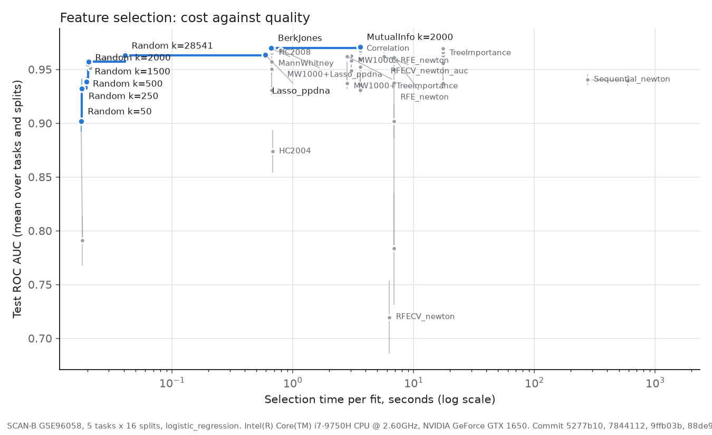
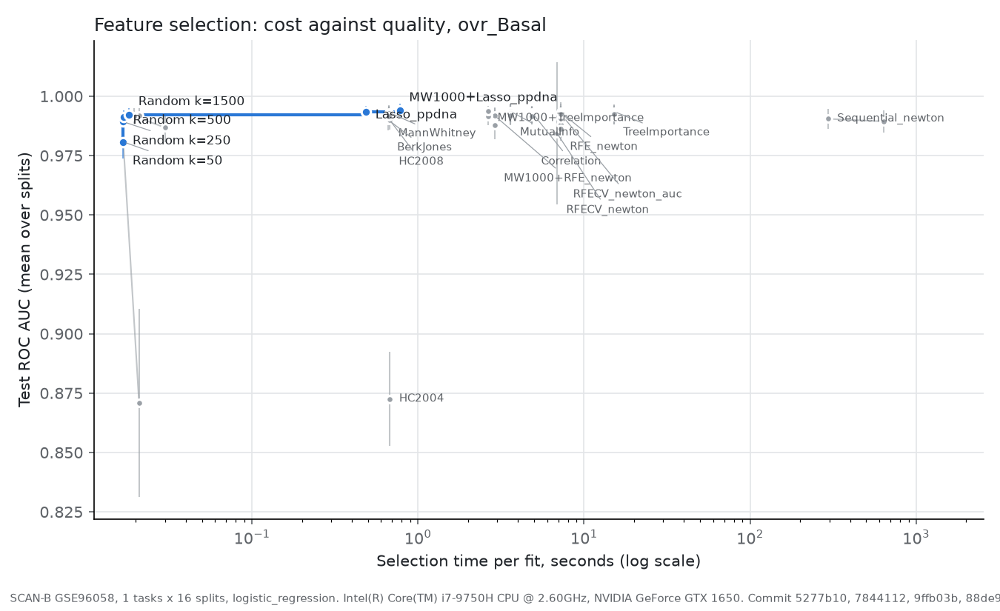
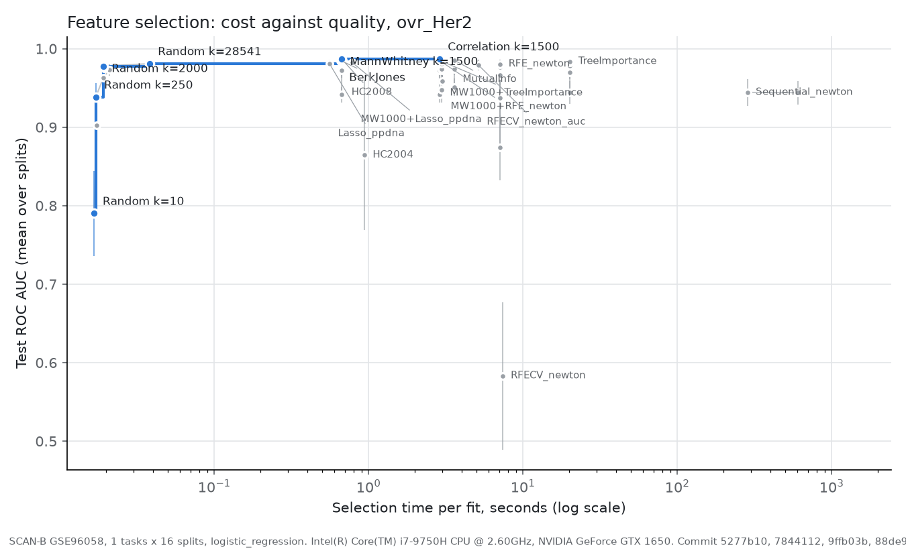
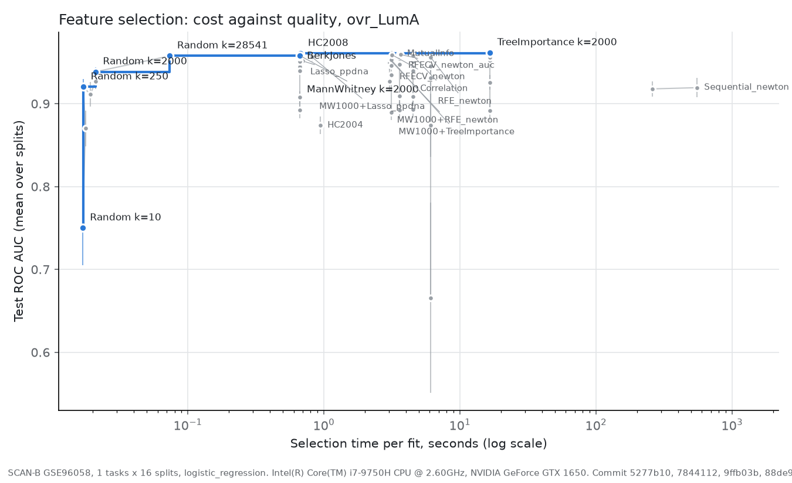
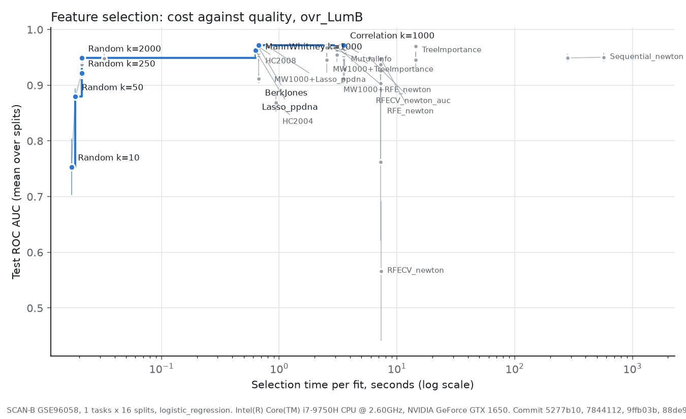
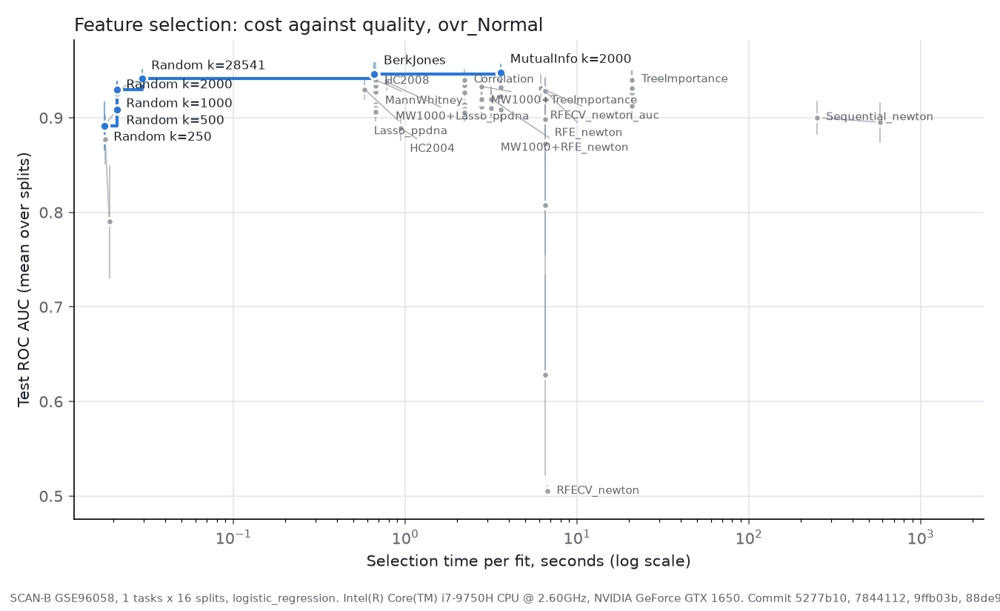
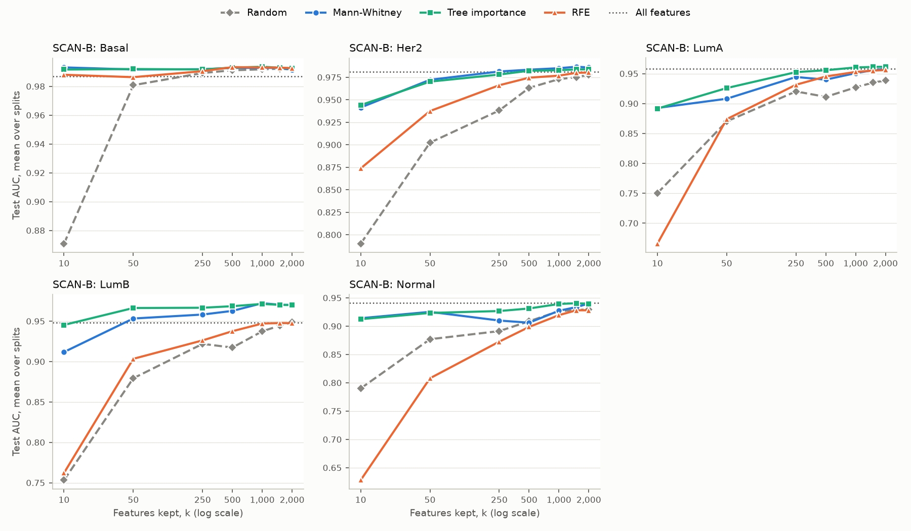

# 7. Results on SCAN-B

[Back to contents](README.md) · Previous: [6. Making it fast](06_making_it_fast.md) · Next: [8. Results on image data](08_results_images.md)

This chapter reports SCAN-B: 2,976 patients, 28,541 genes, five tasks, each
PAM50 subtype against the rest (chapter 2).

Every run follows the protocol of chapter 3, with 2,083 patients in the
training set and 893 in the test set. All numbers are means over the 16
splits.

Sources: [`scripts/summarize_frontier.py`](../scripts/summarize_frontier.py)
wrote the `summary_scanb70_*` tables in [`figures/`](figures/):
`_chosen` (each method at its chosen `k`), `_curve` (test AUC at every
`k`), `_bar` (against random at the same `k`) and `_tests` (against all
genes). Configs: `configs/frontier_scanb70_*.yaml`.

## 7.1 What each method reaches

*Each point is one method at one `k`: median selection time per fit, and
mean test AUC over tasks and splits, with a bar of one standard deviation.
A point is on the frontier (blue) when no other point is both faster and
better. The mean over tasks hides
differences between tasks; the per-task plots follow. Table:
[`figures/frontier_scanb70_roc_auc.csv`](figures/frontier_scanb70_roc_auc.csv).*

### Each task's frontier

The same plot for each task, mean over the 16 splits. Each task has its
own table, `figures/frontier_scanb70_roc_auc_ovr_<task>.csv`.

What the five frontiers show:

- **Random genes are the fast end of every frontier.** They take 0.02 to
  0.07 s. On Basal, 50 random genes already reach 0.981.
- **No one method tops every task.** Mann-Whitney 1000 then Lasso on
  Basal (0.994), Mann-Whitney and correlation at 1,500 on Her2 (0.987),
  Berk-Jones, HC2008 and tree importance on LumA (0.961), Mann-Whitney and
  correlation at 1,000 on LumB (0.972), and mutual information at 2,000 on
  Normal (0.948).
- **Above random, the frontier climbs little,** except on LumB. There it
  goes from 0.949 (random, 2,000 genes) to 0.972. On the other tasks the
  climb is 0.007 or less.
- **The first point above random takes 0.5 to 0.7 s.** It is Lasso on
  Basal and LumB, Berk-Jones on Her2 and Normal, and Mann-Whitney on LumA.
- **The slower methods add at most 0.001.** Correlation, mutual
  information and tree importance take 3 to 17 s.

Test AUC at the `k` each method chose on validation sets:

| Method | Basal | Her2 | LumA | LumB | Normal | Mean |
|---|---|---|---|---|---|---|
| Mutual information | 0.992 | 0.984 | 0.960 | 0.970 | **0.948** | **0.971** |
| Berk-Jones | 0.990 | 0.985 | 0.961 | 0.968 | 0.947 | 0.970 |
| HC2008 | 0.990 | 0.985 | 0.961 | 0.969 | 0.946 | 0.970 |
| Correlation (Spearman) | 0.991 | 0.986 | 0.958 | **0.971** | 0.940 | 0.969 |
| Mann-Whitney | 0.991 | **0.986** | 0.958 | 0.971 | 0.939 | 0.969 |
| Tree importance | 0.991 | 0.983 | **0.961** | 0.971 | 0.937 | 0.969 |
| Mann-Whitney 1000, then Lasso | **0.994** | 0.982 | 0.956 | 0.970 | 0.938 | 0.968 |
| Mann-Whitney 1000, then tree importance | 0.993 | 0.984 | 0.951 | 0.971 | 0.927 | 0.965 |
| Lasso | 0.993 | 0.981 | 0.951 | 0.963 | 0.930 | 0.964 |
| All 28,541 genes | 0.987 | 0.981 | 0.958 | 0.948 | 0.941 | 0.963 |
| Mann-Whitney 1000, then RFE | 0.991 | 0.983 | 0.951 | 0.968 | 0.918 | 0.962 |
| RFECV, scored by AUC | 0.991 | 0.979 | 0.959 | 0.949 | 0.931 | 0.962 |
| RFE | 0.993 | 0.980 | 0.956 | 0.947 | 0.928 | 0.961 |
| HC2004 | 0.873 | 0.865 | 0.874 | 0.869 | 0.889 | 0.874 |
| RFECV, scored by accuracy | 0.984 | 0.583 | 0.959 | 0.566 | 0.505 | 0.720 |

Table: [`figures/summary_scanb70_chosen.csv`](figures/summary_scanb70_chosen.csv).
For each task, Appendix C.1 gives the spread of test AUC (first and third
quartiles), the genes kept, the times and the stability.

What it shows:

- **The top is flat.** Eleven methods lie within 0.01 of each other in
  mean AUC. No method leads on every task.
- **Most methods chose large `k`.** The filters mostly chose 1,000 to
  2,000 genes, tree importance 1,000 to 1,500. On Basal some splits chose
  10: that task is nearly solved by a few genes.
- **Lasso and the chains keep fewer genes.** Lasso kept 67 to 523, and
  Mann-Whitney then Lasso 9 to 158, at about the same AUC.
- **RFECV scored by accuracy failed on three tasks** (section 7.8).

## 7.2 The bar: random genes at each `k`

*Test AUC at each `k`, mean over the 16 splits: one method per family
against random genes. The gap to the gray line is what selection adds at
that `k`. The dotted line is all 28,541 genes. Plot:
[`scripts/plot_curves.py`](../scripts/plot_curves.py).*

The plot shows the chapter's main result. At 10 genes, the methods are far
above random genes. As `k` grows, random genes catch up. RFE alone is the
exception at small `k`: on LumB it is near random, and on LumA and Normal
it is below. Every method's test AUC at every `k` is in Appendix C.1 and
[`figures/summary_scanb70_curve.csv`](figures/summary_scanb70_curve.csv).

The corrected test (section 3.3) against random at the same `k`. A method
is listed when its gain is established (p < 0.05):

| `k` | Basal | Her2 | LumA | LumB | Normal |
|---|---|---|---|---|---|
| 10 | all, +0.12 | all but RFE, +0.15 to +0.17 | all but RFE, +0.14 to +0.18 | all but RFE, +0.16 to +0.20 | all but RFE, +0.10 to +0.13 |
| 50 | filters, tree importance, one chain, +0.01 | filters, tree, chains, +0.07 | filters, tree, chains, +0.04 to +0.08 | filters, tree, chains, +0.07 to +0.09 | filters, tree, chains, +0.04 to +0.06 |
| 250 | none | filters, tree, chains, +0.04 | filters, tree, chains, +0.02 to +0.03 | filters, tree, chains, +0.04 to +0.05 | none |
| 2000 | none | filters, +0.01 | filters, tree, RFE, +0.02 | filters, tree, +0.02 | mutual information, +0.02 |

"Filters" here are Mann-Whitney, correlation and mutual information;
"tree" is tree importance; "chains" are Mann-Whitney 1000 then tree
importance or RFE (section 7.9). Lasso, HC and Berk-Jones choose their own
count, so they have no curve.
Table: [`figures/summary_scanb70_bar.csv`](figures/summary_scanb70_bar.csv).

What it shows:

- **At 10 genes, selection matters a lot.** Every filter and tree
  importance beat random by 0.12 to 0.19 AUC, on every task. With the
  chains and Sequential, the range is 0.11 to 0.20.
- **Basal is easy.** Random genes reach 0.98 at 50 genes. After that no
  method beats them.
- **On LumA and LumB the gain lasts.** At 2,000 genes, the filters and
  tree importance still beat random by about 0.02. On Her2 and Normal a
  smaller gain remains for some filters (table above).
- **Random's curve is not smooth.** On LumA it drops from 0.920 at 250 to
  0.911 at 500. Each split draws new random genes, so the curve is noisy.

## 7.3 Selection against all genes

Each method at its chosen `k`, against all 28,541 genes on the same splits:

| Task | Established gains (p < 0.05) | Established losses |
|---|---|---|
| Basal | none | HC2004 |
| Her2 | none | RFECV by accuracy |
| LumA | none | Lasso −0.006, Mann-Whitney 1000 then tree importance −0.007, HC2004 |
| LumB | ten methods, +0.014 to +0.023, each on all 16 splits | HC2004, RFECV by accuracy |
| Normal | none | Mann-Whitney 1000 then RFE −0.023, HC2004, RFECV by accuracy |

Table: [`figures/summary_scanb70_tests.csv`](figures/summary_scanb70_tests.csv).
On Her2, HC2004 lost 0.116, but with p = 0.10 the loss is not
established.

- **On LumB, selection beats all genes.** Correlation gained 0.023,
  Mann-Whitney 0.023, tree importance 0.022, mutual information 0.022,
  on all 16 splits. RFE and RFECV by AUC did not.
- **On the other four tasks, no gain is established.** On Basal the
  methods gained 0.003 to 0.007 and won 11 to 14 of 16 splits, but the
  corrected test cannot tell this from noise.
- No loss is established for the filters other than HC2004, or for tree
  importance. On one
  task of five they are clearly better.

## 7.4 Stability

Nogueira's measure over the 16 splits, at the chosen `k` (section 3.6),
mean over the five tasks:

| Method | Mean | Range over tasks |
|---|---|---|
| HC2008, Berk-Jones | 0.92 | 0.89 to 0.93 |
| Correlation | 0.78 | 0.56 to 0.91 |
| Mann-Whitney | 0.76 | 0.46 to 0.92 |
| Mutual information | 0.70 | 0.50 to 0.80 |
| HC2004 | 0.67 | 0.45 to 1.00 |
| Mann-Whitney 1000, then tree importance | 0.51 | 0.26 to 0.63 |
| Mann-Whitney 1000, then Lasso | 0.46 | 0.34 to 0.53 |
| Mann-Whitney 1000, then RFE | 0.42 | 0.32 to 0.53 |
| Lasso | 0.36 | 0.31 to 0.45 |
| RFE | 0.33 | 0.28 to 0.44 |
| Tree importance | 0.27 | 0.17 to 0.35 |
| RFECV, by AUC | 0.23 | 0.09 to 0.35 |

The filters are stable; the methods that look at genes together are not.
Tree importance scores as well as Mann-Whitney but picks a different set on
each split. Part of the filters' range comes from `k`: a method whose
chosen `k` varies between splits is less stable. On Basal, Mann-Whitney's
`k` ran from 10 to 2,000, and its stability fell to 0.46.

## 7.5 Higher Criticism and Berk-Jones

HC2008 kept 2,854 or 2,855 genes on every split and task. That is the edge
of its search, 0.1 × 28,541. Berk-Jones kept 2,827 to 2,855, so it stops at
or just before the same edge. The two score alike, 0.970 mean AUC, and are
the most stable methods (0.92).

HC2004 kept one or two genes. It scored 0.874, the lowest of all but RFECV
by accuracy. Its statistic peaks at the single strongest p-value
(section 4.4).

Neither variant found the point where the signal ends. HC2008's score is
still rising at the edge of its search (Appendix B.3): the signal is not
rare. A rule built for rare signal has no edge to find there. Still,
HC2008 as a "top 10%" filter is a good method here: it is 0.001 below
mutual information, the best mean, at a fifth of its time per fit and with
no `k` to choose.

## 7.6 Does selection find the PAM50 genes?

The PAM50 label is computed from 50 known genes. A strong method should rank
them high. [`scripts/pam50_recovery.py`](../scripts/pam50_recovery.py)
measures where the 50 lie in each method's ranking: 10 splits, 70% of the
patients in the training set, all five tasks. Mann-Whitney runs on the
GPU, Lasso chooses its C on validation sets, the forest has 200 trees, and
RFE ranks by elimination order.

**Share of the 50 PAM50 genes found in the top `k`**, mean over tasks and
splits:

| Method | 10 | 50 | 100 | 250 | 500 | 1,000 | 2,500 | 5,000 | 10,000 |
|---|---|---|---|---|---|---|---|---|---|
| Random (expected) | 0.00 | 0.00 | 0.00 | 0.01 | 0.02 | 0.04 | 0.09 | 0.18 | 0.35 |
| Mann-Whitney | **0.05** | **0.12** | **0.17** | 0.25 | 0.31 | 0.42 | **0.57** | **0.73** | **0.85** |
| Tree importance | 0.04 | 0.11 | **0.17** | **0.27** | **0.38** | **0.46** | 0.53 | 0.60 | 0.69 |
| Lasso | **0.05** | 0.09 | 0.10 | 0.12 | 0.12 | 0.12 | 0.12 | 0.12 | 0.12 |
| RFE | 0.01 | 0.03 | 0.04 | 0.07 | 0.11 | 0.16 | 0.25 | 0.34 | 0.45 |

**Share found in the top 50, per task**, mean over splits:

| Method | Basal | Her2 | LumA | LumB | Normal |
|---|---|---|---|---|---|
| Mann-Whitney | 0.08 | 0.06 | **0.26** | 0.14 | 0.06 |
| Tree importance | 0.07 | 0.09 | 0.20 | 0.16 | 0.01 |
| Lasso | 0.08 | 0.09 | 0.13 | 0.14 | 0.01 |
| RFE | 0.04 | 0.06 | 0.02 | 0.01 | 0.00 |

**Rank by which half and 90% of the 50 are found**, median over tasks and
splits:

| Method | Half found by rank | 90% found by rank |
|---|---|---|
| Mann-Whitney | 1,031 | 12,986 |
| Tree importance | 1,971 | 21,976 |
| RFE | 12,612 | 24,852 |
| Lasso | never | never |

Random selection would find half by rank 14,271. Lasso ranks only genes
with a non-zero weight, so it never reaches half.

- **Every method finds PAM50 genes faster than chance.** Mann-Whitney finds
  half in its top 1,031 genes.
- **Tree importance matches Mann-Whitney at 100 genes and leads from 250
  to 1,000**, then falls behind: its last PAM50 genes lie deep.
- **RFE finds few**: 3% in its top 50. Its AUC at small `k` was also the
  weakest (section 7.9).
- **Lasso stops at 12%.** It gives a non-zero weight to too few genes to
  reach the rest.
- **But the share in the top 50 is low for every method**: at most 26%
  (Mann-Whitney on LumA). Yet these methods predict the label well at 50
  genes (section 7.2).
- Mann-Whitney's lead is partly built in. Parker et al. chose the 50 genes
  by ranking each gene alone, by a t-test per subtype (chapter 2), as
  Mann-Whitney ranks them.

**Good prediction does not need the genes that define the label.** Each
PAM50 gene moves with hundreds of others, and these predict just as well.
Each task also needs only part of the 50. So a low share here does not
mean poor selection. It does mean that a method's gene list is one of many
equally good answers.

**Limit.** The share counts all 50 genes in every task, though a single
subtype may depend on only some of them.

Results: [`results/pam50_recovery.md`](../results/pam50_recovery.md).

## 7.7 Does the classifier matter?

A side study runs Mann-Whitney and random selection with five classifiers:
logistic regression, linear SVM, random forest (200 trees), k-nearest
neighbours (k = 5) and shrinkage LDA. It asks how much a separate selection
step adds on top of each classifier's own regularization. It is the
evidence for using logistic regression in every other run.

It keeps its own settings, chosen before the protocol of chapter 3: 12
splits, half the patients in the training set (1,488 each side), macro-F1,
and `k` = 10, 25, 50, 100, 250, 500 and 1000 with no choice of `k`. So its
numbers are not comparable with the rest of this chapter.

Mean macro-F1 over the 12 splits and five tasks:

| Classifier | Selection | 10 | 50 | 250 | 1000 |
|---|---|---|---|---|---|
| Logistic regression | Mann-Whitney | 0.813 | 0.844 | 0.855 | **0.873** |
| | Random | 0.597 | 0.772 | 0.816 | 0.849 |
| Linear SVM | Mann-Whitney | 0.808 | 0.841 | 0.830 | 0.840 |
| | Random | 0.574 | 0.764 | 0.791 | 0.807 |
| Random forest | Mann-Whitney | 0.813 | 0.842 | **0.861** | 0.862 |
| | Random | 0.618 | 0.712 | 0.764 | 0.796 |
| k-NN | Mann-Whitney | 0.803 | 0.834 | 0.851 | 0.844 |
| | Random | 0.598 | 0.674 | 0.702 | 0.713 |
| Shrinkage LDA | Mann-Whitney | 0.811 | 0.845 | 0.857 | 0.825 |
| | Random | 0.609 | 0.774 | 0.833 | 0.832 |

- **Selection helps every classifier at small `k`.** At 10 genes,
  Mann-Whitney beats random by 0.20 to 0.23 macro-F1.
- **The gain shrinks with `k`, at different rates.** At 1,000 genes it is
  0.13 for k-NN, 0.07 for the random forest, 0.02 to 0.03 for the linear
  models, and −0.007 for shrinkage LDA. k-NN's distances over many random
  genes are dominated by noise, so it needs selection most.
- **Logistic regression is the best classifier at 1,000 genes** (0.873),
  and still rising at the largest `k` tested.
- **The gain differs by subtype.** At 10 genes, averaged over the
  classifiers, it runs from 0.13 (LumA) to 0.29 (Basal).

Results: [`results/experiment_classifiers.csv`](../results/experiment_classifiers.csv).
Config: [`configs/experiment_classifiers.yaml`](../configs/experiment_classifiers.yaml).

## 7.8 RFECV: accuracy against AUC

RFECV chooses its count by an inner cross-validation. Scored by accuracy,
its default, it kept a single gene on every split of Her2, LumB and Normal.
Its AUC there was 0.51 to 0.58, close to chance. These tasks are
imbalanced: Normal is 200 patients against 2,776. Accuracy rewards
predicting the majority class, so one gene scores as well as many.

Scored by AUC, RFECV kept 2,855 to 28,541 genes and reached 0.962 mean
AUC, level with RFE. AUC does not reward the majority class, so it is the
right inner score for imbalanced tasks. It is still slower and no better
than a filter: about 40 s of search per split and 6 s per fit, against
Mann-Whitney's 26 s to choose `k` and 0.67 s per fit.

## 7.9 RFE at small `k`, and two-stage selection

RFE alone is poor at small `k`. At 10 genes, on Basal it beat random by
0.117. On LumA and Normal it lost to random (by 0.084 and 0.162, not
established: p = 0.30 and 0.06). RFE removes 2,854 genes (10% of 28,541)
per round, with a strongly penalized SVM (C = 0.01). A likely reason: the
last 10 genes are what is left after a long chain of removals, and small
changes early in the chain change the end.

A filter first fixes this. Mann-Whitney keeps 1,000 genes; RFE then picks
`k` of them. At 10 genes this chain is the best method on four tasks of
five:

| Method at `k` = 10 | Basal | Her2 | LumA | LumB | Normal |
|---|---|---|---|---|---|
| Random | 0.871 | 0.790 | 0.750 | 0.753 | 0.790 |
| RFE alone | 0.988 | 0.874 | 0.666 | 0.762 | 0.628 |
| Mann-Whitney | **0.993** | 0.941 | 0.893 | 0.912 | 0.914 |
| Mann-Whitney 1000, then RFE | 0.990 | **0.959** | **0.927** | **0.954** | **0.916** |
| Sequential | 0.989 | 0.944 | 0.919 | 0.950 | 0.895 |

At the chosen `k`, in mean AUC over tasks, Mann-Whitney then Lasso beats
Lasso alone by 0.005, and Mann-Whitney then RFE beats RFE alone by 0.002.
Mann-Whitney then tree importance loses 0.004 to tree importance alone.
The chains keep at most 500 genes, by design. Their selection is faster:
6 times for tree importance, about 2.3 times for RFE.

## 7.10 Sequential selection

Sequential selection ran at `k` = 5 and 10 only (section 3.11). Its median
time per fit was 276 s at `k` = 5 and 582 s at `k` = 10: the cost grows in
step with `k`. At 10 genes it beat random on every task, and scored above
Mann-Whitney on Her2, LumA and LumB. But Mann-Whitney then RFE scored above
it on all five tasks, in 3 s instead of 10 minutes. Sequential was timed on
one fit per split. The other methods use the median of 10 fits
(section 3.7).

## 7.11 Cost

Median selection time per fit, on the laptop of chapter 6:

| Method | Selection, s per fit | Search or validation, s per split |
|---|---|---|
| Random | 0.02 | — |
| Lasso | 0.58 | 10 (choosing C) |
| HC2008, Berk-Jones, HC2004 | 0.66 to 0.68 | none |
| Mann-Whitney | 0.67 | 26 (choosing `k`) |
| Mann-Whitney 1000, then Lasso | 0.78 | 4 |
| Mann-Whitney 1000, then tree importance or RFE | 2.8 to 3.1 | 13 to 16 |
| Correlation, mutual information | 3.5 to 3.6 | 38 to 40 |
| RFECV | 5.8 to 6.9 | 36 to 41 (choosing its count) |
| RFE | 7.1 | 27 |
| Tree importance | 16.6 | 70 |
| Sequential, `k` = 10 | 582 | none |

The GPU methods ran one fit at a time; the CPU methods (tree importance,
RFE, RFECV) ran two workers at once, which slows each a little.

Choosing `k` costs more than one selection: 5 fits on validation sets, and
a classifier for each `k` on each. For a filter, that dominates.

The whole SCAN-B run took about 33 hours: 18 for Sequential, 6 for the GPU
methods, 5 for the CPU methods, 2.4 for the chains, and 1.1 for RFECV by
AUC.

## 7.12 Side scores and memory

AUC is the main score (section 3.5). Macro-F1 and balanced accuracy are
side scores. They use a decision threshold, fixed at 0.5 (section 9.6).
At the `k` each method chose, mean over the five tasks:

| Method | Macro-F1 | Range over tasks | Balanced accuracy | Peak memory of a fit, MB |
|---|---|---|---|---|
| Mutual information | **0.881** | 0.773 to 0.963 | 0.869 | 454 |
| Berk-Jones | **0.881** | 0.778 to 0.966 | 0.869 | 174 |
| HC2008 | **0.881** | 0.777 to 0.966 | 0.869 | 166 |
| Correlation (Spearman) | 0.879 | 0.768 to 0.962 | 0.869 | 93 |
| Mann-Whitney | 0.879 | 0.770 to 0.960 | 0.869 | 166 |
| Tree importance | 0.877 | 0.763 to 0.960 | 0.867 | 88 |
| Mann-Whitney 1000, then Lasso | 0.872 | 0.756 to 0.957 | 0.866 | 172 |
| Mann-Whitney 1000, then RFE | 0.870 | 0.735 to 0.964 | 0.862 | 172 |
| Mann-Whitney 1000, then tree importance | 0.869 | 0.733 to 0.962 | 0.861 | 172 |
| RFECV, scored by AUC | 0.867 | 0.747 to 0.960 | 0.857 | 633 |
| RFE | 0.865 | 0.743 to 0.963 | 0.854 | 633 |
| Lasso | 0.864 | 0.733 to 0.961 | 0.849 | 227 |
| All 28,541 genes | 0.864 | 0.731 to 0.958 | 0.853 | under 1 |
| Sequential, `k` = 10 | 0.834 | 0.685 to 0.951 | 0.815 | 227 |
| HC2004 | 0.729 | 0.642 to 0.804 | 0.700 | 166 |
| RFECV, scored by accuracy | 0.669 | 0.482 to 0.957 | 0.680 | 633 |

The memory column is the median over tasks and splits. Table, per task
with quartiles:
[`figures/summary_scanb70_side.csv`](figures/summary_scanb70_side.csv),
from [`scripts/summarize_side_metrics.py`](../scripts/summarize_side_metrics.py).

What it shows:

- **The order is almost that of AUC.** The six best methods by AUC are
  also the six best by macro-F1, within 0.004 of each other.
- **By macro-F1, Normal is the hardest task for every method.** It is the
  most imbalanced: 200 patients against 2,776.
- **On Normal, selection gains macro-F1 that AUC does not show.** All
  genes reach macro-F1 0.731; Mann-Whitney 0.770 and HC2008 0.777. Their
  AUCs are almost equal: 0.941, 0.939 and 0.946. So with all genes, the
  threshold of 0.5 suits the model less well. These differences were not
  tested.

**What the memory measure counts.** Section 3.7 defines it. It omits the
data already in memory, memory on the GPU, and memory that compiled
libraries allocate outside NumPy, such as scikit-learn's trees or
PyTorch's tensors. So the numbers compare fits of one method, not methods
on different devices. By this measure, every fit stayed under 1 GB. RFE
and RFECV took the most, 633 MB: at 2,083 training patients and 28,541
genes, one copy of the data in 64-bit floats takes 454 MB. (Here 1 MB
is 2²⁰ bytes.)
