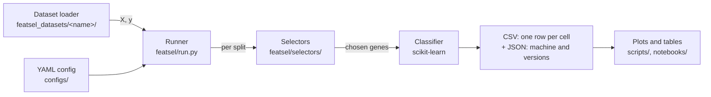

# 5. The software

[Back to contents](README.md) · Previous: [4. The methods](04_the_methods.md) · Next: [6. Making it fast](06_making_it_fast.md)

This chapter covers task 1 (the pipeline) and the parts of task 3 that are
about running safely. Speed itself is chapter 6.

## 5.1 Two deliverables in one package

`featsel` serves two kinds of user.

1. **A practitioner with an existing scikit-learn pipeline.** They swap
   their selection step for one of ours, and change nothing else. This is
   why every selector behaves exactly like a scikit-learn selector, and why
   the ones that copy a scikit-learn method are tested to pick the same
   genes.
2. **A researcher comparing methods.** They write one YAML file and run
   `python -m featsel.run --config <file>`. The runner does the whole
   comparison of chapter 3 and writes one table.



## 5.2 Selectors are scikit-learn estimators

Every selector subclasses `FeatureSelector`, which inherits scikit-learn's
`BaseEstimator` and `SelectorMixin`. A selector:

- lists its parameters in `__init__` and only stores them;
- does its work in `_fit`, and sets `support_`, a boolean mask over the
  features;
- inherits `transform`, `get_support`, `get_params`, `set_params` and
  `clone` from scikit-learn.

So it works in a `Pipeline`, with `cross_val_score` and with
`GridSearchCV`, and a misspelled parameter raises an error instead of being
silently ignored.

```python
from sklearn.linear_model import LogisticRegression
from sklearn.model_selection import cross_val_score
from sklearn.pipeline import make_pipeline
from sklearn.preprocessing import StandardScaler

from featsel.selectors import MannWhitneySelector

pipe = make_pipeline(StandardScaler(),
                     MannWhitneySelector(n_features=50),
                     LogisticRegression(max_iter=1000))
scores = cross_val_score(pipe, X, y, cv=5, scoring='roc_auc')
```

Selection is refit inside every fold here, as chapter 3 requires.

**Registration.** A selector registers itself under its class name when it
is defined. A YAML config names selectors as text, and
`FeatureSelector.create(name, **params)` finds the class. No list of
selectors has to be kept by hand.

**Rank once.** Some methods produce a full ranking whose top `k` equals a
separate fit at that `k`: Mann-Whitney, Lasso, tree importance and RFE.
They set a class flag, `rank_once`, and the runner fits them once per split
and cuts the ranking at every `k`. Tests check that each cut equals a
separate fit.

**Seeds.** Every selector seeds Python's, NumPy's and PyTorch's random
generators from its `random_state` (default 42) at the start of `fit`. A
repeated fit therefore picks the same genes.

**Input.** Every selector accepts a NumPy array, a pandas DataFrame or a
PyTorch tensor, on the CPU or on a GPU (chapter 6).

## 5.3 Datasets: one loader per dataset

Each dataset has its own folder in `featsel_datasets/`, outside the
package (decided 2026-10-16).

- A class that downloads the published files once, caches them, and
  exposes everything in them unchanged: `GSE96058`, `BreastMNIST`.
- A small `featsel_view.py` with this project's choices (HiSeq only, one
  sample per patient, the target), ending in `load_xy()`, which returns `X`
  and `y`.

A config names the view module. A new dataset needs only a new folder with
these two files; nothing in the package changes. This design was chosen
over a generic loader driven by a YAML description, because real datasets
arrive in shapes no YAML schema foresees (several tables, archives,
images).

## 5.4 The runner

One YAML file describes an experiment:

```yaml
dataset: "featsel_datasets.scanb_gse96058.featsel_view"
target: "pam50 subtype"
output: "../results/local/frontier_scanb70_gpu.csv"
seed: 42
n_splits: 5
train_sizes: [0.7]
metrics: [roc_auc, macro_f1, balanced_accuracy]
selectors:
  - name: MannWhitneySelector
    k: [10, 50, 250, 1000]
    params: {device: "cuda"}
models:
  - name: logistic_regression
    params: {max_iter: 1000}
```

The runner turns a multiclass target into one task per class, draws the
splits, and runs every task × split × selector × `k` × classifier. Each
finished cell becomes a row of the CSV: the scores, the chosen genes, the
selection time, peak memory, device, and whether repeated fits agreed. A
JSON file beside the CSV records the machine, the library versions and the
git commit, at the start and at the end of the run.

Analysis is separate from running: `featsel.analysis`, `scripts/` and the
notebooks read the CSV. A new plot never needs a new run.

## 5.5 Running for hours without supervision

Long runs on a 16 GB laptop crashed at first: when memory ran out, the
operating system killed the run with no message. Four mechanisms fix this.

| Mechanism | What it does |
|---|---|
| **Memory cap per worker** | Each worker process gets a limit on its data memory, by default the free RAM shared among the workers. A selector past it gets a Python `MemoryError`; the runner skips that cell, lists it at the end, and goes on. |
| **Restart with fewer workers** | Compiled code can abort a worker instead of raising. The runner then resumes on its own with half the workers, each with twice the cap. |
| **Resume** | Rows are written as they finish. `--resume` skips the cells already in the CSV, so a stopped run continues where it stopped. |
| **One GPU at a time** | A lock file makes GPU fits take turns. A GPU out-of-memory error becomes a `MemoryError`, handled as above. |

**Shared memory.** Each prepared split is written once to `/dev/shm`, and
every worker maps it read-only. So the data exists once in memory, not once
per worker.

## 5.6 Tests

Each selector has its own tests next to it, in
`featsel/selectors/<name>/tests/`. Shared checks are in
`tests/sklearn_reference.py`. For every selector that copies a
scikit-learn method:

- it selects the same features as that method;
- its `fit` is at most 5% slower;
- its GPU path selects the same features as its CPU path.

The tests use binary tasks with positive fractions of 50%, 20%, 10% and 5%,
because our real tasks are imbalanced. The runner has its own tests, for
example that a parallel run gives the same results as a sequential one.

## 5.7 Where to find things

| Part | Location |
|---|---|
| Selectors | [`featsel/selectors/`](../../featsel/selectors/) |
| Base class and registration | [`featsel/selectors/base.py`](../../featsel/selectors/base.py) |
| Runner | [`featsel/run.py`](../../featsel/run.py) |
| GPU policy and lock | [`featsel/selectors/gpu.py`](../../featsel/selectors/gpu.py) |
| Dataset loaders | [`featsel_datasets/`](../../featsel_datasets/) |
| Configs and their documentation | [`configs/`](../../configs/), [`configs/README.md`](../../configs/README.md) |
| Usage demo | [`notebooks/03_usage_demo.ipynb`](../../notebooks/03_usage_demo.ipynb) |
| Design discussion | [`docs/architecture_options.md`](../architecture_options.md) |
