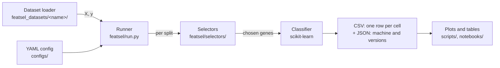

# 5. The software

[Back to contents](README.md) · Previous: [4. The methods](04_the_methods.md) · Next: [6. Making it fast](06_making_it_fast.md)

This chapter covers task 1 (the pipeline) and the parts of task 3 that are
about running safely. Speed itself is chapter 6.

## 5.1 Two deliverables in one package

`featsel` serves two kinds of user.

1. **A practitioner with an existing scikit-learn pipeline.** They swap
   their selection step for one of ours, and change nothing else. This is
   why every selector behaves exactly like a scikit-learn selector, and why
   the ones that copy a scikit-learn method are tested to pick the same
   genes.
2. **A researcher comparing methods.** They write one YAML file and run
   `python -m featsel.run --config <file>`. The runner does the whole
   comparison of chapter 3 and writes one table.



### How we chose this design

On 2026-09-26 we compared four designs for running experiments. Each was
sketched on the same uses: data in memory, data in files, and the command
line.

| Design | How it looks | Gain | Cost |
|---|---|---|---|
| 1. Functions only | `evaluate(X, y, selectors=[...], k=[...], splits=100, ...)` | Smallest surface; trivial to test. | Settings travel as long keyword lists; the YAML and Python forms would differ. |
| **2. One runner, protocol as a config** (chosen) | `run(X, y, config)`, where `config` is a dict or the same thing read from YAML | One protocol applies unchanged to many datasets (task 4). Python and the command line share one format. | A typo in the config surfaces only when the run reaches it. |
| 3. Pure scikit-learn | `cross_validate(pipe, X, y, cv=StratifiedShuffleSplit(...))` | Almost no own code; parallel work for free with `n_jobs`. | Timing selection apart from training, stability per split and resuming a crashed run all need workarounds. Task 3 shrinks to "we set `n_jobs`". |
| 4. Dataset objects | `run(ArrayDataset(X, y, name=...), config)` | Names and metadata travel with the data. | Data in memory needs a wrapper; more classes. |

| Question | 1 | 2 | 3 | 4 |
|---|---|---|---|---|
| Bare `X, y` in memory | yes | yes | yes | needs a wrapper |
| Same protocol on many datasets | pass arguments again | reuse the config | reuse the pipeline and splitter | reuse the config |
| Optional known true features | extra argument | extra argument | manual | field on the dataset |
| Timing selection separately | yes | yes | workaround | yes |
| Task 3 has real content | yes | yes | thin | yes |
| Code to write | least | little | least | most |

Design 2 won. The core is `run(X, y, config, truth=None)`: data always
arrives as `X, y`. `truth` is the optional list of truly informative
features, known only for simulated data; when given, the runner also
records recall and precision against it. `run_config(config)` loads the
dataset named in the config and calls `run`; the command line calls
`run_config`. Paths in a config file are relative to that file, so the
package never assumes this repository's layout.

## 5.2 Selectors are scikit-learn estimators

Every selector subclasses `FeatureSelector`, which inherits scikit-learn's
`BaseEstimator` and `SelectorMixin`. A selector:

- lists its parameters in `__init__` and only stores them;
- does its work in `_fit`, and sets `support_`, a boolean mask over the
  features;
- inherits `transform`, `get_support`, `get_params`, `set_params` and
  `clone` from scikit-learn.

So it works in a `Pipeline`, with `cross_val_score` and with
`GridSearchCV`, and a misspelled parameter raises an error instead of being
silently ignored.

```python
from sklearn.linear_model import LogisticRegression
from sklearn.model_selection import cross_val_score
from sklearn.pipeline import make_pipeline
from sklearn.preprocessing import StandardScaler

from featsel.selectors import MannWhitneySelector

pipe = make_pipeline(StandardScaler(),
                     MannWhitneySelector(n_features=50),
                     LogisticRegression(max_iter=1000))
scores = cross_val_score(pipe, X, y, cv=5, scoring='roc_auc')
```

Selection is refit inside every fold here, as chapter 3 requires.

As in scikit-learn, `transform` returns a NumPy array. Pandas output is
opt-in with `set_output(transform='pandas')`.

**Why.** An earlier version had a wrapper class that picked a selector by
name and forwarded parameters through a hand-written list. A parameter
missing from the list was silently dropped: a typo in a config ran with
the default, and nobody noticed. Adding a selector meant editing three
places. The wrapper, its list, and its modes for combining methods (union,
intersection, voting) were removed on 2026-09-29.

**Registration.** A selector registers itself under its class name when it
is defined, through Python's `__init_subclass__`. Names are stored in
lower case, so lookup ignores case. Two classes claiming the same name
raise an error. A class may also declare aliases, for use after a rename.
A YAML config names selectors as text, and
`FeatureSelector.create(name, **params)` finds the class. No list of
selectors has to be kept by hand. Results always record the class name,
whatever alias a config used, so runs stay comparable. In Python, users
import the class: a misspelled class name then fails at import, not at run
time.

**Rank once.** Some methods produce a full ranking whose top `k` equals a
separate fit at that `k`. They are Mann-Whitney, Lasso, tree importance
and RFE (section 4.2). They set a class flag, `rank_once`, and give their order
through `ranking()`. The runner fits them once per split and cuts the
ranking at every `k`. Tests check that each cut equals a separate fit.

**Scores keep their own names.** A selector keeps its per-feature
measurement under the name of what it measures: `scores_`,
`log_pvalues_`, `coef_` or `variances_`. Only tree importance has
`feature_importances_`, the forest's own attribute. Before 2026-11-09
almost every selector set `feature_importances_`, and it meant a score in
some, a position in RFE, and nothing in the random selector.

**Seeds.** Every selector that uses randomness subclasses
`FeatureSelectorRandom`. It takes `random_state`, 42 by default. At the
start of `fit` it seeds Python's, NumPy's and PyTorch's random generators
from it. A repeated fit therefore picks the same genes. Selectors without
randomness take no seed. A generator kept inside the
object was rejected: scikit-learn's `clone` does not copy it, and its draws
would depend on the order of fits.

**Input.** Every selector accepts a NumPy array, a pandas DataFrame or a
PyTorch tensor, on the CPU or on a GPU (chapter 6). Input is checked in
`fit`, as scikit-learn requires. `check_input=False` skips the check, for
a clean NumPy array.

**How a selector computes is its own business.** It may wrap scikit-learn,
or be its own CPU or GPU code. Replacing one with the other keeps the class
name and the parameters, so configs and results do not change. Each
selector lives in its own folder, `featsel/selectors/<name>/`, with its
tests and notebooks beside it. A family (filter, embedded, wrapper) gets no
folder, since it shares no code. The random selector's folder is
`random_selection/`: a folder named `random` would hide Python's own
`random` module.

**Adding a selector.** A new method is one class. It lists its
parameters, sets `support_` in `_fit`, and registers itself by being
defined. This one ranks features by the gap between the two class means:

```python
import numpy as np
from featsel.selectors.base import FeatureSelector

class MeanGapSelector(FeatureSelector, aliases='mean_gap'):
    rank_once = True          # its top k equals a fit at k

    def __init__(self, n_features=10, check_input=True):
        self.n_features = n_features
        self.check_input = check_input

    def _fit(self, X, y):
        X, y = self._validate(X, y, check_input=self.check_input)
        self.scores_ = np.abs(X[y == 1].mean(axis=0) - X[y == 0].mean(axis=0))
        self.support_ = self._mask(self.ranking()[:self.n_features])
        return self

    def ranking(self):
        return self._best_first(self.scores_)
```

It then works in a scikit-learn pipeline, with `clone`, and in a YAML
config as `MeanGapSelector` or `mean_gap`.

**A method that picks its own count** is used the same way. After `fit`,
`get_support()` is the mask, and its sum is the count it chose:

```python
from featsel.selectors import HigherCriticismSelector

pipe = make_pipeline(StandardScaler(), HigherCriticismSelector(),
                     LogisticRegression(max_iter=1000))
pipe.fit(X_train, y_train)
pipe[1].get_support().sum()     # the count Higher Criticism chose
```

**Embeddings already in memory.** Transfer learning needs no file at all.
A network's embeddings are an array, and the selector picks columns of it:

```python
emb = backbone(images).detach().numpy()          # samples × embedding size
sel = MannWhitneySelector(n_features=64).fit(emb, labels)
columns = sel.get_support(indices=True)          # the 64 chosen dimensions
```

A small model can then be trained on those 64 dimensions only.

**Rejected selector designs.**

- Keeping the wrapper. The silent typo would stay.
- A hand-written name-to-class table. Every selector would need a second
  edit.
- A short declared name per class. It protects only against renames, and
  aliases cover those.
- One file or folder per family. It becomes unmanageable once a method has
  CPU and GPU versions.
- Reimplementing every scikit-learn method. Most selectors cost seconds
  while model fitting costs minutes. So this gains nothing unless a timing
  shows it.

## 5.3 Datasets: one loader per dataset

Each dataset has its own folder in `featsel_datasets/`, outside the
package (decided 2026-10-16).

- A class that downloads the published files once, caches them, and
  exposes everything in them unchanged: `GSE96058`, `BreastMNIST`.
- A small `featsel_view.py` with this project's choices (HiSeq only, one
  sample per patient, the target), ending in `load_xy()`, which returns `X`
  and `y`.

A config names the view module. A new dataset needs only a new folder with
these two files; nothing in the package changes. We rejected a generic
loader driven by a YAML description. Real datasets arrive in shapes no
YAML schema foresees: several tables, archives, images.

**Why.** The course's SCAN-B files came with no recorded source or
filters. Their origin, their patients and how their genes were chosen
could not be checked, and nobody else could reuse our preparation. The
generic class makes no choice for the caller, so other researchers can use
it alone. For BreastMNIST it also computes the ResNet-50 embeddings once
and caches them; it imports PyTorch only in that step, so cached runs never
need it.

- `X` is a pandas DataFrame and `y` a Series. Gene names reach the
  selectors, and patients cannot be misaligned with their labels. This
  matters: GSE96058's gene file and patient file list samples in different
  orders.
- `load_xy` is a function, not a class, because it holds no state.
- The view also defines `NAME` and `TARGET`. The view owns the data
  choices; the experiment config owns the protocol and the values of `k`.

**Rejected loader designs.** A loader class inside the `featsel` package
(the package stays generic; dataset code lives beside its data). Returning
NumPy arrays and a list of names (alignment by position is what the index
protects against). A folder named `datasets/` (the Hugging Face `datasets`
library would hide it on import). A dataset YAML naming the loader, used
briefly on 2026-10-17 (it repeated the choices `load_xy` already makes, so
the two could drift apart).

**Limits.** The runner imports a module named in a config, which is one
fixed convention (`NAME`, `TARGET`, `load_xy`), with no registry. It tells
a module from a CSV config by the `.yaml` ending. `featsel_datasets` is not
installed with the package, so code outside the repository root must put
the root on Python's path. The first SCAN-B load downloads 592 MB and takes
about 85 s.

## 5.4 The runner

One YAML file describes an experiment:

```yaml
dataset: "featsel_datasets.scanb_gse96058.featsel_view"
target: "pam50 subtype"
output: "../results/local/frontier_scanb70_gpu.csv"
seed: 42
n_splits: 5
train_sizes: [0.7]
metrics: [roc_auc, macro_f1, balanced_accuracy]
selectors:
  - name: MannWhitneySelector
    k: [10, 50, 250, 1000]
    params: {device: "cuda"}
models:
  - name: logistic_regression
    params: {max_iter: 1000}
```

The runner turns a multiclass target into one task per class. It draws
the splits. Then it runs every combination of task, split, selector, `k`
and classifier. Each finished cell becomes a row of the CSV: the scores,
the chosen genes, the selection time, peak memory, device, and whether
repeated fits agreed. A JSON file beside the CSV records the machine, the
library versions and the git commit. It is written at the start and again
at the end of the run.

Analysis is separate from running: `featsel.analysis`, `scripts/` and the
notebooks read the CSV. A new plot never needs a new run.

**Nested tuning.** A model entry with a `grid` is tuned inside each split
(section 3.8). The runner wraps the classifier in scikit-learn's
`GridSearchCV`, with stratified Monte Carlo splits of the training part as
its inner splits. The chosen values are stored with each row.

**Parallel work.** One job is one selector on one task of one split. Jobs
run on worker processes through joblib. Parallel work lives in the runner
only.

## 5.5 Running for hours without supervision

Long runs on a 16 GB laptop crashed at first: when memory ran out, the
operating system killed the run with no message. Four mechanisms fix this.

| Mechanism | What it does |
|---|---|
| **Memory cap per worker** | Each worker process gets a limit on its data memory, by default the free RAM shared among the workers. A selector past it gets a Python `MemoryError`; the runner skips that cell, lists it at the end, and goes on. |
| **Restart with fewer workers** | Compiled code can abort a worker instead of raising. The runner then resumes on its own with half the workers, each with twice the cap. |
| **Resume** | Rows are written as they finish. `--resume` skips the cells already in the CSV, so a stopped run continues where it stopped. |
| **One GPU at a time** | A lock file makes GPU fits take turns. A GPU out-of-memory error becomes a `MemoryError`, handled as above. |

**Shared memory.** Each prepared split is written once to `/dev/shm`, and
every worker maps it read-only. So the data exists once in memory, not once
per worker.

**What happened in practice.** Full SCAN-B needs several GB per worker.
On the 16 GB laptop, six workers ran out of memory and the operating system
stopped the run; it resumed with fewer workers. With a cap of 3 GB per
worker, the U-test selectors were skipped, and a second resume at a higher
cap filled them in. Then we held the data as 32-bit floats (section 3.12).
This cut the U-test selectors' peak memory. Now 4 workers fit under a 3 GB
cap, where 2 fit before.

**The cap counts data memory, not address space.** PyTorch's GPU libraries
reserve address space they never use. Under an address-space cap below
about 5 GB they could not even load. After a GPU call, a worker releases
its cached GPU memory and keeps about 64 MB.

## 5.6 Tests

Each selector has its own tests next to it, in
`featsel/selectors/<name>/tests/`. Shared checks are in
`tests/sklearn_reference.py`. For every selector that copies a
scikit-learn method:

- it selects the same features as that method;
- its `fit` is at most 5% slower;
- its GPU path selects the same features as its CPU path.

These shared checks use one balanced binary dataset. Our real tasks are
imbalanced. So the GPU paths of Lasso and mutual information are also
tested at positive fractions of 50%, 20%, 10% and 5%. The runner has its
own tests, for example that a parallel run gives the same results as a
sequential one.

## 5.7 Where to find things

| Part | Location |
|---|---|
| Selectors | [`featsel/selectors/`](../../featsel/selectors/) |
| Base class and registration | [`featsel/selectors/base.py`](../../featsel/selectors/base.py) |
| Runner | [`featsel/run.py`](../../featsel/run.py) |
| GPU policy and lock | [`featsel/selectors/gpu.py`](../../featsel/selectors/gpu.py) |
| Dataset loaders | [`featsel_datasets/`](../../featsel_datasets/) |
| Configs and their documentation | [`configs/`](../../configs/), [`configs/README.md`](../../configs/README.md) |
| Usage demo | [`notebooks/03_usage_demo.ipynb`](../../notebooks/03_usage_demo.ipynb) |
| Design decisions | [Appendix A](appendix_a_decisions.md) |

## 5.8 Known limits

- A config is not checked before the run starts. A typo fails only when
  the first cell that uses it runs.
- A class name is a public identifier: it appears in configs and results.
  Renaming a class needs an alias for old configs.
- Results files written before the switch to class names use old method
  names, such as `random` and `anova_f`. They do not match new runs by
  name, and `--resume` on them recomputes everything.
- A class registers only when its module is imported. `featsel` imports
  every selector on import, so this holds for normal use.
- Selector tests live inside the package. Packaging excludes them, and
  pytest searches both `tests/` and `featsel/`.
