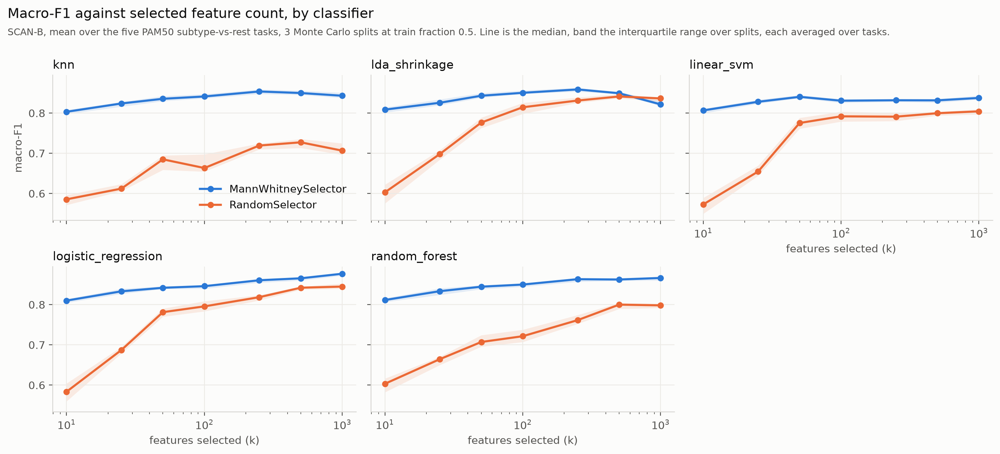
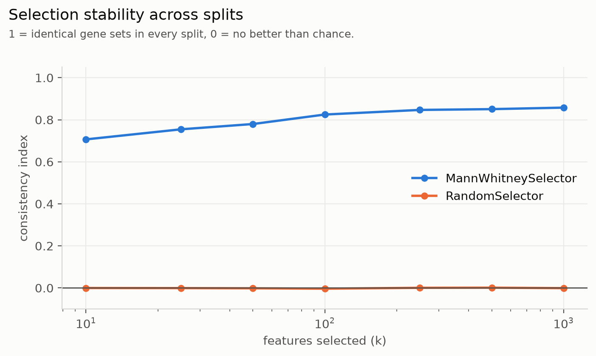
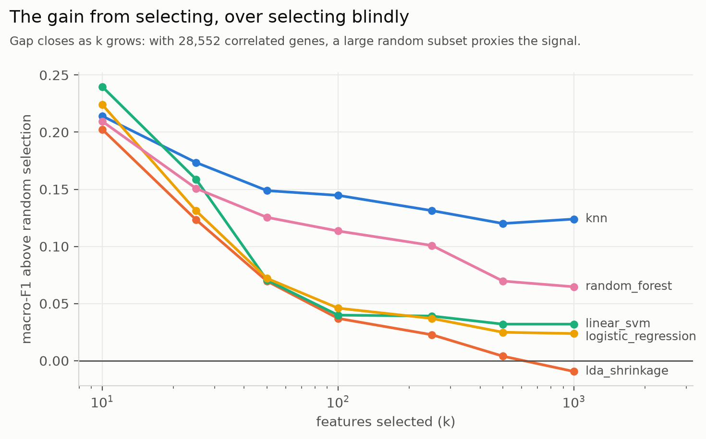
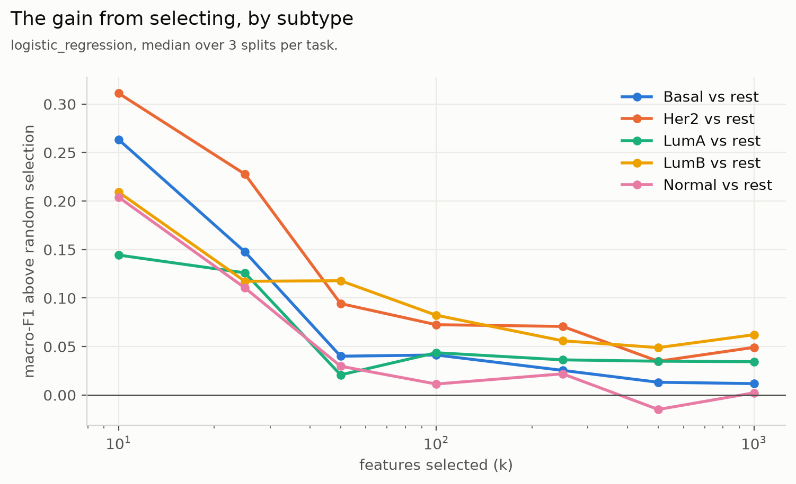

# 7. Results: which method selects best (task 2)

[Back to contents](README.md) · Previous: [6. Making it fast](06_making_it_fast.md) · Next: [8. Results: cost against quality](08_results_frontier.md)

## 7.1 The experiment

| Setting | SCAN-B | BreastMNIST |
|---|---|---|
| Tasks | 5 (each PAM50 subtype vs rest) | 1 (malignant vs rest) |
| Methods | Random, Mann-Whitney, Lasso (C = 1), tree importance (50 trees), RFE (C = 0.01, half the genes per round), HC2004, HC2008 | the same |
| `k` | 5, 10, 20, 50, 100, 250, 500, 1000 | 5, 10, 20, 50, 100, 250 |
| Splits | 16 random splits, half for training | 20 random splits, half for training |
| Classifier | logistic regression, C tuned inside each split | the same |
| Main score | macro-F1 | macro-F1 |
| Executions | 3,520 | 680 |

Configs: [`configs/comparison_scanb.yaml`](../../configs/comparison_scanb.yaml),
[`configs/comparison_breastmnist.yaml`](../../configs/comparison_breastmnist.yaml).
Results: [`results/comparison_scanb.csv`](../../results/comparison_scanb.csv),
[`results/comparison_breastmnist.csv`](../../results/comparison_breastmnist.csv).
Full tables, per task, with times and stability:
[`docs/comparison_scanb.md`](../comparison_scanb.md),
[`docs/comparison_breastmnist.md`](../comparison_breastmnist.md).

Each cell below is macro-F1: averaged over the tasks within a split, then
the median over the splits, with the first and third quartiles in
brackets.

## 7.2 SCAN-B

| Method | k = 5 | 10 | 50 | 250 | 1000 | own count |
|---|---|---|---|---|---|---|
| Random | 0.518 [0.500, 0.534] | 0.575 [0.554, 0.599] | 0.730 [0.717, 0.742] | 0.819 [0.813, 0.828] | 0.855 [0.851, 0.861] | |
| Mann-Whitney | 0.780 [0.771, 0.790] | 0.806 [0.802, 0.814] | 0.847 [0.842, 0.853] | 0.868 [0.864, 0.870] | 0.879 [0.875, 0.883] | |
| Lasso | 0.778 [0.769, 0.788] | 0.820 [0.809, 0.833] | 0.845 [0.840, 0.852] | 0.846 [0.840, 0.851] | 0.848 [0.842, 0.854] | |
| Tree importance | **0.805** [0.794, 0.812] | **0.826** [0.824, 0.830] | **0.858** [0.854, 0.863] | **0.876** [0.872, 0.880] | **0.879** [0.874, 0.882] | |
| RFE | 0.604 [0.580, 0.636] | 0.662 [0.645, 0.682] | 0.744 [0.738, 0.749] | 0.818 [0.812, 0.822] | 0.846 [0.843, 0.850] | |
| HC2004 | | | | | | 0.638 [0.633, 0.645] (1 gene) |
| HC2008 | | | | | | 0.883 [0.880, 0.886] (2,855 genes) |

**Gain over random selection**, same split and `k`, median over splits:

| Method | k = 5 | 10 | 20 | 50 | 100 | 250 | 500 | 1000 |
|---|---|---|---|---|---|---|---|---|
| Mann-Whitney | +0.260 | +0.233 | +0.175 | +0.114 | +0.078 | +0.044 | +0.028 | +0.024 |
| Lasso | +0.263 | +0.239 | +0.189 | +0.114 | +0.074 | +0.024 | +0.001 | −0.007 |
| Tree importance | +0.290 | +0.252 | +0.196 | +0.128 | +0.093 | +0.052 | +0.032 | +0.025 |
| RFE | +0.085 | +0.082 | +0.056 | +0.014 | +0.010 | −0.003 | −0.012 | −0.008 |

*Figure 7.1. Mann-Whitney against random selection, five classifiers,
SCAN-B, 3 splits (the classifier study, section 7.7). The gap is largest
at small `k`.*

### What it shows

1. **Selection pays most when few features are allowed.** At k = 5 the top
   methods beat random selection by 0.26 to 0.29 macro-F1. By k = 250 the
   gain is a few hundredths. 250 random genes of 28,552 already carry most
   of the signal, because the signal is spread over thousands of correlated
   genes (chapter 2).
2. **Tree importance is best up to k = 500**, by 0.004 to 0.027 over
   Mann-Whitney (median paired difference). At k = 1000 the two are equal.
3. **Mann-Whitney, the simplest method, is close behind**, and it is by far
   the most stable (section 7.4).
4. **Lasso stops improving at k = 20.** At C = 1 it gives a non-zero weight
   to only about 330 genes, so at larger `k` it cannot add more. At
   k = 1000 it falls below random selection of 1,000 genes.
5. **RFE is the weakest selector.** It beats random only up to k = 20, and
   falls below it from k = 500. A check of its choices showed many
   near-constant genes: genes at one value in 97% to 100% of patients.
   With a strong penalty (C = 0.01) and half the genes removed per round,
   the SVM's weights are a poor guide on this data.

## 7.3 Are the differences real? Paired tests

All methods ran on the same 16 splits, so we compare them split by split
with the Wilcoxon signed-rank test (two-sided), on each split's mean over
tasks. With 16 splits the smallest possible p-value is 3 × 10⁻⁵. We ran 81
tests on SCAN-B, so we require p < 0.05 / 81 = 0.0006 (Bonferroni) before
calling a difference real.

| Comparison on SCAN-B | Result |
|---|---|
| Mann-Whitney, Lasso, tree importance vs random, k ≤ 250 | Better on all 16 splits at every `k`, p = 3 × 10⁻⁵. |
| Tree importance vs Mann-Whitney, k = 5 to 500 | Tree importance better on 14 to 16 of 16 splits, p ≤ 0.0003. Real. |
| Tree importance vs Mann-Whitney, k = 1000 | No difference (8 of 16, p = 0.86). |
| Lasso vs Mann-Whitney, k = 20 | Lasso better on 15 of 16, p = 6 × 10⁻⁵. Real. From k = 100 Lasso is worse on all 16. |
| RFE vs random, k = 5 to 20 | RFE better, p ≤ 0.0002. |
| RFE vs random, k = 50 to 250 | No difference. |
| RFE vs random, k = 500 and 1000 | RFE worse on 12 to 14 of 16 splits (p = 0.005 and 0.001): suggestive, not past the corrected threshold. |

On BreastMNIST (66 tests, threshold 0.0008), every method beats random at
every `k` (p ≤ 2 × 10⁻⁵). Among the methods, only a few differences pass
the threshold: Lasso beats Mann-Whitney at k = 50 and 100, and at k = 20
Lasso beats RFE while tree importance beats both Mann-Whitney and RFE. The
rest of the top group cannot be told apart.

Script: [`scripts/paired_tests.py`](../../scripts/paired_tests.py).
Tables: [`figures/paired_tests_comparison_scanb.csv`](figures/paired_tests_comparison_scanb.csv),
[`figures/paired_tests_comparison_breastmnist.csv`](figures/paired_tests_comparison_breastmnist.csv).

**What the tests do not cover.** The splits reuse one cohort, so the tests
say the difference is stable under re-splitting, not that it will hold for
new patients (chapter 3).

## 7.4 Stability: same score, different genes

Kuncheva's index on SCAN-B, mean over tasks (1 = the same genes on every
split, 0 = chance):

| Method | k = 5 | 50 | 250 | 1000 |
|---|---|---|---|---|
| Random | 0.00 | 0.00 | 0.00 | 0.00 |
| Mann-Whitney | **0.67** | **0.77** | **0.84** | **0.86** |
| Lasso | 0.23 | 0.20 | 0.21 | 0.22 |
| Tree importance | 0.08 | 0.16 | 0.17 | 0.10 |
| RFE | 0.25 | 0.28 | 0.29 | 0.30 |

Tree importance scores best and is the least stable. Its top genes change
from split to split, while its score barely moves. Many gene sets predict
equally well. So a selected gene list should not be read as *the* genes of
a subtype, unless the method is also stable. Mann-Whitney is both good and
stable. The forest had only 50 trees here, which makes its importances
noisier; on BreastMNIST, 200 trees gave about the same scores with more
stable choices.

*Figure 7.2. Mann-Whitney is stable across splits; random selection is at
0 by construction (classifier study, 3 splits).*

## 7.5 Higher Criticism did not choose its own count

| Variant | Genes kept on SCAN-B | Macro-F1 |
|---|---|---|
| HC2004 | 1 (2 on Normal) | 0.638 |
| HC2008 | 2,855 on every task and split | 0.883 |

**HC2008 always stopped at the edge of its search**, alpha0 · N = 0.1 ×
28,552 = 2,855 genes. At that size it equals Mann-Whitney at k = 2,855
exactly, since both rank genes by the same U test. Its high score comes from
using ten times more genes than any fixed `k`, not from a better choice;
random selection of 2,855 genes scores only 0.017 lower. On BreastMNIST it
again stopped at its edge, 204 of 2,048 features.

**HC2004 kept one gene.** Its denominator, √(p(1 − p)), is tiny for the
smallest p-values, so the strongest gene wins alone.

**Why.** HC is designed for rare, weak, independent signal. Our data has
the opposite: thousands of genes carry signal, and they are correlated
(chapter 2). Then the HC score keeps rising up to the search limit, and the
limit, not the data, sets the count. This is itself a finding: on these
two datasets, HC thresholding reduces to a top-k filter at k = alpha0 · N.

## 7.6 Does selection find the PAM50 genes?

The PAM50 label is computed from 50 known genes. So we can check where
those genes lie in each method's ranking. A strong method should rank them
high. Ten splits, half the patients for training, all five tasks.

**Share of the 50 PAM50 genes found in the top `k`**, mean over tasks and
splits:

| Method | k = 50 | 250 | 1000 | 5000 | 10000 |
|---|---|---|---|---|---|
| Random (expected) | 0.00 | 0.01 | 0.04 | 0.18 | 0.35 |
| Mann-Whitney | **0.12** | **0.25** | **0.42** | **0.73** | **0.85** |
| Tree importance | 0.10 | **0.25** | **0.42** | 0.56 | 0.64 |
| RFE | 0.03 | 0.07 | 0.14 | 0.33 | 0.46 |
| Lasso | 0.07 | 0.12 | 0.16 | 0.16 | 0.16 |

- Every method finds PAM50 genes much faster than chance. Mann-Whitney is
  best: half of the 50 lie in its top 1,041 genes, where random selection
  would need about 14,300.
- **But recall at k = 50 is low for every method**: at most 26% (Mann-Whitney
  on LumA). Yet the same methods predict the label well at k = 50.

**Good prediction does not need the genes that define the label.** Each
PAM50 gene moves with hundreds of others, which predict just as well. Each
task also needs only part of the 50. Low recall here does not mean poor
selection. It does mean that "the genes a method selected" is one of many
equally good answers.

Source: [`docs/pam50_recovery.md`](../pam50_recovery.md),
[`scripts/pam50_recovery.py`](../../scripts/pam50_recovery.py).

## 7.7 Does the classifier matter?

A side study ran Mann-Whitney and random selection with five classifiers
(logistic regression, linear SVM, random forest, k-nearest neighbours,
shrinkage LDA), on 3 splits.

*Figure 7.3. The gain from selecting, by classifier. It shrinks with `k` for
every classifier; for k-NN it stays large, since k-NN suffers most from
irrelevant features.*

- Selection beats random for every classifier, by 0.21 to 0.23 at k = 10.
- The gain shrinks as `k` grows. For shrinkage LDA it turns negative at
  k = 1000.
- k-NN gains the most at large `k`: distances computed over many irrelevant
  genes are dominated by noise.
- Logistic regression is the best classifier overall, 0.877 at k = 1000.

*Figure 7.4. The gain differs by subtype: at k = 10, from 0.14 (LumA) to
0.31 (Her2).*

Notebook: [`notebooks/02_classifier_behaviour.ipynb`](../../notebooks/02_classifier_behaviour.ipynb).

## 7.8 BreastMNIST

| Method | k = 5 | 10 | 50 | 100 | 250 |
|---|---|---|---|---|---|
| Random | 0.429 [0.422, 0.456] | 0.468 [0.432, 0.495] | 0.576 [0.534, 0.653] | 0.675 [0.619, 0.699] | 0.747 [0.732, 0.765] |
| Mann-Whitney | 0.640 [0.613, 0.674] | 0.681 [0.666, 0.698] | 0.748 [0.734, 0.761] | 0.773 [0.756, 0.789] | 0.795 [0.782, 0.817] |
| Lasso | **0.668** [0.642, 0.689] | 0.700 [0.675, 0.716] | **0.778** [0.757, 0.789] | **0.798** [0.780, 0.816] | **0.815** [0.796, 0.827] |
| Tree importance | 0.641 [0.621, 0.686] | **0.706** [0.687, 0.730] | 0.761 [0.740, 0.779] | 0.773 [0.766, 0.788] | 0.793 [0.785, 0.807] |
| RFE | 0.607 [0.575, 0.656] | 0.653 [0.620, 0.694] | 0.752 [0.739, 0.773] | 0.790 [0.774, 0.802] | 0.803 [0.797, 0.812] |

HC2004: 0.521. HC2008: 0.790, at 204 features, equal to Mann-Whitney at
k = 204.

**The main pattern holds on image embeddings.** Every method beats random
at every `k`, most at small `k`. HC2008 again stops at its edge. The fine
ranking changes: Lasso leads here, and it does not stall, because a few
hundred non-zero weights are most of what `k` asks for. RFE is weakest at
small `k` but catches up from k = 100: with only 2,048 features, removing
half per round costs less.

The comparison stops at k = 250. Chapter 8 (section 8.7) goes further and
finds that, on this dataset, using all 2,048 features scores best in AUC.

## 7.9 Summary

- Every method except RFE beats random selection clearly at small `k`; the
  gain fades as `k` grows.
- Tree importance, Mann-Whitney and Lasso form the top group. Their order
  depends on the dataset and on `k`.
- Mann-Whitney is the most stable by far.
- Higher Criticism reduced to a top-k filter on both datasets, because
  their signal is neither rare nor independent.
- Good prediction does not require the defining genes.
