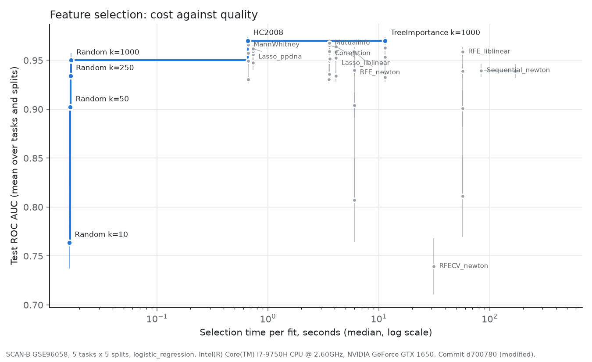
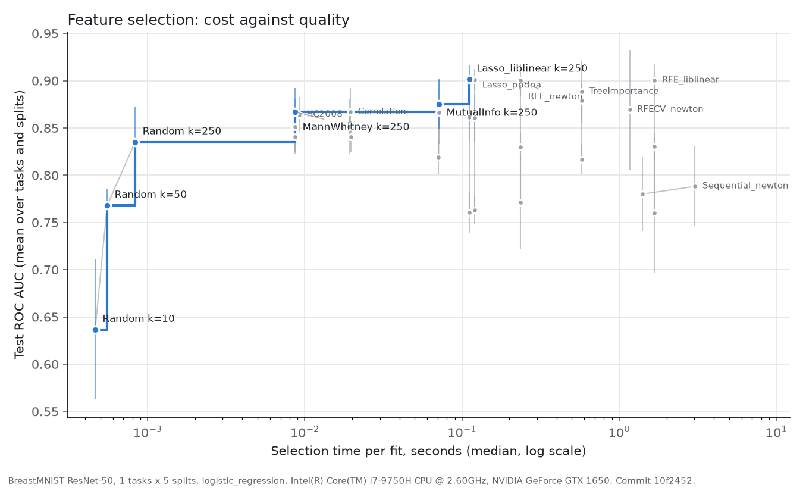
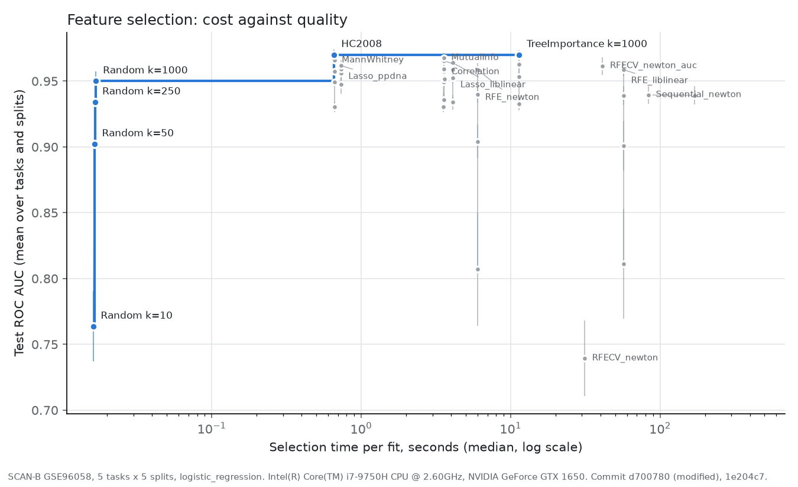
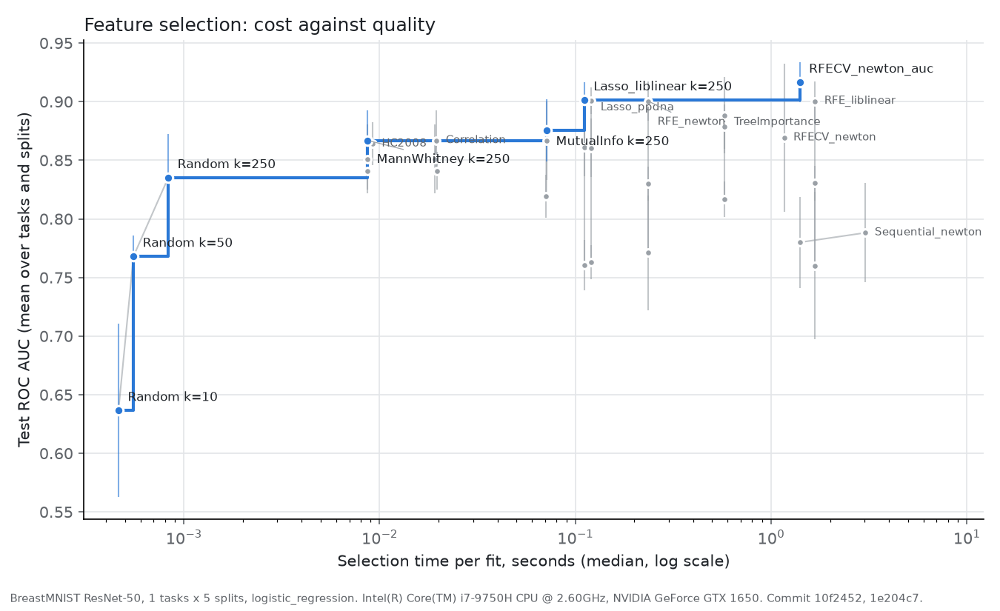

# 8. Results: cost against quality

[Back to contents](README.md) · Previous: [7. Results: quality](07_results_quality.md) · Next: [9. Conclusions](09_conclusions.md)

Chapter 7 asked which method selects best. A practitioner also asks what
each method costs. This chapter puts both on one plot.

## 8.1 What a cost-quality frontier is

Each point on the plot is one method at one `k`. Its x-position is the
selection time per fit (log scale), and its y-position is the test ROC
AUC. A point is **on the frontier** when no other point is both faster and
better. The frontier, drawn in blue, is the set of sensible choices: for
any time budget, the best method you can afford is on it. Points off the
frontier (gray) are dominated: something else is at least as good and
faster.

## 8.2 The experiment

| Setting | Value |
|---|---|
| Datasets | SCAN-B (five tasks) and BreastMNIST (one task) |
| Methods | Random; Mann-Whitney, HC2008, Spearman correlation, mutual information and Lasso (PPDNA) on the GPU; Lasso (liblinear), tree importance (200 trees, 4 threads), RFE (liblinear and Newton), RFECV (Newton) on the CPU; Sequential (Newton) on the GPU. RFECV scored by AUC was added later (section 8.6). |
| `k` | 10, 50, 250, 1000 on SCAN-B; 10, 50, 250 on BreastMNIST; 5 and 10 for Sequential |
| Splits | 5 random splits, 70% of the samples for training |
| Classifier | logistic regression, C = 1 (not tuned, to keep the run short) |
| Score | ROC AUC; macro-F1 and balanced accuracy also recorded |
| Timing | median of 10 fits by fresh selectors (1 fit for Sequential); one fit at a time on the GPU |

The GPU methods ran with one worker, so no two fits shared the GPU. The
CPU methods ran with two workers. Every GPU method's fits were recorded as
running on the GPU.

Configs: [`configs/frontier_scanb70_*.yaml`](../../configs/),
[`configs/frontier_breastmnist70_*.yaml`](../../configs/). Plot script:
[`scripts/plot_frontier.py`](../../scripts/plot_frontier.py). Notebook with
all SCAN-B plots: [`notebooks/04_frontier_scanb70.ipynb`](../../notebooks/04_frontier_scanb70.ipynb).
The SCAN-B run took about 8 hours; BreastMNIST took about 6 minutes.

## 8.3 SCAN-B, all five tasks

*Figure 8.1. Selection time against test AUC, mean over 5 tasks and 5
splits. Bars: one standard deviation over splits. Table:
[`figures/frontier_scanb70_roc_auc.csv`](figures/frontier_scanb70_roc_auc.csv).*

| Method | Best AUC (its `k`) | Time per fit | Device | On frontier |
|---|---|---|---|---|
| Random | 0.950 (1000) | 0.02 s | CPU | yes, every `k` |
| HC2008 | **0.970** (2,855 genes) | 0.66 s | GPU | **yes** |
| Mann-Whitney | 0.966 (1000) | 0.66 s | GPU | no |
| Lasso, PPDNA | 0.962 (1000) | 0.73 s | GPU | no |
| Mutual information | 0.968 (1000) | 3.6 s | GPU | no |
| Spearman correlation | 0.966 (1000) | 3.6 s | GPU | no |
| Lasso, liblinear | 0.964 (1000) | 4.1 s | CPU | no |
| RFE, Newton | 0.959 (1000) | 6.0 s | CPU | no |
| Tree importance | **0.970** (1000) | 11.4 s | CPU | yes, by 0.00002 |
| RFECV, Newton | 0.739 (own count) | 31 s | CPU | no |
| RFE, liblinear | 0.959 (1000) | 57 s | CPU | no |
| Sequential, Newton | 0.939 (5) | 84 s | GPU | no |

**What it shows.**

1. **The cheap end is enough.** HC2008 and Mann-Whitney reach AUC 0.97 in
   0.66 s. Nothing slower is clearly better. Tree importance ties HC2008
   (0.970) but takes 17 times longer; split by split, each wins on some of
   the five splits.
2. **The GPU moved four methods into the top-left corner.** Mann-Whitney,
   HC2008, Lasso (PPDNA), mutual information and correlation all run in
   under 4 s, at AUC 0.96 to 0.97. Before the GPU work, Mann-Whitney took
   about 10 s and mutual information more than a minute per fit (chapter 6).
3. **The wrappers lose on both axes.** RFE, RFECV and Sequential take 6 to
   170 s and score below the simple filters. Sequential's 5 or 10 genes
   cannot match 1,000 well-chosen ones.
4. **Random genes come close.** Random k = 1000 reaches 0.950: once `k` is
   large, almost any genes work, as chapter 7 found.
5. **The top methods differ by about one standard deviation over splits**
   (0.003 to 0.016). With 5 splits a paired test cannot reach p < 0.06, so
   the order among the top methods is not established here. Chapter 7, with
   16 splits, is the place for that.

**Caution on HC2008.** It kept 2,855 genes, the edge of its search, on
every task and split, as in chapter 7. It is on the frontier because it is
as fast as Mann-Whitney and uses more genes. It is not a sign that HC
chose a better count.

## 8.4 SCAN-B, each task

| Task | Frontier beyond random selection (AUC, time) | Note |
|---|---|---|
| [Basal vs rest](figures/frontier_scanb70_roc_auc_ovr_Basal.png) | Lasso PPDNA k = 250 (0.992, 0.55 s), Mann-Whitney k = 10 (0.993, 0.67 s), mutual information k = 1000 (0.993, 3.7 s), Lasso liblinear k = 250 (0.993, 3.9 s) | The easiest task: almost every method scores 0.99, and random 1,000 genes 0.988. |
| [Her2 vs rest](figures/frontier_scanb70_roc_auc_ovr_Her2.png) | HC2008 (0.985, 0.66 s) | RFECV collapses to 0.63. |
| [LumA vs rest](figures/frontier_scanb70_roc_auc_ovr_LumA.png) | HC2008 (0.960, 0.65 s), tree importance k = 1000 (0.961, 11.4 s) | The only balanced task; RFECV works here (0.960). |
| [LumB vs rest](figures/frontier_scanb70_roc_auc_ovr_LumB.png) | HC2008 (0.970, 0.65 s), Mann-Whitney k = 1000 (0.974, 0.67 s) | RFECV collapses to 0.64. |
| [Normal vs rest](figures/frontier_scanb70_roc_auc_ovr_Normal.png) | Mann-Whitney k = 1000 (0.929, 0.65 s), HC2008 (0.947, 0.66 s) | The hardest task; RFECV at chance (0.50). |

Click a task to see its plot; each has a table beside it in
[`figures/`](figures/). On every task the frontier above random selection
holds only sub-second GPU filters, except tree importance on LumA and two
slower near-ties on Basal.

### Why RFECV failed on three tasks

RFECV chooses its own count by inner 5-fold cross-validation. In the
frontier it kept only 1 or 2 genes on Her2, LumB and Normal, giving AUC
0.50 to 0.64. On LumA it kept 8,567 to 25,697 genes and scored 0.96. On
Basal it kept 2,857 genes on four splits and 2 on one.

Our hypothesis: RFECV's default inner score is accuracy. On an imbalanced
task with a strong penalty (C = 0.01), the SVM predicts "rest" for almost
everyone at any gene count, so the accuracy curve is flat. A flat curve
makes the smallest count win the tie. LumA is the only balanced task, and
there RFECV works. Section 8.6 tests this hypothesis.

## 8.5 BreastMNIST

*Figure 8.2. BreastMNIST, 5 splits. Table:
[`figures/frontier_breastmnist70_roc_auc.csv`](figures/frontier_breastmnist70_roc_auc.csv).*

| Method | Best AUC (its `k`) | Time per fit | On frontier |
|---|---|---|---|
| Random | 0.835 (250) | < 0.001 s | yes |
| Mann-Whitney | 0.867 (250) | 0.009 s | yes |
| HC2008 | 0.864 (204) | 0.009 s | no |
| Spearman correlation | 0.867 (250) | 0.02 s | no |
| Mutual information | 0.875 (250) | 0.07 s | yes |
| Lasso, liblinear | **0.902** (250) | 0.11 s | **yes** |
| Lasso, PPDNA | 0.901 (250) | 0.12 s | no |
| RFE, Newton | 0.900 (250) | 0.24 s | no |
| Tree importance | 0.888 (250) | 0.58 s | no |
| RFECV, Newton | 0.869 (own count) | 1.2 s | no |
| RFE, liblinear | 0.900 (250) | 1.7 s | no |
| Sequential, Newton | 0.788 (10) | 3.0 s | no |

- With 2,048 features and 546 training images, every method takes under
  3 s, so cost hardly matters here.
- **Lasso is the best choice at a fixed `k`**: 0.90 in 0.11 s. (RFECV
  scored by AUC, which picks its own larger count, does better; section
  8.6.) Here the methods that see
  features together (Lasso, RFE, trees) beat the one-at-a-time filters by
  about 0.03. Image embedding features are weakly correlated with each
  other, and a combination of them carries more than the sum of single
  features.
- RFECV works on this task (0.87).
- **Spearman correlation equals Mann-Whitney exactly** at every `k`. With a
  binary label, ranking features by |Spearman correlation| gives the same
  order as ranking by the U test's AUC: both depend only on the ranks of the
  feature within the two classes. On SCAN-B they differ slightly at large
  `k`, only because the correlation selector also drops one gene of each
  highly correlated pair.

## 8.6 RFECV: testing the hypothesis

We refit RFECV on one 70/30 split of four SCAN-B tasks, with three inner
scores, and scored logistic regression on the genes it kept:

| Task | Inner score | Genes kept | Test AUC |
|---|---|---|---|
| Normal vs rest | accuracy (default) | 1 | 0.502 |
| | ROC AUC | 5,712 | 0.952 |
| | balanced accuracy | 2,857 | 0.940 |
| Her2 vs rest | accuracy (default) | 2 | 0.727 |
| | ROC AUC | 11,422 | 0.975 |
| | balanced accuracy | 2,857 | 0.975 |
| LumB vs rest | accuracy (default) | 2 | 0.529 |
| | ROC AUC | 5,712 | 0.959 |
| | balanced accuracy | 2,857 | 0.955 |
| Basal vs rest | all three | 2,857 | 0.987 |

**The hypothesis holds.** With accuracy, RFECV collapses to one or two
genes on the imbalanced tasks. With an imbalance-aware score it keeps
thousands of genes and scores like the other methods. On Basal, where the
classes separate easily, all three scores agree.

**The lesson** is general: a wrapper that tunes itself by cross-validation
inherits the weakness of its inner score. Accuracy on an imbalanced task
rewards predicting the majority class, and then the smallest gene set
wins the tie.

Script: [`scripts/rfecv_scoring.py`](../../scripts/rfecv_scoring.py).

### The full frontier run with AUC as the inner score

We then reran RFECV with `scoring='roc_auc'` on all five frontier splits of
both datasets, everything else unchanged.

| Task | Default (accuracy): AUC | Inner AUC: AUC | Inner AUC: genes kept (min to max) |
|---|---|---|---|
| Basal vs rest | 0.966 | 0.991 | 2,857 to 19,987 |
| Her2 vs rest | 0.625 | 0.976 | 5,712 to 17,132 |
| LumA vs rest | 0.960 | 0.959 | 8,567 to 28,552 |
| LumB vs rest | 0.641 | 0.951 | 5,712 to 22,842 |
| Normal vs rest | 0.504 | 0.930 | 2,857 to 5,712 |
| **SCAN-B, mean** | 0.739 | **0.961** | |
| **BreastMNIST** | 0.869 | **0.916** | 416 to 1,436 |

*Figure 8.3. SCAN-B frontier with RFECV scored by AUC added. Table:
[`figures/frontier_scanb70_with_rfecv_auc_roc_auc.csv`](figures/frontier_scanb70_with_rfecv_auc_roc_auc.csv).*

*Figure 8.4. BreastMNIST frontier with RFECV scored by AUC added. Table:
[`figures/frontier_breastmnist70_with_rfecv_auc_roc_auc.csv`](figures/frontier_breastmnist70_with_rfecv_auc_roc_auc.csv).*

What the rerun shows:

- **On SCAN-B the collapse is gone**, but RFECV is still not worth its
  cost. It reaches 0.961, below Mann-Whitney at k = 1000 (0.966), and
  takes 41 s per fit against 0.66 s. It also keeps thousands of genes, so
  it does not answer "which few genes matter".
- **On BreastMNIST, RFECV scored by AUC beats every method capped at
  k = 250**: 0.916 in 1.4 s, ahead of Lasso k = 250 (0.902). But it keeps
  416 to 1,436 of the 2,048 features, more than that cap. Section 8.7
  shows that its lead comes from the larger count, not from better choices.
- With 5 splits these differences are not tested for significance
  (section 8.3, point 5).

Configs: [`configs/frontier_scanb70_rfecv_auc.yaml`](../../configs/frontier_scanb70_rfecv_auc.yaml),
[`configs/frontier_breastmnist70_rfecv_auc.yaml`](../../configs/frontier_breastmnist70_rfecv_auc.yaml).
The SCAN-B run took 85 minutes; BreastMNIST 41 seconds.

## 8.7 BreastMNIST at larger `k`: is selection needed at all?

To test where RFECV's lead came from, we reran BreastMNIST on the same
five splits at k = 500 and 1,000, and with all 2,048 features (random
selection of every feature, that is, no selection).

| Method | k = 250 | k = 500 | k = 1000 | Time per fit |
|---|---|---|---|---|
| Random | 0.835 | 0.870 | 0.914 | < 0.001 s |
| Mann-Whitney | 0.867 | 0.891 | 0.912 | 0.01 s |
| Lasso, liblinear | 0.902 | 0.902 (keeps 207 to 240) | the same | 0.06 to 0.11 s |
| Tree importance | 0.888 | 0.905 | 0.904 | 0.5 s |
| RFE, Newton | 0.900 | 0.912 | 0.919 | 0.16 to 0.24 s |
| RFECV, scored by AUC | | | 0.916 (own count, 416 to 1,436) | 1.4 s |
| **All 2,048 features** | | | **0.921** | none |

Mean test AUC over 5 splits. The k = 250 column is from section 8.5; times
differ slightly between the two runs. Table:
[`figures/frontier_breastmnist70_large_k.csv`](figures/frontier_breastmnist70_large_k.csv).
Config: [`configs/frontier_breastmnist70_large_k.yaml`](../../configs/frontier_breastmnist70_large_k.yaml).

What it shows:

- **No selection is best for AUC on BreastMNIST.** All 2,048 features give
  0.921. Random 1,000 features already reach 0.914. RFECV's 0.916 is not a
  better choice of features; it is close to keeping them all.
- **Selection pays only when few features are allowed.** At k = 10 to 250
  the methods beat random clearly (section 8.5); by k = 1000 they do not.
  This is the same pattern as on SCAN-B (chapter 7).
- **Lasso stops at its own count.** With C = 1 its model keeps only 207 to
  240 non-zero coefficients, so a larger `k` changes nothing.
- These differences are within one or two standard deviations over 5
  splits (0.01 to 0.03) and are not tested for significance.

## 8.8 Summary

- On SCAN-B, sub-second GPU filters (Mann-Whitney, HC2008) give the best
  AUC for their cost; a 200-tree forest ties them at 17 times the cost.
- On BreastMNIST, Lasso is best at k ≤ 250, and every method is cheap. With
  no limit on the count, using all 2,048 features is best: selection there
  buys a smaller model, not a better one.
- Wrappers cost the most and gave the least on both datasets.
- RFECV with its default inner score fails on imbalanced tasks. Scored by
  AUC, it recovers on SCAN-B (0.961) but stays slow; on BreastMNIST it
  keeps most features and scores like using them all.
