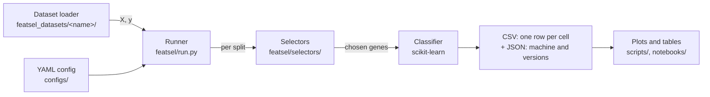

# 5. The software

[Back to contents](README.md) · Previous: [4. The methods](04_the_methods.md) · Next: [6. Making it fast](06_making_it_fast.md)

This chapter covers task 1 (the pipeline) and the safe-running parts of
task 3. Speed is chapter 6.

## 5.1 Two deliverables in one package

`featsel` serves two kinds of user.

1. **A practitioner with a scikit-learn pipeline** swaps the selection
   step for one of ours and changes nothing else. So every selector
   behaves like a scikit-learn selector, and those that copy a
   scikit-learn method are tested to pick the same features.
2. **A researcher comparing methods** writes one YAML file and runs
   `python -m featsel.run --config <file>`. The runner does the whole
   comparison of chapter 3 and writes one table.



### How we chose this design

We sketched four designs on three uses: data in memory, data in files,
and the command line.

| Design | How it looks | Gain | Cost |
|---|---|---|---|
| 1. Functions only | `evaluate(X, y, selectors=[...], k=[...], splits=100, ...)` | Smallest surface; trivial to test. | Long keyword lists; YAML and Python forms differ. |
| **2. One runner, protocol as a config** (chosen) | `run(X, y, config)`, `config` a dict or read from YAML | One protocol runs unchanged on many datasets (task 4). Python and the command line share one format. | A config typo surfaces only when the run reaches it. |
| 3. Pure scikit-learn | `cross_validate(pipe, X, y, cv=StratifiedShuffleSplit(...))` | Almost no own code; parallel work free with `n_jobs`. | Timing selection apart from training, stability per split and resuming a crash need workarounds. Task 3 shrinks to "we set `n_jobs`". |
| 4. Dataset objects | `run(ArrayDataset(X, y, name=...), config)` | Names and metadata travel with the data. | Data in memory needs a wrapper; more classes. |

| Question | 1 | 2 | 3 | 4 |
|---|---|---|---|---|
| Same protocol on many datasets | pass arguments again | reuse the config | reuse the pipeline and splitter | reuse the config |
| Optional known true features | extra argument | extra argument | manual | field on the dataset |
| Code to write | least | little | least | most |

Design 2 won. Data always arrives as `X, y`. An optional argument,
`truth`, lists the truly informative features, known only for simulated
data. When given, the runner also records recall and precision against
it. `run_config(config)` loads the dataset named in the config and calls
`run`; the command line calls `run_config`. Paths in a config are
relative to the config file, so the package never assumes this
repository's layout.

## 5.2 Selectors are scikit-learn estimators

Every selector subclasses `FeatureSelector`, which inherits scikit-learn's
`BaseEstimator` and `SelectorMixin`. A selector:

- lists its parameters in `__init__` and only stores them;
- does its work in `_fit` and sets `support_`, a boolean mask over the
  features. The base `fit` sets the seed where needed, then calls `_fit`.
  `_fit` is abstract, so a selector without it fails when created, not
  when fitted;
- passes the base class's helpers what they need as arguments. A helper
  never reads an undeclared setting such as `self.n_features`, so each
  selector can be read from its own file;
- inherits `transform`, `get_support`, `get_params` and `set_params`.

So a selector works in a `Pipeline` and with `clone`, `cross_val_score`
and `GridSearchCV`. A misspelled parameter raises an error.

```python
from sklearn.linear_model import LogisticRegression
from sklearn.model_selection import cross_val_score
from sklearn.pipeline import make_pipeline
from sklearn.preprocessing import StandardScaler

from featsel.selectors import MannWhitneySelector

pipe = make_pipeline(StandardScaler(),
                     MannWhitneySelector(n_features=50),
                     LogisticRegression(max_iter=1000))
scores = cross_val_score(pipe, X, y, cv=5, scoring='roc_auc')
```

Selection is refit inside every fold, as chapter 3 requires.

**Input and output.** A selector accepts a NumPy array, a pandas
DataFrame or a PyTorch tensor, on the CPU or a GPU (chapter 6). Input is
checked in `fit`, as scikit-learn requires; `check_input=False` skips
this for a clean NumPy array. `transform` returns a NumPy array, or pandas
with `set_output(transform='pandas')`. A tensor comes back as a tensor on
the same device.

**Why.** An earlier wrapper class forwarded parameters through a
hand-written list. A parameter missing from it was silently dropped, so a
config typo ran with the default. Adding a selector meant editing three
places. The wrapper, its list and its combining modes (union,
intersection, voting) were removed.

**Registration.** A selector registers under its class name when defined,
through `__init_subclass__`. Names are stored in lower case, so lookup
ignores case. A duplicate name raises an error. A class may declare
aliases. `FeatureSelector.create(name, **params)` finds the class a YAML
config names, so no list is kept by hand. Results record the class name,
whatever alias was used, unless the config sets a `label` such as
`HC2008`. In Python, users import the class, so a misspelled name fails
at import.

**Rank once.** For Mann-Whitney, mutual information, correlation, Lasso,
tree importance and RFE, the top `k` of the full ranking equals a fit at
that `k` (section 4.2). They set the flag `rank_once` and return their
order through `ranking()`. The runner fits each once per split and cuts
the ranking at every `k`. Tests check each cut against a separate fit.

**Scores keep their own names:** `scores_`, `log_pvalues_`, `coef_` or
`variances_`. Only tree importance has `feature_importances_`, the
forest's own attribute. So a name never means a score in one selector and
a position in another.

**Seeds.** Mutual information, tree importance and the random selector
subclass `FeatureSelectorRandom`. It takes an integer `random_state`, 42
by default; `None` is not allowed. `fit` seeds Python's and NumPy's
generators, and PyTorch's once imported, so a repeated fit picks the same
genes. Other selectors take no seed. RFE, RFECV and Lasso are among them:
their exact solvers use no randomness (section 6.2). We rejected a
generator kept inside the object: `clone` does not copy it, and its draws
would depend on the order of fits.

**How a selector computes is its own business.** It may wrap scikit-learn
or run its own CPU or GPU code. Swapping one for the other keeps the class
name and parameters, so configs and results do not change. Each selector
has a folder, `featsel/selectors/<name>/`, with its tests and notebooks.
Families (filter, embedded, wrapper) share no code and get no folder. The
random selector's folder is `random_selection/`; `random` would hide
Python's own module.

**Adding a selector** means writing one class. This one ranks features by
the gap between the two class means:

```python
import numpy as np
from featsel.selectors.base import FeatureSelector

class MeanGapSelector(FeatureSelector, aliases='mean_gap'):
    rank_once = True          # its top k equals a fit at k

    def __init__(self, n_features=10, check_input=True):
        self.n_features = n_features
        self.check_input = check_input

    def _fit(self, X, y):
        X, y = self._validate(X, y, check_input=self.check_input)
        self.scores_ = np.abs(X[y == 1].mean(axis=0) - X[y == 0].mean(axis=0))
        self.support_ = self._mask(self.ranking()[:self.n_features])
        return self

    def ranking(self):
        return self._best_first(self.scores_)
```

It works in a pipeline, with `clone`, and in a YAML config as
`MeanGapSelector` or `mean_gap`.

**A method that picks its own count**, such as `HigherCriticismSelector()`,
is used the same way. After `fit`, `get_support().sum()` is the count it
chose.

**Embeddings in memory** need no file. The selector picks embedding
dimensions from the array, and a small model can then train on them only:

```python
emb = backbone(images).detach().numpy()          # samples × embedding size
sel = MannWhitneySelector(n_features=64).fit(emb, labels)
dims = sel.get_support(indices=True)             # the 64 chosen dimensions
```

**Rejected selector designs.**

| Design | Why rejected |
|---|---|
| Keep the wrapper | The silent typo would stay. |
| A hand-written name-to-class table | Every selector would need a second edit. |
| A short declared name per class | It protects only against renames, and aliases cover those. |
| One file or folder per family | Unmanageable once a method has CPU and GPU versions. |
| Reimplement every scikit-learn method | Most selectors cost seconds; model fitting costs minutes. A rewrite gains nothing unless a timing shows it does. |

## 5.3 Datasets: one loader per dataset

Each dataset has its own folder in `featsel_datasets/`, outside the
package, with two parts:

- a class that downloads the published files once, caches them, and
  exposes everything in them unchanged: `GSE96058`, `BreastMNIST`;
- `featsel_view.py`, with this project's choices (HiSeq only, one sample
  per patient, the target), `NAME`, `TARGET` and `load_xy()`, which
  returns `X` and `y`.

A config names the view module. A new dataset needs only a new folder;
the package does not change.

**Why.** The course's SCAN-B files had no recorded source or filters.
Their origin, patients and gene choice could not be checked, and nobody
could reuse our preparation. The generic class makes no choice for the
caller, so others can use it alone. For BreastMNIST it also computes the
ResNet-50 embeddings and finds the copied images
([`copies_report.md`](../featsel_datasets/medmnist_breastmnist/copies_report.md)),
once each, and caches both. It imports PyTorch and OpenCV only for those
steps, so cached runs never need them.

`X` is a pandas DataFrame and `y` a Series. So gene names reach the
selectors, and patients stay aligned with their labels. This matters:
GSE96058's gene file and patient file list samples in different orders.
`load_xy` is a function because it holds no state. The view owns the data
choices; the experiment config owns the protocol and the values of `k`.

**Rejected loader designs.**

| Design | Why rejected |
|---|---|
| A generic loader driven by a YAML description | Real datasets arrive in shapes no schema foresees: several tables, archives, images. |
| A loader class inside `featsel` | The package stays generic; dataset code lives beside its data. |
| NumPy arrays plus a list of names | Alignment by position is what the index protects against. |
| A folder named `datasets/` | The Hugging Face `datasets` library would hide it on import. |
| A dataset YAML naming the loader | It repeated the choices `load_xy` makes, so the two could drift apart. |

**Limits.** The runner imports the module a config names. The module
follows one fixed convention (`NAME`, `TARGET`, `load_xy`), with no
registry. A `.yaml` or `.yml` ending marks a CSV config instead.
`featsel_datasets` is not installed with the package, so code run outside
the repository root must put the root on Python's path. The first SCAN-B
load downloads 592 MB and takes about 85 s.

## 5.4 The runner

One YAML file describes an experiment. This is
[`configs/frontier_scanb70_gpu.yaml`](../configs/frontier_scanb70_gpu.yaml),
shortened:

```yaml
dataset: "featsel_datasets.scanb_gse96058.featsel_view"
target: "pam50 subtype"
output: "../results/local/frontier_scanb70_gpu.csv"
seed: 42
n_splits: 16
train_sizes: [0.7]
k_validation: {cv: 5}
metrics: [roc_auc, macro_f1, balanced_accuracy]
selectors:
  - name: MannWhitneySelector
    k: [10, 50, 250, 500, 1000, 1500, 2000]
    params: {device: "cuda"}
  - name: LassoSelector
    params: {Cs: [0.01, 0.1, 1.0, 10.0], cv: 5, device: "cuda"}
models:
  - name: logistic_regression
    params: {max_iter: 1000}
```

A multiclass target becomes binary tasks, one per class against the rest,
so PAM50 gives five tasks. The runner draws the splits and runs every
combination of task, split, selector, `k` and classifier. Each finished
cell becomes a CSV row: the scores, the chosen genes, the selection time,
peak memory, device, and whether repeated fits agreed. A JSON file beside
it records the machine, the library versions and the git commit, at the
start of the run and again at the end.

**Choosing on validation sets.** With `k_validation`, every method with a
`k` list also gets a validation AUC per `k`. The runner cuts the training
set into `cv` stratified folds, 5 in the experiments. In each fold it fits
the selector on the other folds and scores the classifier on the
validation fold. So `k` is chosen without the test set. Lasso has no `k`
list. It chooses C from `Cs` by validation AUC the same way, and C sets
its count.

**A search runs once.** A searching selector, Lasso with `Cs` or RFECV,
searches once per split; that time goes in `search_time_s`. The timed
repeats then fit with the chosen value.

Analysis is separate: `featsel.analysis`, `scripts/` and the notebooks
read the CSV. A new plot never needs a new run.

**Two-stage selection.** A selector entry can be a chain: a fast filter
cuts the features, and a slower method picks the final `k` from the rest.
The runner builds it as a scikit-learn `Pipeline`. Recorded genes are
always indices of the original features, and the selection time covers
every step. Section 8.9 compares chains with their last step alone.

**Nested tuning.** A model entry with a `grid` is tuned inside each split
(section 3.8), by scikit-learn's `GridSearchCV` on stratified Monte Carlo
splits of the training set. The chosen values are stored with each row.

**Parallel work.** One job is one selector on one task of one split. A
rank-once selector covers all its `k` values in one job; any other gets
one job per `k`. Jobs run on joblib worker processes. Parallel work lives
in the runner only.

One split, stratified on the five-class PAM50 label, serves all five
tasks. Each split is prepared once and written to `/dev/shm`, and every
worker maps it read-only. Otherwise each worker would prepare its own
copy for each task, 2 to 3 GB each. Sharing saves that memory and
preprocesses once instead of five times.

## 5.5 Running for hours without supervision

Long runs on a 16 GB laptop crashed at first: when memory ran out, the
operating system killed the run with no message. Six mechanisms fix this.

| Mechanism | What it does |
|---|---|
| **Memory cap per worker** | A limit on each worker's data memory. By default: the free RAM, less room for three prepared splits and 1 GB, shared among the workers. Past it, a selector or classifier gets a Python `MemoryError`; the runner skips that cell, lists it at the end, and goes on. |
| **Restart with fewer workers** | Compiled code can abort a worker instead of raising. The runner then resumes with half the workers. Under the default cap each gets about twice the memory; a cap set by hand stays. |
| **Resume** | Rows are written as they finish. `--resume` skips cells already in the CSV. |
| **One GPU at a time** | A lock file makes GPU fits take turns. A GPU out-of-memory error becomes a `MemoryError`. |
| **Skip a job that kills the runner** | With one worker, jobs run in the runner's own process, so an abort ends the run. The running job's name is kept in a file beside the CSV, which a crash leaves behind. The next run skips that job and lists it with the out-of-memory cells. A later `--resume` tries it again. |
| **Restart after a crash** | `scripts/run_until_done.py` restarts the runner with `--resume` and the worker count it had fallen back to. It gives up after three restarts in a row with no new row and no new skipped job. It keeps the machine awake meanwhile. |

**The cap counts data memory, not address space.** PyTorch's GPU
libraries reserve address space they never use. Under an address-space
cap below about 5 GB, they could not even load. After a GPU call, a
worker releases its cached GPU memory and keeps about 64 MB.

**What happened in practice.** Full SCAN-B needs several GB per worker.
On the 16 GB laptop, six workers ran out of memory; the run resumed with
fewer. Under a 3 GB cap the U-test selectors were skipped, and a resume
at a higher cap filled them in. Holding the data as 32-bit floats
(section 3.12) cut peak selection memory by 30% to 45%: under a 3 GB cap,
4 workers fit instead of 2. Two later changes were not measured again:
the one-sort U test needs about 1.25 times the memory, and the cap moved
from address space to data memory.

The last two mechanisms came from the scaling measurement of section 6.1,
when RFE and Lasso still ran liblinear. With 5 or 6 workers on full
SCAN-B, liblinear needed about 1.45 GB per fit; the default cap at 6
workers allowed 1.26 GB. So
it aborted, and the runner fell back to fewer workers, as designed. But
many runs in one process left memory behind, and the process crashed
even with one worker. The scaling script now runs each measurement in a
fresh process, saves it as it ends, and can resume.

**Limits.** Nothing restarts a run after a reboot or power loss; the same
command continues from the saved rows. A cell that never fits in memory
is skipped and listed.

## 5.6 Tests

Each selector's tests sit in `featsel/selectors/<name>/tests/`. Shared
checks in `tests/sklearn_reference.py` test each selector that copies a
scikit-learn method:

- it selects the same features as that method;
- its `fit` plus `get_support` is at most 5% slower. Both are timed,
  because scikit-learn builds its mask only in `get_support`. Each side's
  time is the median of 50 fits. The fast filters are timed on larger
  data (1,000 × 4,000), so timing noise stays below 5%;
- its GPU path selects the same features as its CPU path.

RFE, RFECV and Lasso reach the exact solution (section 6.2), so their
selection is compared with scikit-learn's liblinear run to a tight
tolerance, not at its defaults. Lasso has no speed test: no scikit-learn
solver reaches its solution.

The shared checks use one balanced binary dataset, but our real tasks are
imbalanced. So two paths are also tested at positive fractions of 50%,
20%, 10% and 5%: Lasso's PPDNA solver, and mutual information on the
GPU. The runner has its own tests; one checks that a parallel run gives
the same results as a sequential one.

## 5.7 Where to find things

| Part | Location |
|---|---|
| Selectors | [`featsel/selectors/`](../featsel/selectors/) |
| Base class and registration | [`featsel/selectors/base.py`](../featsel/selectors/base.py) |
| Runner | [`featsel/run.py`](../featsel/run.py) |
| GPU policy and lock | [`featsel/selectors/gpu.py`](../featsel/selectors/gpu.py) |
| Dataset loaders | [`featsel_datasets/`](../featsel_datasets/) |
| Configs and their documentation | [`configs/`](../configs/), [`configs/README.md`](../configs/README.md) |
| Usage demo | [`notebooks/03_usage_demo.ipynb`](../notebooks/03_usage_demo.ipynb) |

## 5.8 Known limits

- A config is not checked before the run starts. A typo fails only when
  the first cell that uses it runs.
- A class name is public: it appears in configs and results. Renaming a
  class needs an alias for old configs.
- A class registers only when its module is imported. Importing `featsel`
  imports every selector, so this holds in normal use.
- Selector tests live inside the package. Packaging excludes them, and
  pytest searches both `tests/` and `featsel/`.
- CorrelationSelector can drop a gene whose only redundant partner was
  itself dropped (section 4.2). The frontier used it as it is.
