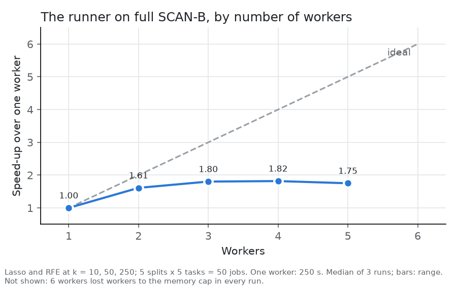

# 6. Making it fast (task 3)

[Back to contents](README.md) · Previous: [5. The software](05_the_software.md) · Next: [7. Results: quality](07_results_quality.md)

Task 3 asks for infrastructure that speeds up feature selection. We worked
at two levels: the whole experiment (the runner) and each method (faster
algorithms, and a GPU).

The speed-ups in this chapter's tables come from series of measurements
on several sizes, never from one timing. The few single timings in the
text are marked as such. They explain a design choice and claim no
speed-up. All ran on one laptop: Intel i7-9750H, 12 threads, 16 GB RAM,
and an NVIDIA GTX 1650 with 4 GB.

## 6.1 The runner against plain scikit-learn

Most selectors and all classifiers come from scikit-learn, so the
runner's value over it must be measured. The same small grid ran four
ways on the same splits: scikit-learn's `cross_validate`
(one call per selector and `k`) and our runner, each on one core and on
12 threads. The scikit-learn side uses its own selectors:
`SelectFromModel` with L1 logistic regression for Lasso, and `RFE` with
`LinearSVC` for RFE. The script checks that all four runs give the same
test scores before it reports a time. All 30 test macro-F1 scores were
equal on every run.

The setting, chosen to see the whole flow in about a minute:

- SCAN-B, Basal vs rest: 2,976 patients, 3,000 random genes of 28,552.
- 5 splits at a training fraction of 0.5.
- Lasso and RFE (step 0.5) at `k` = 10, 50 and 250.
- Logistic regression with a fixed C, as in the experiments.
- Every seed fixed and the same on every split, so both sides fit the
  same models. The experiments seed each split differently.
- Data in 32-bit floats on both sides.

These timings predate dropping liblinear (section 6.2). Both sides ran
Lasso and RFE with liblinear at its defaults. The script now compares
with liblinear run to a tight tolerance. It has not been re-run since.

| Run | Seconds | Speed-up over scikit-learn on 1 core |
|---|---|---|
| scikit-learn, 1 core | 33.6 | 1.0 |
| runner, 1 core | 10.4 | 3.2 |
| scikit-learn, 12 threads | 22.3 | 1.5 |
| runner, 12 threads | 6.3 | 5.3 |

**Why.** The runner does less work, not different work:

- It prepares each split (imputation, scaling) once for every task,
  selector and classifier.
- It fits each rank-once selector once per split and cuts the ranking at
  every `k` (chapter 5). scikit-learn refits it for every `k`. For Lasso
  and tree importance on GSE96058, this cut selection from about 245 s to
  39 s per split (single timings), with identical genes.
- It runs jobs in parallel, with the data in shared memory.

Parallel work added little on this grid. scikit-learn spreads only the 5
splits of one call, and gains 1.5 times. The runner's 10 jobs (2
selectors × 5 splits) gain 1.7 times over its own one-core run. Starting
the worker processes took about 4.5 of its 6.3 seconds.

### Parallel work at full size

The same grid ran on all 28,552 genes and all five tasks: 50 jobs. Each
worker count ran 3 times, each in a fresh process. The runs varied by
less than 2%.

| Workers | Seconds (median) | Speed-up | Efficiency (speed-up per worker) |
|---|---|---|---|
| 1 | 250 | 1.00 | 1.00 |
| 2 | 155 | 1.61 | 0.81 |
| 3 | 139 | 1.80 | 0.60 |
| 4 | 138 | 1.82 | 0.45 |
| 5 | 143 | 1.75 | 0.35 |

The speed-up stops at about 1.8, from 3 workers on. Job sizes do not
explain it. The longest of the 50 jobs took 12 s, and all of them 240 s.
Preparing the splits and writing the results took at most about 20 s.
So 3 workers could finish in about 100 s. They took 139 s.

Instead, each job ran slower beside others. With 3 workers, the selection
fits took 1.75 times as long as alone. The classifier fits, on 10 to 250
genes, did not slow down. A selection fit reads the whole training set,
1,488 patients × 28,552 genes, far more than the processor's cache holds.
A classifier fit reads only a few genes. This points to memory bandwidth,
shared by all cores, as the limit. We did not measure the bandwidth
itself.

This run also predates dropping liblinear. With 6 workers, the memory cap
gave each worker 1.26 GB. liblinear needed about 1.45 GB for one fit, so
it aborted. Every 6-worker run fell back to 3 workers (section 5.5). So
on this 16 GB laptop, 3 workers were the useful maximum for this grid.

Sources: [`scripts/parallel_scaling.py`](../scripts/parallel_scaling.py),
[`figures/parallel_scaling.csv`](figures/parallel_scaling.csv); per-job
times from [`scripts/parallel_job_times.py`](../scripts/parallel_job_times.py),
[`figures/parallel_scaling_jobs_1_worker.csv`](figures/parallel_scaling_jobs_1_worker.csv)
and [`figures/parallel_scaling_jobs_3_workers.csv`](figures/parallel_scaling_jobs_3_workers.csv).

### Why the speed matters: the full grid

The original design had 100 splits at three training fractions (300 in
all), 6 selectors and nested tuning. We extrapolated its cost from the
classifier study's 12-split run with the F-test (section 7.7). Without
the linear SVM classifier, it needed about 30 to 35 CPU-hours: a day and
a half on one core, shorter in proportion with more cores. RFE removing
one feature per round would take about 2,300 hours. Removing 10% per
round and ranking once takes about 3 hours. This is the specification's
point that some techniques are impractical in this setting. A linear SVM
classifier with scikit-learn's default solver would have cost hundreds of
hours more. We cut the grid instead (section 3.3).

An early SCAN-B run showed where the time goes. Selection took 82%, and
tree importance alone half. The classifiers, with their tuning of C, took
the rest. Memory, not cores, limited the run to 2 workers. So the runs now
hold the data in 32-bit floats (section 3.12).

Source: [`scripts/benchmark_speed.py`](../scripts/benchmark_speed.py),
[`results/speed_benchmark.csv`](../results/speed_benchmark.csv).

## 6.2 Each method, faster

Each selector has a speed notebook,
`featsel/selectors/<name>/demos/speed.ipynb`. It times the scikit-learn
original and our versions on synthetic data shaped like SCAN-B: 3,000
samples, 1,000 to 30,000 features, binary and imbalanced (80/20). It
checks that every fit is reproducible and picks the original's features.
Each time is the median of 2 timed fits, after one untimed warm-up fit.
If the warm-up takes over a minute, one timed fit follows and the variant
stops growing. Two fits show a gap of several times, not of a few
percent.

Results at the largest size both sides reached (30,000 features unless
noted). Every fit of every variant was reproducible.

| Method | Original | Ours, CPU | Ours, GPU | Same features? | Notebook |
|---|---|---|---|---|---|
| ANOVA, FDR, FWE, Percentile (F-test) | 0.36 s | 0.36 s | 0.14 s (2.6×) | yes | [anova_f](../featsel/selectors/anova_f/demos/speed.ipynb) |
| Variance threshold | 0.83 s | 0.86 s | 0.13 s (6.4×) | yes | [variance_threshold](../featsel/selectors/variance_threshold/demos/speed.ipynb) |
| Correlation (pandas full matrix) | 7.05 s | 6.89 s | 0.25 s (28×) | yes | [correlation](../featsel/selectors/correlation/demos/speed.ipynb) |
| Mann-Whitney and Higher Criticism (our NumPy U test) | 3.76 s | — | 0.49 s (7.7×) | yes | [mann_whitney](../featsel/selectors/mann_whitney/demos/speed.ipynb) |
| Berk-Jones (our NumPy U test) | 3.88 s | — | 0.46 s (8.4×) | yes | [berk_jones](../featsel/selectors/berk_jones/demos/speed.ipynb) |
| Mutual information, 10,000 features | 78.3 s | 18.4 s (4.2×) | 1.60 s (49×) | yes, bit for bit | [mutual_info](../featsel/selectors/mutual_info/demos/speed.ipynb) |
| Lasso (liblinear → PPDNA solver) | 5.78 s | 25.4 s (4.4× slower) | 1.01 s (5.7×) | 91% overlap (see below) | [lasso](../featsel/selectors/lasso/demos/speed.ipynb) |
| Tree importance, 10,000 features (1 thread → 12) | 103.7 s | 18.8 s (5.5×) | no GPU path | yes | [tree_importance](../featsel/selectors/tree_importance/demos/speed.ipynb) |
| RFE (liblinear → exact Newton solver) | 26.2 s | 12.9 s (2.0×) | 15.6 s (1.7×) | not at every size (see below) | [rfe](../featsel/selectors/rfe/demos/speed.ipynb) |
| RFECV, 10,000 features | 70.1 s | 49.9 s (1.4×) | 42.2 s (1.7×) | not at every size | [rfecv](../featsel/selectors/rfecv/demos/speed.ipynb) |
| Sequential forward, 1,000 features | 163.8 s | 22.5 s (7.3×) | 4.9 s (34×) | yes | [sequential](../featsel/selectors/sequential/demos/speed.ipynb) |
| Random | — | 0.02 s | — | — | [random_selection](../featsel/selectors/random_selection/demos/speed.ipynb) |

The mutual information, tree importance, RFECV and Sequential notebooks
were run again after a fix. Past the original's largest size, the overlap
check had compared two of our variants instead of one with the original.
That overlap is now left empty. Most times moved by 7% or less.
scikit-learn's Sequential selection took 164 s, against 191 s before, so
the GPU's lead fell from 39 to 34 times. Two timed fits cannot pin a time
closer than that.

The RFE, RFECV and Lasso results were rerun on 2026-11-14, after
liblinear was dropped, against liblinear at its defaults. They ran as a
plain script,
[`scripts/benchmark_speed_selectors.py`](../scripts/benchmark_speed_selectors.py),
with nothing else running. Inside Jupyter, the same call ran Newton
slower on the CPU: 61 s against 41 s for RFECV at 3,000 features. The
cause was not found. It was not heat: ten fits in a row held their time,
clock and temperature. The script's RFECV times match the notebooks'
first run within 2%.

The script also times Lasso on the five tasks of real SCAN-B (2,976
patients, 28,552 genes):

| One Lasso fit per task | Seconds | Against liblinear |
|---|---|---|
| liblinear | 4.8 to 5.7 | — |
| PPDNA, GPU | 0.71 to 1.36 | 3.9 to 7.0 times faster |
| PPDNA, CPU | 4.5 to 31.3 | faster on Basal and Normal, up to 5.9 times slower on LumB |

The notebook standardizes the data in 32-bit floats, as the runner holds
it. A few genes are nearly constant: their spread is 10⁻⁶ to 10⁻⁹ around
the expression floor. 32-bit floats cannot hold so small a spread.
Standardizing them gives values up to 0.06 apart from the 64-bit result.
Only 0.02% of the values move by more than 0.001. PPDNA on the CPU is
sensitive to this. On LumB it took 35 s on data standardized in 32 bits
and 7.3 s in 64 bits, and kept 730 genes against 735.

A second series ran on real SCAN-B: the training set of one split, Basal
vs rest (1,488 patients, half of them), median of 5 fits. Script:
[`scripts/benchmark_selectors.py`](../scripts/benchmark_selectors.py);
its output in `results/local/benchmark_selectors/` is not tracked. At all
28,552 genes:

| Method | scikit-learn's solver | Exact Newton solver, CPU | Exact Newton solver, GPU |
|---|---|---|---|
| RFE | 23.1 s | 2.8 s | 3.4 s |
| RFECV | 111 s | 18.1 s | 17.3 s |
| Sequential | 324 s at only 1,000 genes | 186 s at 10,000 genes | 146 s |

### Where the speed comes from

| Method | What changed |
|---|---|
| U test | One sort per gene gives the ranks and the tie groups. On the GPU, PyTorch sorts thousands of genes in parallel. Only the rank sums and tie counts are computed there, exactly, in 64-bit floats. The p-value is finished on the CPU, so every device gives identical results. Before this work a U-test fit took about 10 s on SCAN-B. The NumPy version replaced two ranking passes by one sort. At 3,000 × 10,000 it took 2.15 s, against 6.59 s before and 3.76 s for SciPy, at about 1.25 times the peak memory. |
| F-test, variance | Class sums as one vector product per class, on the GPU. |
| Correlation | The gene-gene correlations are computed in blocks, so the full 28,552 × 28,552 matrix is never held in memory. |
| Mutual information | scikit-learn's estimate (Ross 2014) finds nearest neighbours with a KD-tree. For one feature, a sort per class finds the k-th neighbour, and a binary search counts the points within its radius. The random noise, the distances and the order of every mean are scikit-learn's, so the scores are identical, bit for bit. A class of 2 to 7 samples, and regression, go to scikit-learn, which uses brute-force distances there. The GPU path draws scikit-learn's noise on the CPU and sends it over. |
| Lasso | PPDNA (Liu and Zhou 2023), a semismooth Newton method, solves the same L1 problem to a tight tolerance on the GPU. |
| RFE, RFECV | An exact Newton solver for the linear SVM (Chapelle 2007). With fewer samples than genes, it works through the samples' n × n kernel matrix (3,000 × 3,000, not 30,000 genes wide). The matrix is kept between rounds. |
| Sequential | Each step solves all candidate features at once: one batched Newton problem on the logistic regressions, in PyTorch, in 64 bits. The candidates share the features already chosen, so every Hessian block is one product over all candidates and no design matrix is built. Each fit starts from that candidate's solution at the previous step. It selects what scikit-learn does with a converged logistic regression. It covers two classes, forward search and accuracy, and raises an error otherwise. The GPU wins here: the work is wide elementwise passes and large products. |
| Tree importance | scikit-learn's own forest on all threads (`n_jobs=-1`). scikit-learn's default is one thread. On synthetic SCAN-B-shaped data (1,488 samples × 28,552 features), one fit took 21.5 s on one thread and 4.2 s on 12. In the runner, threads per worker times workers should not exceed the cores. |

**RFE's step.** RFE removes a share of the remaining genes each round. A
retired comparison used step 0.5 for speed. On SCAN-B, one fit took about
35 s at step 0.1 and 2.4 s at step 0.5 (single timings). Every run now
uses step 0.1.

### Why some methods do not pick the same features

**Lasso.** liblinear stops at a tolerance of 10⁻⁴, far from the exact
solution. PPDNA reaches the solution, so it picks fewer, different genes.
On all 2,976 patients (C = 1):

| Task | liblinear, default | PPDNA | Jaccard |
|---|---|---|---|
| Basal | 330 | 196 | 0.55 |
| Her2 | 571 | 430 | 0.69 |
| LumA | 1,600 | 907 | 0.51 |
| LumB | 1,029 | 733 | 0.58 |
| Normal | 577 | 542 | 0.88 |

PPDNA is reproducible. Source:
`results/local/speed/LassoSelector_scanb.csv` (not tracked in git).

**Why PPDNA.** Simpler solvers failed. FISTA, even on a working set of
genes, only tied liblinear. Parallel coordinate descent overshot on
correlated genes. SSNAL handles only the squared loss. Our PPDNA departs
from the paper in three ways, each needed on SCAN-B-shaped data:

- Its proximal step size starts at 40 C and grows five-fold per outer
  step, up to 10⁶ C. Beyond that, rounding loses the digits the weights
  are made of.
- The Newton matrix is factored in 32-bit floats, where this GPU is fast.
  The solution is refined in 64 bits.
- It also stops when three outer steps fail to halve the best residual.
  On 28,552 genes, rounding sets a floor near 10⁻⁹, above the target of
  10⁻¹⁰. Without this rule, Basal ran all 1,000 outer steps in 43 s.
  With it, 0.73 s (single timings), and every task stopped within 7 to
  10 outer steps.

**RFE.** The cause is the same. When genes are strongly correlated,
liblinear's tolerance changes which genes are removed. On the synthetic
data at 3,000 features, the Jaccard index between the two gene sets was
only 0.28. On synthetic SCAN-B-shaped data with correlated genes,
liblinear at its default tolerance (10⁻⁴) shared 32 of 50 genes with the
exact answer. At 10⁻⁸ it shared all 50. So liblinear stops early; neither
is in error.

**Newton's answer is the exact one.** liblinear's tolerance is a stopping
rule, not part of the method. Its coordinate descent nears the solution
with every pass but never reaches it. Newton's method reaches the exact
solution in a finite number of steps (Keerthi and DeCoste 2005,
Theorem 1). Given unlimited time, liblinear would end at Newton's answer.
So Newton gives the selection SVM-RFE intends, and liblinear's default
approximates it.

For Lasso the claim is weaker. PPDNA is not proven to stop exactly at
Lasso's solution. It stops at a residual of 10⁻¹⁰, far tighter than
liblinear's 10⁻⁴.

**Dropping liblinear.** RFE, RFECV and Lasso no longer offer liblinear,
and have no `solver` parameter. Each runs only its exact solver: Newton
for RFE and RFECV, PPDNA for Lasso. The reasons:

- **Speed.** On the SCAN-B frontier (section 8.3), liblinear RFE took
  57 s per fit, Newton 6.0 s. RFE with liblinear was the largest single
  cost of the frontier runs.
- **Exactness.** Newton reaches the solution that liblinear only
  approaches.
- **Repeatability.** Unless its seed is fixed, liblinear shuffles the
  data differently on each fit and keeps different genes. Newton and
  PPDNA use no randomness, so the selectors lost `random_state` too.
- **No loss in AUC.** On the frontier, the two RFE solvers and the two
  Lasso solvers scored the same AUC at every `k`, within the spread over
  splits. For RFE: 0.811 and 0.807 at k = 10, 0.959 and 0.959 at
  k = 1000.

For Lasso the speed argument is weaker. On the CPU, with C chosen from
four values by 5-fold validation AUC, both solvers took the same total
time over the five SCAN-B tasks: 379 s for liblinear, 381 s for PPDNA
(single fits, on data standardized in 64 bits). PPDNA was faster on
Basal, Her2 and Normal and slower on LumA and LumB. Its cost grows with
the number of genes the model keeps, and the luminal tasks keep the most.
Both chose C = 0.1 on every task. Their validation AUCs agreed to the
fourth digit. Only on a GPU, which liblinear cannot use, was PPDNA
clearly faster (table above).

Unlike every other wrapped selector, Lasso has no test that it is at most
5% slower than scikit-learn. No scikit-learn solver reaches Lasso's exact
solution. Its Newton solvers refuse the L1 penalty. liblinear and saga
accept it but stop at a tolerance: less work, a different answer. On small synthetic data, PPDNA on the
CPU was 3 to 4 times slower than liblinear at its defaults. So Lasso's
speed comparison is the SCAN-B one above.

The cost is the drop-in promise. These three selectors now select what
scikit-learn selects with liblinear run to a tight tolerance, not with
its defaults. Lasso also lost regression, which only liblinear supported.
It is now classification only. The project's tasks are all binary
classification (section 2.1).

Newton has one limit. It works in the samples' space, through an n × n
kernel, so it wins only when genes outnumber samples. On synthetic data
with 3,000 patients and 1,000 genes, Newton RFE took 7.7 s and liblinear
1.6 s. At 3,000 genes the two crossed: 7.5 s against 13.5 s.

**The rule.** Every other selector selects what scikit-learn selects by
default. Sequential's Newton solver is an option, not its default. No
selector picks its solver on its own. The device is chosen at run time
only under `device='auto'` (section 6.3). Each result records the device
used.

### Why the GPU does not always win

- **64-bit arithmetic.** The GTX 1650 is a consumer card. It runs 64-bit
  floating point at 1/32 of its 32-bit speed. RFE's solver needs 64 bits:
  with 32 bits, it selected different genes. So at 30,000 genes RFE is
  slower on this GPU than on the CPU. At 1,000 to 10,000 genes the GPU is
  still faster.
- **Copying.** For the fast filters, copying the data to the GPU takes
  about half the time.
- **Memory.** 4 GB is small. The forest trials:

| Forest | Data (samples × features) | Result |
|---|---|---|
| XGBoost, GPU | 1,488 × 28,552 (synthetic, SCAN-B-shaped) | out of memory even with 64 bins, needing 3.4 GB |
| XGBoost, CPU | 1,488 × 28,552 | 339 s per fit |
| scikit-learn, 12 threads | 1,488 × 28,552 | 4.2 s per fit |
| XGBoost, GPU, depth 6 | 3,000 × 3,000 | 6.5 s, a tie with scikit-learn's 6.7 s |
| XGBoost, GPU, depth 6 | 3,000 × 30,000 | out of memory twice, asking for 3.5 GB in one block |
| cuML, GPU | 3,000 × 3,000 | 21.5 s, 3 times slower than scikit-learn's 6.7 s |

Only 21 of XGBoost's top 50 genes were scikit-learn's. That does not show
a different method. scikit-learn under another seed shares only about 20
of its own top 50 at full size (Jaccard 0.25). cuML's slowness was not
memory. Capping its trees at depth 8 took 4.5 s, at depth 16 15.1 s, and
with no cap 21.1 s. So most of the time goes to the middle levels, where
nodes are many. Tree importance therefore stays on the CPU.

**Libraries we did not use.** JAX was rejected for the U test. It is a
new dependency, reserves most GPU memory per process, and recompiles for
every data shape. CuPy and Numba were not needed. Library sorts in
PyTorch were enough, and PyTorch is already needed for the embeddings.

## 6.3 The device policy

Ten selectors share one rule for choosing where to run:

| `device` | Behaviour |
|---|---|
| `'auto'` (default) | Use the GPU if one is free now; otherwise the CPU. |
| `'cpu'` | Always the CPU. |
| `'cuda'` | Wait for the GPU and use it. |
| any | A tensor already on a GPU runs there. |

`'auto'` never waits, so a parallel run never stalls on the GPU. It uses
the GPU only when PyTorch loads, a GPU is present, and no other fit holds
it. It falls back to the CPU when the GPU runs out of memory. `'cuda'`
raises an error if the GPU cannot run. The frontier runs (chapter 8) set
`'cuda'`, so every timing of a GPU method was really taken on the GPU.

A file lock lets one fit at a time hold the GPU. Batch sizes come from
the GPU's free memory. Fitted scores are NumPy arrays on every device.
The device used is recorded with every result.

## 6.4 Summary

- The runner is 3.2 times faster than plain scikit-learn on one core and
  5.3 times on twelve threads, with identical scores.
- On the GPU, the filters run 2.6 to 49 times faster and Sequential
  selection 34 times faster, with the same features.
- Lasso, RFE and RFECV now run only exact solvers. RFE's is 10 times
  faster on SCAN-B. Because they are exact, they pick somewhat different
  genes from scikit-learn's defaults, at the same AUC.
- A cheap 4 GB GPU limits what can move to it. On it, 64-bit work and
  large forests do not pay.
