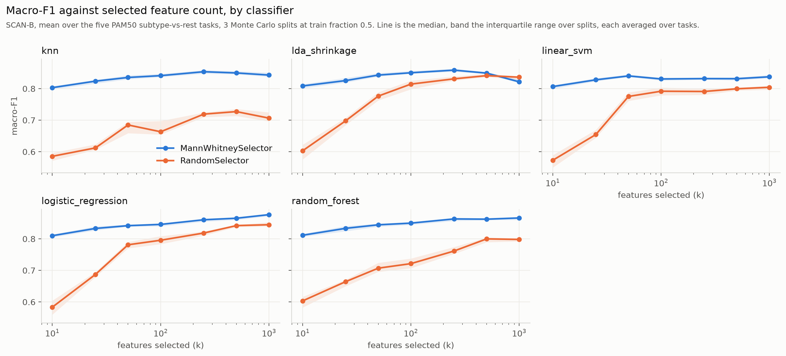
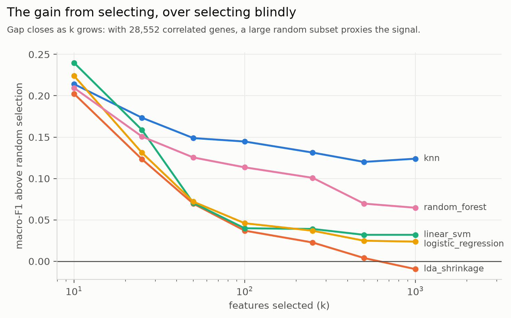
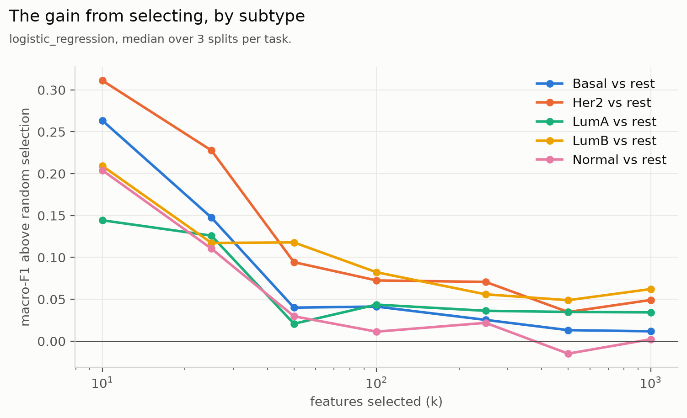
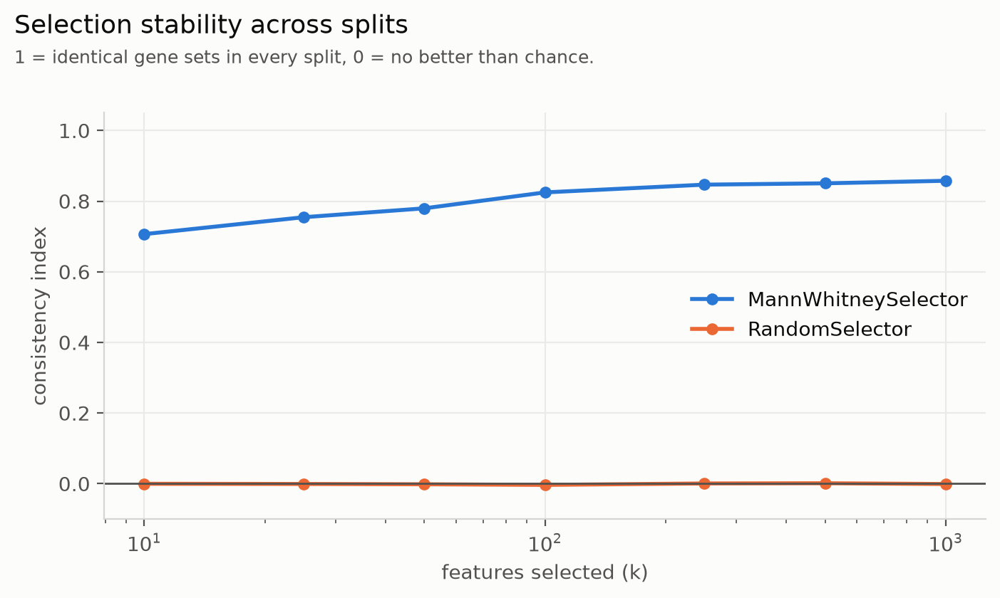

# 7. Results: which method selects best (task 2)

[Back to contents](README.md) · Previous: [6. Making it fast](06_making_it_fast.md) · Next: [8. Results: cost against quality](08_results_frontier.md)

## 7.1 The experiment

| Setting | SCAN-B | BreastMNIST |
|---|---|---|
| Tasks | 5 (each PAM50 subtype vs rest) | 1 (malignant vs rest) |
| Methods | Random, Mann-Whitney, Lasso (C = 1), tree importance (50 trees), RFE (C = 0.01, half the genes per round), HC2004, HC2008 | the same |
| `k` | 5, 10, 20, 50, 100, 250, 500, 1000 | 5, 10, 20, 50, 100, 250 |
| Splits | 16 random splits, half for training | 20 random splits, half for training |
| Classifier | logistic regression, C tuned inside each split | the same |
| Main score | macro-F1 | macro-F1 |
| Executions | 3,520 | 680 |
| Run time | 29 minutes on 4 workers | about a minute on 4 workers |

Both runs hold the data in 32-bit floats. RFE's first
round removes half of all genes. Its second round removes the rest down
to `k`. Random selection and Mann-Whitney also run at the count that
Higher Criticism 2008 chose: 2,855 on SCAN-B and 204 on BreastMNIST. This
compares HC2008 with them at equal size. The comparison ranks methods
under one protocol. It does not aim at the best possible classifier. The
order between methods matters more than the absolute scores. So does the
gap over the random control.

**Earlier runs.** Before these final runs, smaller versions of the
comparison ran while the protocol was being fixed, with other numbers of
splits, 64-bit data on SCAN-B, and 200 trees in the forest. Their results
are not reported. The text cites one only where it checks a setting of the
final run.

The main score is macro-F1, not AUC, because the runner began recording
AUC only after the comparison ran. Macro-F1 depends on the classifier's
threshold. Chapter 8 scores by AUC.

Configs: [`configs/comparison_scanb.yaml`](../configs/comparison_scanb.yaml),
[`configs/comparison_breastmnist.yaml`](../configs/comparison_breastmnist.yaml).
Results: [`results/comparison_scanb.csv`](../results/comparison_scanb.csv),
[`results/comparison_breastmnist.csv`](../results/comparison_breastmnist.csv).
Full tables, per task, with times and stability:
[Appendix D](appendix_d_comparison_tables.md).

Each cell below is macro-F1. It is averaged over the tasks within a split.
Then we take the median over the splits. The first and third quartiles
are in brackets.

## 7.2 SCAN-B

**Macro-F1**, mean over the five tasks:

| Method | k = 5 | 10 | 20 | 50 | 100 |
|---|---|---|---|---|---|
| Random | 0.518 [0.500, 0.534] | 0.575 [0.554, 0.599] | 0.647 [0.637, 0.669] | 0.730 [0.717, 0.742] | 0.775 [0.765, 0.784] |
| Mann-Whitney | 0.780 [0.771, 0.790] | 0.806 [0.802, 0.814] | 0.826 [0.817, 0.830] | 0.847 [0.842, 0.853] | 0.856 [0.851, 0.860] |
| Lasso | 0.778 [0.769, 0.788] | 0.820 [0.809, 0.833] | **0.844** [0.834, 0.849] | 0.845 [0.840, 0.852] | 0.846 [0.842, 0.853] |
| Tree importance | **0.805** [0.794, 0.812] | **0.826** [0.824, 0.830] | **0.844** [0.839, 0.846] | **0.858** [0.854, 0.863] | **0.868** [0.865, 0.872] |
| RFE | 0.604 [0.580, 0.636] | 0.662 [0.645, 0.682] | 0.704 [0.695, 0.708] | 0.744 [0.738, 0.749] | 0.775 [0.770, 0.779] |

| Method | k = 250 | 500 | 1000 | 2855 | own count |
|---|---|---|---|---|---|
| Random | 0.819 [0.813, 0.828] | 0.845 [0.841, 0.850] | 0.855 [0.851, 0.861] | 0.868 [0.865, 0.870] | |
| Mann-Whitney | 0.868 [0.864, 0.870] | 0.873 [0.870, 0.877] | **0.879** [0.875, 0.883] | 0.883 [0.880, 0.886] | |
| Lasso | 0.846 [0.840, 0.851] | 0.847 [0.843, 0.852] | 0.848 [0.842, 0.854] | | |
| Tree importance | **0.876** [0.872, 0.880] | **0.878** [0.876, 0.880] | **0.879** [0.874, 0.882] | | |
| RFE | 0.818 [0.812, 0.822] | 0.835 [0.832, 0.837] | 0.846 [0.843, 0.850] | | |
| HC2004 | | | | | 0.638 [0.633, 0.645] (1 gene) |
| HC2008 | | | | | 0.883 [0.880, 0.886] (2,855 genes) |

**Gain over random selection**, same split and `k`, median over splits
with quartiles:

| Method | k = 5 | 10 | 20 | 50 | 100 |
|---|---|---|---|---|---|
| Mann-Whitney | +0.260 [0.240, 0.276] | +0.233 [0.204, 0.255] | +0.175 [0.149, 0.192] | +0.114 [0.101, 0.126] | +0.078 [0.074, 0.094] |
| Lasso | +0.263 [0.242, 0.281] | +0.239 [0.221, 0.266] | +0.189 [0.177, 0.203] | +0.114 [0.102, 0.125] | +0.074 [0.065, 0.088] |
| Tree importance | +0.290 [0.265, 0.300] | +0.252 [0.227, 0.275] | +0.196 [0.175, 0.208] | +0.128 [0.113, 0.139] | +0.093 [0.087, 0.106] |
| RFE | +0.085 [0.065, 0.105] | +0.082 [0.061, 0.116] | +0.056 [0.036, 0.077] | +0.014 [−0.003, 0.033] | +0.010 [−0.013, 0.015] |

| Method | k = 250 | 500 | 1000 | 2855 |
|---|---|---|---|---|
| Mann-Whitney | +0.044 [0.035, 0.052] | +0.028 [0.023, 0.034] | +0.024 [0.021, 0.027] | +0.017 [0.014, 0.018] |
| Lasso | +0.024 [0.018, 0.030] | +0.001 [−0.003, 0.011] | −0.007 [−0.012, −0.001] | |
| Tree importance | +0.052 [0.049, 0.057] | +0.032 [0.027, 0.038] | +0.025 [0.017, 0.028] | |
| RFE | −0.003 [−0.015, 0.005] | −0.012 [−0.016, −0.002] | −0.008 [−0.013, −0.005] | |

Per-task tables, the number of genes kept, selection times and the chosen
C are in [Appendix D](appendix_d_comparison_tables.md).

### What it shows

1. **Selection pays most when few features are allowed.** At k = 5 the top
   methods beat random selection by 0.26 to 0.29 macro-F1. By k = 250 the
   gain is a few hundredths. 250 random genes of 28,552 already carry most
   of the signal. The reason is that the signal is spread over thousands
   of correlated genes (chapter 2).
2. **Tree importance is best up to k = 500**, by 0.004 to 0.027 over
   Mann-Whitney (median paired difference). At k = 1000 the two are equal.
3. **Mann-Whitney, the simplest method, is close behind**, and it is by far
   the most stable (section 7.4).
4. **Lasso stops improving at k = 20.** At C = 1 it gives a non-zero weight
   to only about 330 genes. At k = 1000 it keeps a median of 327 genes,
   with quartiles 286 and 619. So at larger `k` it cannot add more. At
   k = 1000 it falls below random selection of 1,000 genes. These counts
   come from liblinear at its default tolerance, which stops before the
   solution (chapter 6). On all patients, the exact solution keeps 196 to
   907 genes per task, against liblinear's 330 to 1,600.
5. **RFE is the weakest selector.** It beats random only up to k = 20, and
   falls below it from k = 500. Per task, it fails at small `k` on LumA,
   LumB and Normal. At k = 5 its macro-F1 is 0.35 on LumA, below random
   selection's 0.61. On Basal and Her2 it is close to the others. A check
   of its choices showed many near-constant genes: genes at one value in
   97% to 100% of patients. Such genes are 12% of all genes. At k = 10 they
   are 20% to 80% of RFE's picks, per task. Removing half the genes per
   round is not the cause. A preliminary run of the frontier (section 8.2)
   used a step of 0.1 and picked them too: 22% to 62% at k = 10. It scored
   near random there, AUC 0.78 to 0.79 against 0.76. liblinear and the
   exact Newton solver chose the same genes in 86 of 100 cells. So the
   solver is not the cause either. At C = 0.01, the SVM's weights are a
   poor guide on this data.
6. **The tasks differ in difficulty.** Basal is the easiest: at k = 5 the
   top methods reach 0.94 to 0.95. Normal is the hardest: at k = 1000 the
   best reaches 0.77 (Appendix D).

## 7.3 Are the differences real? Paired tests

All methods ran on the same 16 splits. So we compare them split by split.
The test is the two-sided Wilcoxon signed-rank test (Wilcoxon 1945), on
each split's mean over tasks. With 16 splits the smallest possible p-value
is 3 × 10⁻⁵. We ran 81 tests on SCAN-B, so we require p < 0.05 / 81 =
0.0006 (Bonferroni) before calling a difference real.

| Comparison on SCAN-B | Result |
|---|---|
| Mann-Whitney, Lasso, tree importance vs random, k ≤ 250 | Better on all 16 splits at every `k`, p = 3 × 10⁻⁵. |
| Tree importance vs Mann-Whitney, k = 5 to 500 | Tree importance better on 14 to 16 of 16 splits, p ≤ 0.0003. Real. |
| Tree importance vs Mann-Whitney, k = 1000 | No difference (8 of 16, p = 0.86). |
| Lasso vs Mann-Whitney, k = 20 | Lasso better on 15 of 16, p = 6 × 10⁻⁵. Real. From k = 100 Lasso is worse on all 16. |
| RFE vs random, k = 5 to 20 | RFE better, p ≤ 0.0002. |
| RFE vs random, k = 50 to 250 | No difference. |
| RFE vs random, k = 500 and 1000 | RFE worse on 12 to 14 of 16 splits (p = 0.005 and 0.001): suggestive, not past the corrected threshold. |

On BreastMNIST (66 tests, threshold 0.0008), every method beats random at
every `k` (p ≤ 2 × 10⁻⁵). Among the methods, only a few differences pass
the threshold. Lasso beats Mann-Whitney at k = 50 and 100. At k = 20,
Lasso beats RFE, and tree importance beats both Mann-Whitney and RFE. The
rest of the top group cannot be told apart.

Script: [`scripts/paired_tests.py`](../scripts/paired_tests.py).
Tables: [`figures/paired_tests_comparison_scanb.csv`](figures/paired_tests_comparison_scanb.csv),
[`figures/paired_tests_comparison_breastmnist.csv`](figures/paired_tests_comparison_breastmnist.csv).

**What the tests do not cover.** The splits reuse one cohort. So the tests
say the difference is stable under re-splitting. They do not say it will
hold for new patients (chapter 3).

## 7.4 Stability: same score, different genes

Kuncheva's index on SCAN-B, mean over tasks (1 = the same genes on every
split, 0 = chance), over 120 pairs of splits:

| Method | k = 5 | 10 | 20 | 50 | 100 | 250 | 500 | 1000 |
|---|---|---|---|---|---|---|---|---|
| Random | 0.00 | 0.00 | 0.00 | 0.00 | 0.00 | 0.00 | 0.00 | 0.00 |
| Mann-Whitney | **0.67** | **0.67** | **0.72** | **0.77** | **0.82** | **0.84** | **0.85** | **0.86** |
| Lasso | 0.23 | 0.22 | 0.21 | 0.20 | 0.20 | 0.21 | 0.21 | 0.22 |
| Tree importance | 0.08 | 0.11 | 0.14 | 0.16 | 0.19 | 0.17 | 0.13 | 0.10 |
| RFE | 0.25 | 0.28 | 0.29 | 0.28 | 0.30 | 0.29 | 0.29 | 0.30 |

HC2008 scores 0.87 at its 2,855 genes, the same as Mann-Whitney at that
size. HC2004 scores 0.59.

On BreastMNIST (190 pairs), Mann-Whitney and HC2008 are again the most
stable. Mann-Whitney scores 0.53 to 0.69 over `k`, and both score 0.65 at
204 features. Lasso is the least stable, at 0.14 to 0.21. Tree importance
scores 0.20 to 0.30, and RFE 0.24 to 0.28.

Tree importance scores best on SCAN-B and is the least stable. Its top
genes change from split to split. Its score barely moves. Lasso and tree
importance choose quite different genes on each split. Yet they score
close to Mann-Whitney. Many gene sets predict equally well. So a selected
gene list should not be read as *the* genes of a subtype, unless the
method is also stable. Stability has to be reported next to accuracy.
Mann-Whitney is both good and stable. The forest had only 50 trees here,
which makes its importances noisier. An earlier run of the BreastMNIST
comparison used 200 trees. Its scores were within 0.013 of the 50-tree
scores at every `k`, and the forest's Kuncheva index was 0.32 to 0.51.

## 7.5 Higher Criticism did not choose its own count

| Variant | Genes kept on SCAN-B | Macro-F1 |
|---|---|---|
| HC2004 | median 1 (1.5 on Normal); 1 to 6 over all tasks and splits | 0.638 |
| HC2008 | 2,855 on 77 of the 80 task-splits, 2,856 on the other 3 | 0.883 |

**HC2008 always stopped at the edge of its search**, alpha0 · N = 0.1 ×
28,552 = 2,855 genes. It kept one gene more three times, when the gene
after the edge tied in p-value with the one at the edge. At that size it
equals Mann-Whitney at k = 2,855 (median difference 0.000). Both rank
genes by the same U test. Its high score comes from using more genes:
nearly three times the largest fixed `k` (1,000). It does not come from a
better choice. Random selection of 2,855 genes scores only
0.017 [0.014, 0.018] lower.

On BreastMNIST it again stopped at its edge: 204 of 2,048 features. It
again equalled Mann-Whitney at k = 204 on every split. There it gains
0.060 [0.037, 0.084] over random selection of 204 features. With the first
5 splits, that gain's range included zero. With 20 splits, its quartiles
do not.

**HC2004 kept one gene.** Its denominator, √(p(1 − p)), is tiny for the
smallest p-values. So the strongest gene wins alone. Per task its
macro-F1 on SCAN-B runs from 0.48 (Normal, near chance) to 0.80 (LumA). On
BreastMNIST it kept 1 or 2 features on 18 of the 20 splits, and 4 and 6
on the other two. It scored 0.521.

**Why.** HC is designed for rare, weak, independent signal. Our data has
the opposite. Thousands of genes carry signal, and they are correlated
(chapter 2). Then the HC score keeps rising up to the search limit. So the
limit sets the count, not the data. This is itself a finding. On these
two datasets, HC thresholding reduces to a top-k filter at k = alpha0 · N.

## 7.6 Does selection find the PAM50 genes?

The PAM50 label is computed from 50 known genes. So we can check where
those genes lie in each method's ranking. A strong method should rank them
high. Ten splits, half the patients for training, all five tasks. The
forest has 200 trees here, not the 50 of the comparison.

**Share of the 50 PAM50 genes found in the top `k`**, mean over tasks and
splits:

| Method | k = 10 | 50 | 100 | 250 | 500 | 1000 | 2500 | 5000 | 10000 |
|---|---|---|---|---|---|---|---|---|---|
| Random (expected) | 0.00 | 0.00 | 0.00 | 0.01 | 0.02 | 0.04 | 0.09 | 0.18 | 0.35 |
| Mann-Whitney | **0.05** | **0.12** | **0.17** | **0.25** | 0.31 | **0.42** | **0.57** | **0.73** | **0.85** |
| Tree importance | 0.03 | 0.10 | 0.16 | **0.25** | **0.34** | **0.42** | 0.50 | 0.56 | 0.64 |
| RFE | 0.01 | 0.03 | 0.04 | 0.07 | 0.09 | 0.14 | 0.24 | 0.33 | 0.46 |
| Lasso | 0.03 | 0.07 | 0.09 | 0.12 | 0.14 | 0.16 | 0.16 | 0.16 | 0.16 |

**Recall at k = 50, per task**, mean over splits:

| Method | Basal | Her2 | LumA | LumB | Normal |
|---|---|---|---|---|---|
| Mann-Whitney | 0.08 | 0.07 | **0.26** | 0.14 | 0.06 |
| Tree importance | 0.08 | 0.07 | 0.19 | 0.16 | 0.02 |
| Lasso | 0.07 | 0.09 | 0.08 | 0.10 | 0.00 |
| RFE | 0.04 | 0.06 | 0.02 | 0.02 | 0.00 |

**Rank at which half and 90% of the 50 are found**, median over tasks and
splits:

| Method | 50% found by rank | 90% found by rank |
|---|---|---|
| Mann-Whitney | 1,041 | 12,419 |
| Tree importance | 3,811 | 22,848 |
| RFE | 11,503 | 24,234 |
| Lasso | never | never |

Lasso ranks only genes with a non-zero weight, so it never reaches half.

- Every method finds PAM50 genes much faster than chance. Mann-Whitney is
  best: half of the 50 lie in its top 1,041 genes, where random selection
  would need about 14,300.
- Tree importance trails Mann-Whitney at small `k`. It matches or beats
  Mann-Whitney from k = 250 to 1000. But its last genes lie deep: 90% only
  by rank 22,848.
- RFE recovers few, 3% at k = 50. Its scores were also the weakest.
- Lasso stops at 16%. It gives a non-zero weight to too few genes to reach
  the rest.
- **But recall at k = 50 is low for every method.** It is at most 26%
  (Mann-Whitney on LumA). Yet the same methods predict the label well at
  k = 50.
- Mann-Whitney's lead is partly built in. Parker et al. chose the 50 genes
  by testing each gene alone (chapter 2), which is how Mann-Whitney ranks.
- The 10-split numbers differ from an earlier 2-split run by at most 0.03.

**Good prediction does not need the genes that define the label.** Each
PAM50 gene moves with hundreds of others, which predict just as well. Each
task also needs only part of the 50. Low recall here does not mean poor
selection. It does mean that "the genes a method selected" is one of many
equally good answers.

**Limit.** Recall counts all 50 genes in every task, though a single
subtype may depend on only some of them.

Source: [`scripts/pam50_recovery.py`](../scripts/pam50_recovery.py),
10 splits.

## 7.7 Does the classifier matter?

A side study ran Mann-Whitney and random selection with five classifiers.
They were logistic regression, linear SVM, random forest, k-nearest
neighbours and shrinkage LDA. It used 3 splits, with C fixed. The run took
9 minutes on 2 workers. It asks how much external selection is worth to a model,
given the model's own regularization.

*Figure 7.1. Mann-Whitney against random selection, five classifiers,
SCAN-B, 3 splits. The gap is largest at small `k`.*

*Figure 7.2. The gain from selecting, by classifier. It shrinks with `k` for
every classifier. For k-NN it stays large. k-NN suffers most from
irrelevant features.*

- Selection beats random for every classifier, by 0.21 to 0.23 at k = 10.
- The gain shrinks as `k` grows. For shrinkage LDA it turns negative at
  k = 1000.
- k-NN gains the most at large `k`. Its distances over many irrelevant
  genes are dominated by noise.
- Logistic regression is the best classifier overall, 0.877 at k = 1000.
  It was still rising at the largest `k` tested, so its peak is not known.

*Figure 7.3. The gain differs by subtype: at k = 10, from 0.14 (LumA) to
0.31 (Her2).*

*Figure 7.4. Mann-Whitney is stable across splits. Random selection is at
0 by construction. Classifier study, 3 splits.*

**An earlier run with the F-test.** Before the switch to the U test, the
same study ran with ANOVA-F selection on 12 splits. It showed the same
pattern:

- ANOVA beat random by 0.20 to 0.24 at k = 10, for every classifier.
- LDA fell below random at k = 1000.
- The gain at k = 10 ran from 0.15 (LumA) to 0.33 (Her2).
- Logistic regression was best, 0.869 at k = 1000.

Results: [`results/experiment_classifiers.csv`](../results/experiment_classifiers.csv)
(Mann-Whitney, 3 splits) and
[`results/experiment_classifiers_anova_12splits.csv`](../results/experiment_classifiers_anova_12splits.csv)
(F-test, 12 splits).
Notebook: [`notebooks/02_classifier_behaviour.ipynb`](../notebooks/02_classifier_behaviour.ipynb).

## 7.8 BreastMNIST

**Macro-F1**, malignant against benign or normal:

| Method | k = 5 | 10 | 20 | 50 |
|---|---|---|---|---|
| Random | 0.429 [0.422, 0.456] | 0.468 [0.432, 0.495] | 0.521 [0.463, 0.567] | 0.576 [0.534, 0.653] |
| Mann-Whitney | 0.640 [0.613, 0.674] | 0.681 [0.666, 0.698] | 0.714 [0.692, 0.731] | 0.748 [0.734, 0.761] |
| Lasso | **0.668** [0.642, 0.689] | 0.700 [0.675, 0.716] | 0.736 [0.727, 0.748] | **0.778** [0.757, 0.789] |
| Tree importance | 0.641 [0.621, 0.686] | **0.706** [0.687, 0.730] | **0.745** [0.732, 0.757] | 0.761 [0.740, 0.779] |
| RFE | 0.607 [0.575, 0.656] | 0.653 [0.620, 0.694] | 0.702 [0.680, 0.715] | 0.752 [0.739, 0.773] |

| Method | k = 100 | 204 | 250 | own count |
|---|---|---|---|---|
| Random | 0.675 [0.619, 0.699] | 0.739 [0.717, 0.760] | 0.747 [0.732, 0.765] | |
| Mann-Whitney | 0.773 [0.756, 0.789] | 0.790 [0.771, 0.810] | 0.795 [0.782, 0.817] | |
| Lasso | **0.798** [0.780, 0.816] | | **0.815** [0.796, 0.827] | |
| Tree importance | 0.773 [0.766, 0.788] | | 0.793 [0.785, 0.807] | |
| RFE | 0.790 [0.774, 0.802] | | 0.803 [0.797, 0.812] | |
| HC2004 | | | | 0.521 [0.498, 0.583] (1 to 6 features, median 1) |
| HC2008 | | | | 0.790 [0.771, 0.810] (204 features) |

**Gain over random selection**, same split and `k`:

| Method | k = 5 | 10 | 20 | 50 | 100 | 250 |
|---|---|---|---|---|---|---|
| Mann-Whitney | +0.192 [0.173, 0.239] | +0.201 [0.173, 0.250] | +0.199 [0.134, 0.242] | +0.167 [0.100, 0.208] | +0.110 [0.063, 0.146] | +0.059 [0.026, 0.063] |
| Lasso | +0.223 [0.188, 0.244] | +0.236 [0.188, 0.254] | +0.210 [0.181, 0.279] | +0.192 [0.127, 0.241] | +0.129 [0.115, 0.164] | +0.066 [0.045, 0.079] |
| Tree importance | +0.209 [0.183, 0.238] | +0.231 [0.202, 0.259] | +0.232 [0.156, 0.264] | +0.181 [0.110, 0.237] | +0.106 [0.083, 0.150] | +0.056 [0.038, 0.060] |
| RFE | +0.156 [0.125, 0.207] | +0.177 [0.131, 0.234] | +0.164 [0.114, 0.242] | +0.161 [0.130, 0.202] | +0.118 [0.099, 0.155] | +0.048 [0.042, 0.070] |

At k = 250 Lasso keeps only 172 [162, 176] features: fewer than asked.

Lasso or tree importance has the highest median at every `k`. Their
quartiles overlap at every `k`. So their order is not settled, and the
paired tests of section 7.3 agree. One task means every number rests on
the same 780 images.

**The main pattern holds on image embeddings.** Every method beats random
at every `k`, most at small `k`. HC2008 again stops at its edge. The fine
ranking changes. Lasso and tree importance lead here. Lasso does not
stall, because a few hundred non-zero weights are most of what `k` asks
for. RFE is weakest at small `k` but catches up from k = 100.

The comparison stops at k = 250. Chapter 8 (section 8.7) goes further. It
finds that on this dataset, using all 2,048 features scores best in AUC.

## 7.9 Discussion

**Why selection matters most at small budgets.** The signal is spread over
many features. On SCAN-B, each PAM50 gene moves with hundreds of others.
So a random draw of a few hundred genes already holds good stand-ins for
most of them. On BreastMNIST, a quarter of the features pass the U test at
a 5% false discovery rate. Again, random draws find signal easily. This
agrees with Neekhra et al. (2025): small random subsets often match
selected ones on high-dimensional data. Without the random control, every
method at k = 250 would look good. Against it, the methods differ mainly
at small `k`.

**The simplest method holds its own.** Mann-Whitney scores each feature
alone and ignores redundancy. It still sits in the top group, and it is by
far the most stable. This parallels Dudoit et al. (2002), where simple
classifiers did as well as complex ones on tumour gene expression.

**Why RFE is weak on SCAN-B.** The step of 0.5 is not the cause. The
frontier uses step 0.1, and RFE still scored below the simple filters
there (chapter 8). Its preliminary run at step 0.1 picked near-constant
genes too (section 7.2, point 5). The
exact solver chose mostly the same genes as liblinear. What remains is the
SVM's weights at C = 0.01, which favour near-constant genes on this data.
On BreastMNIST, RFE catches up from k = 100.

**Why Lasso stalls on SCAN-B but not on BreastMNIST.** At C = 1 the
penalty leaves only a few hundred genes with a non-zero weight. So larger
`k` adds nothing on SCAN-B. liblinear stopping early inflates that count.
The exact solution keeps fewer (section 7.2, point 4). A weaker penalty
would rank more genes. The
penalty is fixed here. So Lasso's curve shows that setting's limit, not
the method's. On BreastMNIST a few hundred non-zero weights are most of
what `k` asks for. So Lasso does not stall there.

**What carries over between datasets.** The main pattern holds on both.
Every method beats random in the median. The gain is largest at small
`k`. HC2008 stops at its edge. The fine ranking does not carry over. Tree
importance leads on gene expression. Lasso and tree importance share the
lead on image embeddings.

**Threats to validity.**

- **Re-splits, not new patients.** The quartiles over 16 or 20 splits
  measure re-splitting the same patients. They are not a confidence
  interval.
- **Shared patients.** The five SCAN-B tasks use the same patients and the
  same splits. They are not independent replicates.
- **Copied images.** 19% of BreastMNIST's images are copies of others,
  some with a different label (chapter 2). A copy on each side of a split
  leaks. It inflates the BreastMNIST scores by an unmeasured amount. Every
  method sees the same splits. So the leak may matter less for the ranking
  than for the absolute scores. This is not checked.
- **Computed labels.** PAM50 subtypes are computed from gene expression.
  The SCAN-B tasks reproduce a published classifier. Scores may be higher
  than on a measured clinical outcome.
- **One classifier.** All comparison scores use L2-penalized logistic
  regression. Section 7.7 checks four others for Mann-Whitney only.
- **Different models inside the selectors.** RFE and RFECV rank genes by
  a linear SVM (LinearSVC). Sequential selection scores candidates with
  logistic regression. Lasso fits an L1 logistic model, and tree
  importance a forest. A selector whose own model is closer to the final
  classifier may gain from that alone.
- **Fixed selector settings.** Lasso, RFE and the forest use fixed
  settings. Only the classifier's C is tuned. RFE's coarse step and the
  forest's 50 trees were chosen for speed.
- **Mild tuning bias.** The selector is fit on the whole training part. So
  the inner validation parts that choose C also helped choose the
  features. The outer test part is untouched.
- **Timings.** Selection times in the comparison are per fit on one of 4
  workers sharing the machine, before the GPU work. Chapter 8 times every
  method properly.
- **32-bit data.** In a one-split check against 64 bits, single scores
  moved slightly for Lasso, RFE and the forest.

## 7.10 Summary

- Every method beats random selection at small `k`, RFE by the least. The
  gain fades as `k` grows.
- Tree importance, Mann-Whitney and Lasso form the top group. Their order
  depends on the dataset and on `k`.
- Mann-Whitney is the most stable by far.
- Higher Criticism reduced to a top-k filter on both datasets. Their
  signal is neither rare nor independent.
- Good prediction does not require the defining genes.
