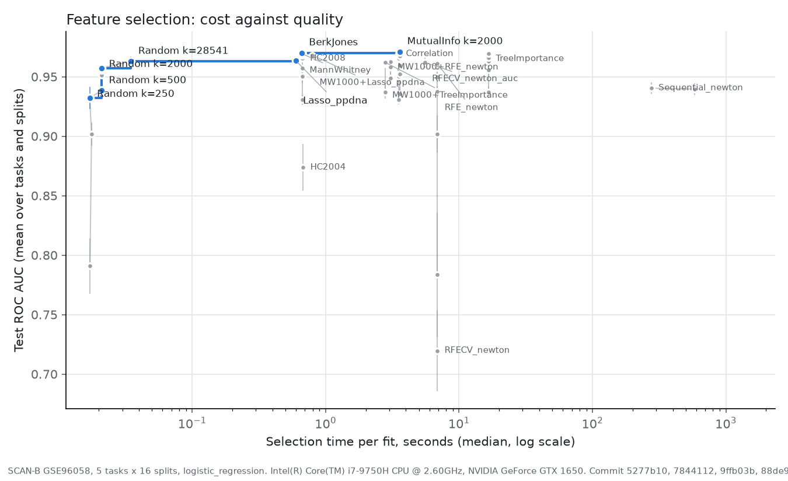

# 7. Results on SCAN-B

[Back to contents](README.md) · Previous: [6. Making it fast](06_making_it_fast.md) · Next: [8. Results on image data](08_results_images.md)

This chapter reports SCAN-B: 2,976 patients, 28,541 genes, five tasks, each
PAM50 subtype against the rest (chapter 2).

Every run follows the protocol of chapter 3: 16 splits, 70% of the patients
in the training set (2,083), 893 in the test set, `k` chosen on validation
sets, ROC AUC on the test set. `k` is 10, 50, 250, 500, 1000, 1500 or 2000.
Random selection also runs at 28,541, every gene. All numbers are means
over the 16 splits.

Random selection is the bar (section 3.4). A method has value at a given
`k` only if it beats random genes at that `k`.

Sources: [`scripts/summarize_frontier.py`](../scripts/summarize_frontier.py)
wrote the `summary_scanb70_*` tables in [`figures/`](figures/):
`_chosen` (each method at its chosen `k`), `_curve` (test AUC at every
`k`), `_bar` (against random at the same `k`) and `_tests` (against all
genes). Configs: `configs/frontier_scanb70_*.yaml`.

## 7.1 What each method reaches

*Each point is one method at one `k`: median selection time per fit, and
mean test AUC over tasks and splits. A point is on the frontier (blue) when
no other point is both faster and better. Per-task plots:
`figures/frontier_scanb70_roc_auc_ovr_<task>.png`. Table:
[`figures/frontier_scanb70_roc_auc.csv`](figures/frontier_scanb70_roc_auc.csv).*

Test AUC at the `k` each method chose on validation sets:

| Method | Basal | Her2 | LumA | LumB | Normal | Mean |
|---|---|---|---|---|---|---|
| Mutual information | 0.992 | 0.984 | 0.960 | 0.970 | **0.948** | **0.971** |
| Berk-Jones | 0.990 | 0.985 | 0.961 | 0.968 | 0.947 | 0.970 |
| HC2008 | 0.990 | 0.985 | 0.961 | 0.969 | 0.946 | 0.970 |
| Correlation (Spearman) | 0.991 | 0.986 | 0.958 | **0.971** | 0.940 | 0.969 |
| Mann-Whitney | 0.991 | **0.986** | 0.958 | 0.971 | 0.939 | 0.969 |
| Tree importance | 0.991 | 0.983 | **0.961** | 0.971 | 0.937 | 0.969 |
| Mann-Whitney 1000, then Lasso | **0.994** | 0.982 | 0.956 | 0.970 | 0.938 | 0.968 |
| Mann-Whitney 1000, then tree importance | 0.993 | 0.984 | 0.951 | 0.971 | 0.927 | 0.965 |
| Lasso | 0.993 | 0.981 | 0.951 | 0.963 | 0.930 | 0.964 |
| All 28,541 genes | 0.987 | 0.981 | 0.958 | 0.948 | 0.941 | 0.963 |
| Mann-Whitney 1000, then RFE | 0.991 | 0.983 | 0.951 | 0.968 | 0.918 | 0.962 |
| RFECV, scored by AUC | 0.991 | 0.979 | 0.959 | 0.949 | 0.931 | 0.962 |
| RFE | 0.993 | 0.980 | 0.956 | 0.947 | 0.928 | 0.961 |
| HC2004 | 0.873 | 0.865 | 0.874 | 0.869 | 0.889 | 0.874 |
| RFECV, scored by accuracy | 0.984 | 0.583 | 0.959 | 0.566 | 0.505 | 0.720 |

Table: [`figures/summary_scanb70_chosen.csv`](figures/summary_scanb70_chosen.csv).

What it shows:

- **The top is flat.** Eleven methods lie within 0.01 of each other in
  mean AUC. No method leads on every task.
- **Most methods chose large `k`.** The filters mostly chose 1,000 to
  2,000 genes, tree importance 1,000 to 1,500. On Basal some splits chose
  10: that task is nearly solved by a few genes.
- **Lasso and the chains keep fewer genes.** Lasso kept 67 to 523, and
  Mann-Whitney then Lasso 9 to 158, at about the same AUC.
- **RFECV scored by accuracy failed on three tasks** (section 7.8).

## 7.2 The bar: random genes at each `k`

Mean test AUC at each `k`, for random genes and for Mann-Whitney:

| Task | Method | 10 | 50 | 250 | 500 | 1000 | 2000 | 28,541 |
|---|---|---|---|---|---|---|---|---|
| Basal | Random | 0.871 | 0.981 | 0.989 | 0.991 | 0.992 | 0.992 | 0.987 |
| | Mann-Whitney | 0.993 | 0.992 | 0.992 | 0.993 | 0.993 | 0.992 | |
| Her2 | Random | 0.790 | 0.902 | 0.938 | 0.963 | 0.973 | 0.978 | 0.981 |
| | Mann-Whitney | 0.941 | 0.972 | 0.981 | 0.983 | 0.985 | 0.986 | |
| LumA | Random | 0.750 | 0.870 | 0.920 | 0.911 | 0.927 | 0.939 | 0.958 |
| | Mann-Whitney | 0.893 | 0.908 | 0.944 | 0.940 | 0.951 | 0.958 | |
| LumB | Random | 0.753 | 0.879 | 0.922 | 0.917 | 0.938 | 0.949 | 0.948 |
| | Mann-Whitney | 0.912 | 0.953 | 0.958 | 0.963 | 0.972 | 0.970 | |
| Normal | Random | 0.790 | 0.877 | 0.891 | 0.909 | 0.927 | 0.930 | 0.941 |
| | Mann-Whitney | 0.914 | 0.925 | 0.910 | 0.906 | 0.927 | 0.940 | |

Every method's curve is in
[`figures/summary_scanb70_curve.csv`](figures/summary_scanb70_curve.csv).

The corrected test (section 3.3) against random at the same `k`. A method
is listed when its gain is established (p < 0.05):

| `k` | Basal | Her2 | LumA | LumB | Normal |
|---|---|---|---|---|---|
| 10 | all, +0.12 | all but RFE, +0.15 to +0.17 | all but RFE, +0.14 to +0.18 | all but RFE, +0.16 to +0.20 | all but RFE, +0.10 to +0.13 |
| 50 | filters, tree importance, one chain, +0.01 | filters, tree, chains, +0.07 | filters, tree, chains, +0.04 to +0.08 | filters, tree, chains, +0.07 to +0.09 | filters, tree, chains, +0.04 to +0.06 |
| 250 | none | filters, tree, chains, +0.04 | filters, tree, chains, +0.02 to +0.03 | filters, tree, chains, +0.04 to +0.05 | none |
| 2000 | none | filters, +0.01 | filters, tree, RFE, +0.02 | filters, tree, +0.02 | mutual information, +0.02 |

"Filters" here are Mann-Whitney, correlation and mutual information;
"tree" is tree importance; "chains" are Mann-Whitney 1000 then tree
importance or RFE (section 7.9). Lasso, HC and Berk-Jones choose their own
count, so they have no curve.
Table: [`figures/summary_scanb70_bar.csv`](figures/summary_scanb70_bar.csv).

What it shows:

- **At 10 genes, selection matters a lot.** Every filter and tree
  importance beat random by 0.12 to 0.19 AUC, on every task.
- **Basal is easy.** Random genes reach 0.98 at 50 genes. After that no
  method beats them.
- **On LumA and LumB the gain lasts.** At 2,000 genes, the filters and
  tree importance still beat random by about 0.02.
- **Random's curve is not smooth.** On LumA it drops from 0.920 at 250 to
  0.911 at 500. Each split draws new random genes, so the curve is noisy.

## 7.3 Selection against all genes

Each method at its chosen `k`, against all 28,541 genes on the same splits:

| Task | Established gains (p < 0.05) | Established losses |
|---|---|---|
| Basal | none | HC2004 |
| Her2 | none | RFECV by accuracy; HC2004 lost 0.116, but p = 0.10 |
| LumA | none | Lasso −0.006, Mann-Whitney 1000 then tree importance −0.007, HC2004 |
| LumB | ten methods, +0.014 to +0.023, each on all 16 splits | HC2004, RFECV by accuracy |
| Normal | none | Mann-Whitney 1000 then RFE −0.023, HC2004, RFECV by accuracy |

Table: [`figures/summary_scanb70_tests.csv`](figures/summary_scanb70_tests.csv).

- **On LumB, selection beats all genes.** Correlation gained 0.023,
  Mann-Whitney 0.023, tree importance 0.022, mutual information 0.022,
  on all 16 splits. RFE and RFECV by AUC did not.
- **On the other four tasks, no gain is established.** On Basal the
  methods gained 0.003 to 0.007 and won 11 to 14 of 16 splits, but the
  corrected test cannot tell this from noise.
- The filters and tree importance never lose to all genes. On one task of
  five they are clearly better.

## 7.4 Stability

Nogueira's measure over the 16 splits, at the chosen `k` (section 3.6),
mean over the five tasks:

| Method | Mean | Range over tasks |
|---|---|---|
| HC2008, Berk-Jones | 0.92 | 0.89 to 0.93 |
| Correlation | 0.78 | 0.56 to 0.91 |
| Mann-Whitney | 0.76 | 0.46 to 0.92 |
| Mutual information | 0.70 | 0.50 to 0.80 |
| HC2004 | 0.67 | 0.45 to 1.00 |
| Mann-Whitney 1000, then tree importance | 0.51 | 0.26 to 0.63 |
| Mann-Whitney 1000, then Lasso | 0.46 | 0.34 to 0.53 |
| Mann-Whitney 1000, then RFE | 0.42 | 0.32 to 0.53 |
| Lasso | 0.36 | 0.31 to 0.45 |
| RFE | 0.33 | 0.28 to 0.44 |
| Tree importance | 0.27 | 0.17 to 0.35 |
| RFECV, by AUC | 0.23 | 0.09 to 0.35 |

The filters are stable; the methods that look at genes together are not.
Tree importance scores as well as Mann-Whitney but picks a different set on
each split. Part of the filters' range comes from `k`: a method whose
chosen `k` varies between splits is less stable. On Basal, Mann-Whitney's
`k` ran from 10 to 2,000, and its stability fell to 0.46.

## 7.5 Higher Criticism and Berk-Jones

HC2008 kept 2,854 or 2,855 genes on every split and task. That is the edge
of its search, 0.1 × 28,541. Berk-Jones kept 2,827 to 2,855, so it stops at
or just before the same edge. The two score alike, 0.970 mean AUC, and are
the most stable methods (0.92).

HC2004 kept one or two genes. It scored 0.874, the lowest of all but RFECV
by accuracy. Its statistic peaks at the single strongest p-value
(section 4.4).

Neither variant found the point where the signal ends. HC2008's score is
still rising at the edge of its search (Appendix C.3): the signal is not
rare. A rule built for rare signal has no edge to find there. Still,
HC2008 as a "top 10%" filter is a good method here: it is 0.001 below
mutual information, the best mean, at a fifth of its time per fit and with
no `k` to choose.

## 7.6 Does selection find the PAM50 genes?

The PAM50 label is computed from 50 known genes. A strong method should rank
them high. [`scripts/pam50_recovery.py`](../scripts/pam50_recovery.py)
measures where the 50 lie in each method's ranking, under the protocol of
chapter 3.

**Pending.** The earlier run of this check used an older protocol (half the
patients in the training set). It is being rerun with 70%, and its results
will go here.

## 7.7 Does the classifier matter?

A side study runs Mann-Whitney and random selection with five classifiers:
logistic regression, linear SVM, random forest, k-nearest neighbours and
shrinkage LDA. It asks how much a separate selection step adds on top of
each classifier's own regularization. It is the evidence for using logistic
regression in every other run.

**Pending.** The study is being rerun on SCAN-B without its 11 flat genes
(config: [`configs/experiment_classifiers.yaml`](../configs/experiment_classifiers.yaml)).
Its results will go here.

## 7.8 RFECV: accuracy against AUC

RFECV chooses its count by an inner cross-validation. Scored by accuracy,
its default, it kept a single gene on every split of Her2, LumB and Normal.
Its AUC there was 0.51 to 0.58, close to chance. These tasks are
imbalanced: Normal is 200 patients against 2,776. Accuracy rewards
predicting the majority class, so one gene scores as well as many.

Scored by AUC, RFECV kept 2,855 to 28,541 genes and reached 0.962 mean
AUC, level with RFE. AUC does not reward the majority class, so it is the
right inner score for imbalanced tasks. It is still slower and no better
than a filter: about 40 s of search per split and 6 s per fit, against
Mann-Whitney's 26 s to choose `k` and 0.67 s per fit.

## 7.9 RFE at small `k`, and two-stage selection

RFE alone is poor at small `k`. At 10 genes, on Basal it beat random by
0.117. On LumA and Normal it lost to random (by 0.084 and 0.162, not
established: p = 0.30 and 0.06). RFE removes 2,854 genes (10% of 28,541)
per round, with a strongly penalized SVM (C = 0.01). A likely reason: the
last 10 genes are what is left after a long chain of removals, and small
changes early in the chain change the end.

A filter first fixes this. Mann-Whitney keeps 1,000 genes; RFE then picks
`k` of them. At 10 genes this chain is the best method on four tasks of
five:

| Method at `k` = 10 | Basal | Her2 | LumA | LumB | Normal |
|---|---|---|---|---|---|
| Random | 0.871 | 0.790 | 0.750 | 0.753 | 0.790 |
| RFE alone | 0.988 | 0.874 | 0.666 | 0.762 | 0.628 |
| Mann-Whitney | **0.993** | 0.941 | 0.893 | 0.912 | 0.914 |
| Mann-Whitney 1000, then RFE | 0.990 | **0.959** | **0.927** | **0.954** | **0.916** |
| Sequential | 0.989 | 0.944 | 0.919 | 0.950 | 0.895 |

At the chosen `k`, in mean AUC over tasks, Mann-Whitney then Lasso beats
Lasso alone by 0.005, and Mann-Whitney then RFE beats RFE alone by 0.002.
Mann-Whitney then tree importance loses 0.004 to tree importance alone.
The chains keep at most 500 genes, by design. Their selection is faster:
6 times for tree importance, 2.3 times for RFE.

## 7.10 Sequential selection

Sequential selection ran at `k` = 5 and 10 only (section 3.11). Its median
time per fit was 276 s at `k` = 5 and 582 s at `k` = 10: the cost grows in
step with `k`. At 10 genes it beat random on every task, and scored above
Mann-Whitney on Her2, LumA and LumB. But Mann-Whitney then RFE scored above
it on all five tasks, in 3 s instead of 10 minutes. Sequential was timed on
one fit, not ten.

## 7.11 Cost

Median selection time per fit, on the laptop of the README:

| Method | Selection, s per fit | Search or validation, s per split |
|---|---|---|
| Random | 0.02 | — |
| Lasso | 0.58 | 10 (choosing C) |
| HC2008, Berk-Jones, HC2004 | 0.66 to 0.68 | none |
| Mann-Whitney | 0.67 | 26 (choosing `k`) |
| Mann-Whitney 1000, then Lasso | 0.78 | 4 |
| Mann-Whitney 1000, then tree importance or RFE | 2.8 to 3.0 | 12 to 16 |
| Correlation, mutual information | 3.5 to 3.6 | 38 to 40 |
| RFECV | 5.8 to 6.9 | 36 to 41 (choosing its count) |
| RFE | 7.1 | 27 |
| Tree importance | 16.6 | 70 |
| Sequential, `k` = 10 | 582 | none |

The GPU methods ran one fit at a time; the CPU methods (tree importance,
RFE, RFECV) ran two workers at once, which slows each a little.

Choosing `k` costs more than one selection: 5 fits on validation sets, and
a classifier for each `k` on each. For a filter, that dominates.

The whole SCAN-B run took about 33 hours: 18 for Sequential, 6 for the GPU
methods, 5 for the CPU methods, 2.4 for the chains, and 1.1 for RFECV by
AUC.

## 7.12 Summary

- On SCAN-B, eleven methods score within 0.01 AUC of each other at their
  chosen `k`. No method leads on every task.
- At 10 genes, selection beats random genes by 0.10 to 0.20 AUC. On Basal
  the gain is gone by 250 genes; on LumA and LumB it lasts to 2,000.
- Against all 28,541 genes, selection gains 0.014 to 0.023 on LumB. On the
  other tasks no gain is established, and the filters and tree importance
  do not lose.
- HC2008 and Berk-Jones stop at the edge of their search, 10% of the genes.
  As a top-10% filter they are among the best, and the most stable.
- For a small gene set, filter first: Mann-Whitney then RFE is the best at
  10 genes on four tasks, and RFE alone is the worst.
- RFECV needs AUC as its inner score on imbalanced tasks. With accuracy it
  keeps one gene.
- HC2008 and Berk-Jones are the best value: 0.970 mean AUC in 0.66 s per
  fit, with no `k` to choose. Mann-Whitney scores 0.969 in the same time
  per fit, plus 26 s to choose `k`. Mutual information, the best mean
  (0.971), takes five times as long per fit.
