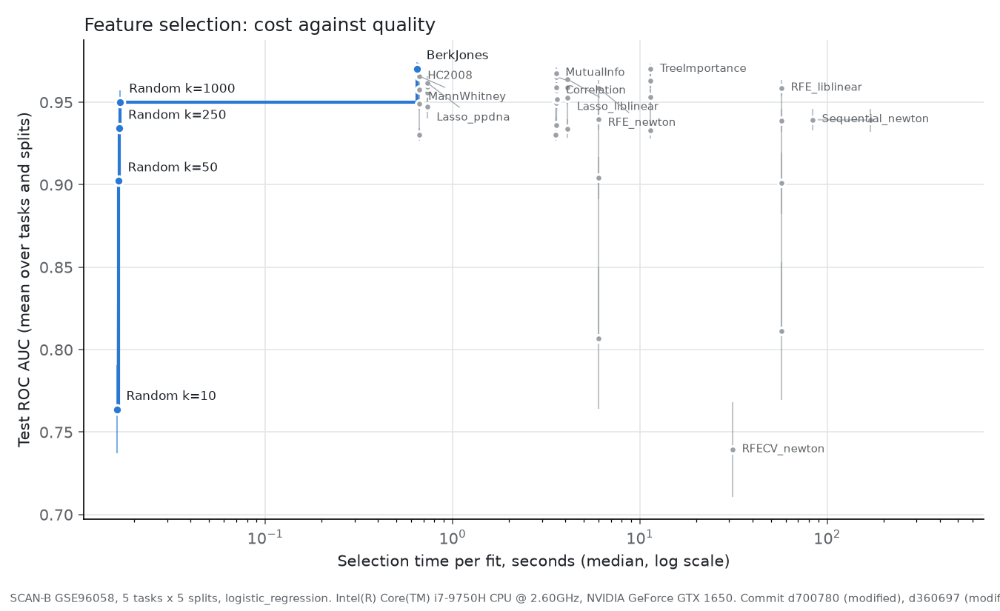
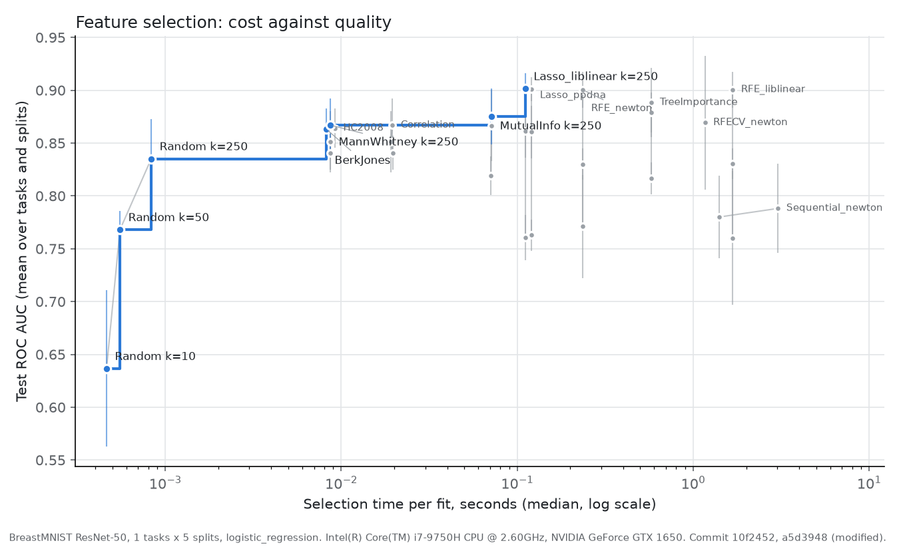
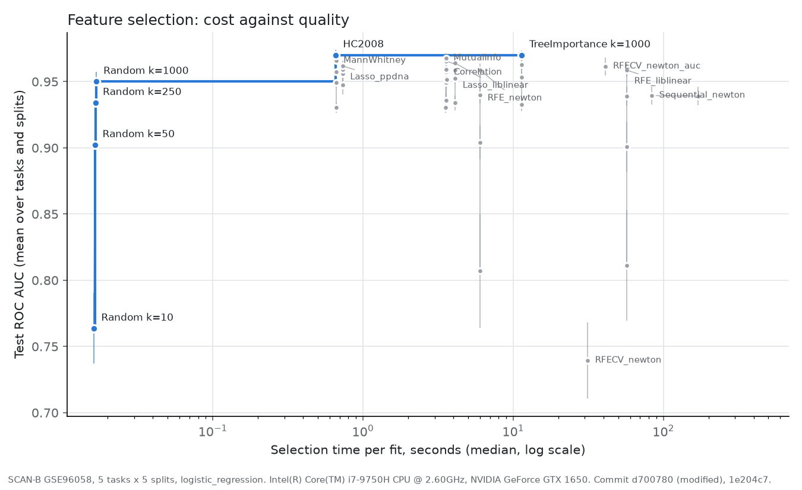
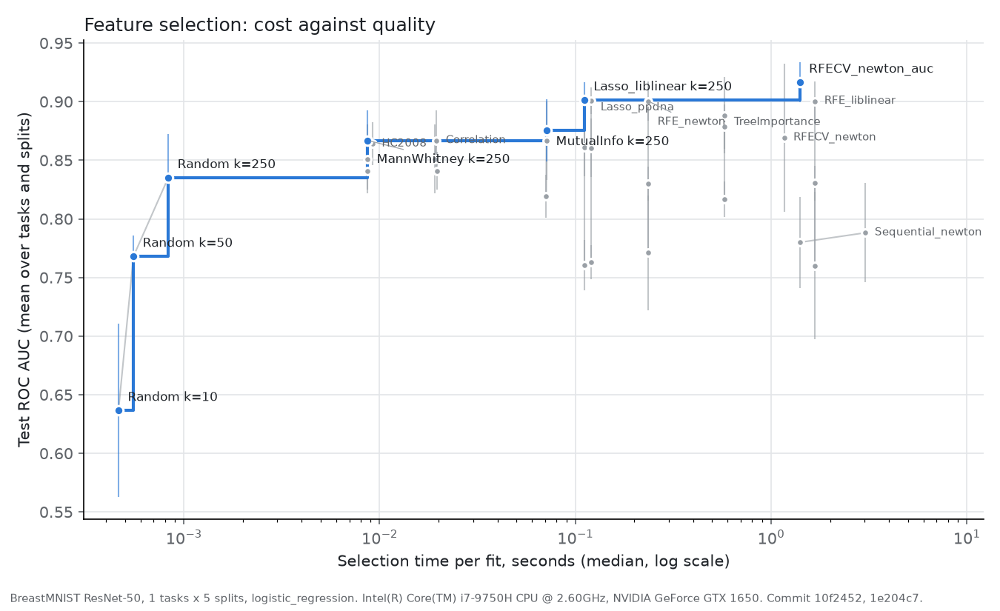

# 8. Results: cost against quality

[Back to contents](README.md) · Previous: [7. Results: quality](07_results_quality.md) · Next: [9. Conclusions](09_conclusions.md)

Chapter 7 asked which method selects best. A practitioner also asks what
each method costs. This chapter puts both on one plot.

## 8.1 What a cost-quality frontier is

Each point on the plot is one method at one `k`. Its x-position is the
selection time per fit, on a log scale. Its y-position is the test ROC
AUC. A point is **on the frontier** when no other point is both faster and
better. The frontier, drawn in blue, is the set of sensible choices. For
any time budget, the best method you can afford is on it. Points off the
frontier (gray) are dominated. Something else is at least as good and
faster.

## 8.2 The experiment

| Setting | Value |
|---|---|
| Datasets | SCAN-B (five tasks) and BreastMNIST (one task) |
| Methods | Random; Mann-Whitney, HC2008, Spearman correlation, mutual information and Lasso (PPDNA) on the GPU; Lasso (liblinear), tree importance (200 trees, 4 threads), RFE (liblinear and Newton), RFECV (Newton) on the CPU; Sequential (Newton) on the GPU. Added later on the same splits: RFECV scored by AUC (section 8.6), Berk-Jones on the GPU, and two-stage chains (section 8.9). |
| `k` | 10, 50, 250, 1000 on SCAN-B; 10, 50, 250 on BreastMNIST; 5 and 10 for Sequential |
| Splits | 5 random splits, 70% of the samples for training |
| Classifier | logistic regression, C = 1 (not tuned, to keep the run short) |
| Score | ROC AUC; macro-F1 and balanced accuracy also recorded |
| Timing | median of 10 fits by fresh selectors (1 fit for Sequential); one fit at a time on the GPU |

A preliminary run of the frontier trained on 50% of the patients. It
let the GPU methods fall back to the CPU when the GPU was busy, so most of
their fits ran on the CPU. Its times are not reported; chapter 7 cites it
once, for RFE's choice of genes.

The GPU methods ran with one worker, so no two fits shared the GPU. The
CPU methods ran with two workers. Every GPU method's fits were recorded as
running on the GPU. Two workers slow each other, so the CPU times are
somewhat inflated. In the preliminary run, liblinear RFE on Basal took
31 s per fit with two workers. Alone, on the same 1,488
training patients, it took 23.1 s. Sequential selection got one fit per
selection, because ten would have taken about 24 hours.

Configs: [`configs/frontier_scanb70_*.yaml`](../configs/),
[`configs/frontier_breastmnist70_*.yaml`](../configs/). Plot script:
[`scripts/plot_frontier.py`](../scripts/plot_frontier.py). Notebook with
all SCAN-B plots: [`notebooks/04_frontier_scanb70.ipynb`](../notebooks/04_frontier_scanb70.ipynb).
The SCAN-B run took about 8 hours. BreastMNIST took about 3 minutes.

## 8.3 SCAN-B, all five tasks

*Figure 8.1. Selection time against test AUC, mean over 5 tasks and 5
splits. Bars: one standard deviation over splits. Table:
[`figures/frontier_scanb70_roc_auc.csv`](figures/frontier_scanb70_roc_auc.csv).*

| Method | Best AUC (its `k`) | Time per fit at that `k` | Device | On frontier |
|---|---|---|---|---|
| Random | 0.950 (1000) | 0.02 s | CPU | yes, every `k` |
| Berk-Jones | **0.970** (2,841 to 2,855 genes) | 0.65 s | GPU | **yes** |
| HC2008 | **0.970** (2,855 genes) | 0.66 s | GPU | no, by 0.0002 |
| Mann-Whitney | 0.966 (1000) | 0.66 s | GPU | no |
| Lasso, PPDNA | 0.962 (1000) | 0.73 s | GPU | no |
| Mutual information | 0.968 (1000) | 3.6 s | GPU | no |
| Spearman correlation | 0.966 (1000) | 3.6 s | GPU | no |
| Lasso, liblinear | 0.964 (1000) | 4.1 s | CPU | no |
| RFE, Newton | 0.959 (1000) | 6.0 s | CPU | no |
| Tree importance | **0.970** (1000) | 11.4 s | CPU | no, by 0.0002 |
| RFECV, Newton | 0.739 (own count) | 31 s | CPU | no |
| RFE, liblinear | 0.959 (1000) | 57 s | CPU | no |
| Sequential, Newton | 0.939 (5) | 84 s | GPU | no |

**What it shows.**

1. **The cheap end is enough.** Berk-Jones, HC2008 and Mann-Whitney reach
   AUC 0.97 in 0.65 to 0.66 s. Nothing slower is clearly better. Tree
   importance ties HC2008 (0.970) but takes 17 times longer. Split by
   split, each wins on some of the five splits. Berk-Jones, added later,
   leads HC2008 by 0.0002 AUC and 0.01 s. That puts it alone on the
   frontier, but the gap is far below the spread over splits (0.004).
2. **The GPU moved five methods into the top-left corner.** Mann-Whitney,
   HC2008, Lasso (PPDNA), mutual information and correlation all run in
   under 4 s, at AUC 0.96 to 0.97. In the comparison of chapter 7,
   Mann-Whitney took about 10 s per fit. A NumPy version with one sort per
   gene brought that to about 3 s on the CPU. The GPU then
   took it below a second. Mutual information took more than a minute
   (chapter 6).
3. **The wrappers lose on both axes.** RFE, RFECV and Sequential take 6 to
   84 s per fit at their best `k`, and Sequential 170 s at k = 10. They
   score below the simple filters. Sequential's 5 or 10 genes
   cannot match 1,000 well-chosen ones.
4. **Random genes come close.** Random k = 1000 reaches 0.950. Once `k` is
   large, almost any genes work, as chapter 7 found.
5. **The top methods are close.** Their best AUCs differ by at most
   0.008. Over splits, the standard deviation is 0.002 to 0.004 for the
   mean over tasks, and 0.002 to 0.017 for a single task. These
   differences are not tested here. With 5 splits, the corrected paired
   test of section 7.3 has only 4 degrees of freedom. With 16 splits, in
   chapter 7, it could not order the top methods either.

**Caution on HC2008 and Berk-Jones.** HC2008 kept 2,855 genes, the edge of
its search, on every task and split, as in chapter 7. Berk-Jones kept
2,841 to 2,855. They lead because they are as fast as Mann-Whitney and use
nearly three times the genes of its largest `k`. It is not a sign that
they chose a better count.

## 8.4 SCAN-B, each task

| Task | Frontier beyond random selection (AUC, time) | Note |
|---|---|---|
| [Basal vs rest](figures/frontier_scanb70_roc_auc_ovr_Basal.png) | Lasso PPDNA k = 250 (0.992, 0.55 s), Mann-Whitney k = 10 (0.993, 0.67 s), mutual information k = 1000 (0.993, 3.7 s), Lasso liblinear k = 250 (0.993, 3.9 s) | The easiest task: almost every method scores 0.99, and random 1,000 genes 0.988. |
| [Her2 vs rest](figures/frontier_scanb70_roc_auc_ovr_Her2.png) | Berk-Jones (0.985, 0.64 s), HC2008 (0.985, 0.66 s) | RFECV collapses to 0.63. |
| [LumA vs rest](figures/frontier_scanb70_roc_auc_ovr_LumA.png) | Berk-Jones (0.960, 0.64 s), tree importance k = 1000 (0.961, 11.4 s) | The only balanced task; RFECV works here (0.960). |
| [LumB vs rest](figures/frontier_scanb70_roc_auc_ovr_LumB.png) | HC2008 (0.970, 0.65 s), Berk-Jones (0.970, 0.65 s), Mann-Whitney k = 1000 (0.974, 0.67 s) | RFECV collapses to 0.64. |
| [Normal vs rest](figures/frontier_scanb70_roc_auc_ovr_Normal.png) | Mann-Whitney k = 1000 (0.929, 0.65 s), Berk-Jones (0.947, 0.66 s) | The hardest task; RFECV at chance (0.50). |

Click a task to see its plot. Each has a table beside it in
[`figures/`](figures/). On every task the frontier above random selection
holds only sub-second GPU methods. The exceptions are tree importance on
LumA and two slower near-ties on Basal.

### Why RFECV failed on three tasks

RFECV chooses its own count by inner 5-fold cross-validation. In the
frontier it kept only 1 or 2 genes on Her2, LumB and Normal. Its AUC there
was 0.50 to 0.64. On LumA it kept 8,567 to 25,697 genes and scored 0.96.
On Basal it kept 2,857 genes on four splits and 2 on one.

Our hypothesis: RFECV's default inner score is accuracy. Take an
imbalanced task with a strong penalty (C = 0.01). There the SVM predicts
"rest" for almost everyone at any gene count. So the accuracy curve is
flat. A flat curve makes the smallest count win the tie. LumA is the only
balanced task, and there RFECV works. Section 8.6 tests this hypothesis.

## 8.5 BreastMNIST

*Figure 8.2. BreastMNIST, 5 splits. Table:
[`figures/frontier_breastmnist70_roc_auc.csv`](figures/frontier_breastmnist70_roc_auc.csv).*

| Method | Best AUC (its `k`) | Time per fit | On frontier |
|---|---|---|---|
| Random | 0.835 (250) | < 0.001 s | yes |
| Berk-Jones | 0.863 (199 to 204) | 0.008 s | yes |
| Mann-Whitney | 0.867 (250) | 0.009 s | yes |
| HC2008 | 0.864 (204) | 0.009 s | no |
| Spearman correlation | 0.867 (250) | 0.02 s | no |
| Mutual information | 0.875 (250) | 0.07 s | yes |
| Lasso, liblinear | **0.902** (250) | 0.11 s | **yes** |
| Lasso, PPDNA | 0.901 (250) | 0.12 s | no |
| RFE, Newton | 0.900 (250) | 0.24 s | no |
| Tree importance | 0.888 (250) | 0.58 s | no |
| RFECV, Newton | 0.869 (own count) | 1.2 s | no |
| RFE, liblinear | 0.900 (250) | 1.7 s | no |
| Sequential, Newton | 0.788 (10) | 3.0 s | no |

- With 2,048 features and 546 training images, every method takes 3 s or
  less. So cost hardly matters here.
- **Lasso is the best choice at k = 250**: 0.90 in 0.11 s. RFECV scored by
  AUC does better. But it picks its own, larger count (section 8.6). At
  k = 250, the methods that see features together (Lasso, RFE, trees)
  beat the one-at-a-time filters by 0.01 to 0.04. Image embedding
  features are weakly correlated with each other. A combination of them
  carries more than the sum of single features.
- At k = 10 the order reverses. Mann-Whitney and correlation reach 0.84,
  tree importance 0.82, and Lasso and RFE 0.76 to 0.77.
- RFECV works on this task (0.87). With its default inner score it kept 8
  to 212 features.
- **Spearman correlation equals Mann-Whitney exactly** at every `k`. With a
  binary label, |Spearman correlation| is the U test's tie-corrected z
  score, up to a constant. The U test also applies a continuity
  correction. With ties, that correction can reorder genes. On all SCAN-B
  patients it changes no top-`k` set at k = 10 to 1000. Yet on SCAN-B the
  two selectors differ slightly at every `k`, most at large `k`. The
  correlation selector has two more steps. It keeps only features with
  |correlation| ≥ 0.1. On SCAN-B that is 8,233 to 14,032 genes per task,
  so it does not bind here. It also drops one gene of each pair
  correlated above 0.95. So the difference comes mainly from that drop.
- The drop step has a flaw. It drops a gene for a partner even when that
  partner was itself dropped. So a gene can be lost although no kept gene
  duplicates it.

## 8.6 RFECV: testing the hypothesis

We refit RFECV on one 70/30 split of four SCAN-B tasks, with three inner
scores. Then we scored logistic regression on the genes it kept:

| Task | Inner score | Genes kept | Test AUC |
|---|---|---|---|
| Normal vs rest | accuracy (default) | 1 | 0.502 |
| | ROC AUC | 5,712 | 0.952 |
| | balanced accuracy | 2,857 | 0.940 |
| Her2 vs rest | accuracy (default) | 2 | 0.727 |
| | ROC AUC | 11,422 | 0.975 |
| | balanced accuracy | 2,857 | 0.975 |
| LumB vs rest | accuracy (default) | 2 | 0.529 |
| | ROC AUC | 5,712 | 0.959 |
| | balanced accuracy | 2,857 | 0.955 |
| Basal vs rest | all three | 2,857 | 0.987 |

**The hypothesis holds.** With accuracy, RFECV collapses to one or two
genes on the imbalanced tasks. With an imbalance-aware score it keeps
thousands of genes and scores like the other methods. On Basal, where the
classes separate easily, all three scores agree.

**The lesson** is general. A wrapper that tunes itself by cross-validation
inherits the weakness of its inner score. Accuracy on an imbalanced task
rewards predicting the majority class. Then the smallest gene set wins the
tie.

Script: [`scripts/rfecv_scoring.py`](../scripts/rfecv_scoring.py).

### The full frontier run with AUC as the inner score

We then reran RFECV with `scoring='roc_auc'` on all five frontier splits of
both datasets, everything else unchanged.

| Task | Default (accuracy): AUC | Inner AUC: AUC | Inner AUC: genes kept (min to max) |
|---|---|---|---|
| Basal vs rest | 0.966 | 0.991 | 2,857 to 19,987 |
| Her2 vs rest | 0.625 | 0.976 | 5,712 to 17,132 |
| LumA vs rest | 0.960 | 0.959 | 8,567 to 28,552 |
| LumB vs rest | 0.641 | 0.951 | 5,712 to 22,842 |
| Normal vs rest | 0.504 | 0.930 | 2,857 to 5,712 |
| **SCAN-B, mean** | 0.739 | **0.961** | |
| **BreastMNIST** | 0.869 | **0.916** | 416 to 1,436 |

*Figure 8.3. SCAN-B frontier with RFECV scored by AUC added. Table:
[`figures/frontier_scanb70_with_rfecv_auc_roc_auc.csv`](figures/frontier_scanb70_with_rfecv_auc_roc_auc.csv).*

*Figure 8.4. BreastMNIST frontier with RFECV scored by AUC added. Table:
[`figures/frontier_breastmnist70_with_rfecv_auc_roc_auc.csv`](figures/frontier_breastmnist70_with_rfecv_auc_roc_auc.csv).*

What the rerun shows:

- **On SCAN-B the collapse is gone**, but RFECV is still not worth its
  cost. It reaches 0.961, below Mann-Whitney at k = 1000 (0.966). It takes
  41 s per fit, against 0.66 s. It also keeps thousands of genes. So it
  does not answer "which few genes matter".
- **On BreastMNIST, RFECV scored by AUC beats every method capped at
  k = 250**: 0.916 in 1.4 s, ahead of Lasso k = 250 (0.902). But it keeps
  416 to 1,436 of the 2,048 features, more than that cap. Section 8.7
  shows that its lead comes from the larger count, not from better
  choices.
- With 5 splits these differences are not tested for significance
  (section 8.3, point 5).

Configs: [`configs/frontier_scanb70_rfecv_auc.yaml`](../configs/frontier_scanb70_rfecv_auc.yaml),
[`configs/frontier_breastmnist70_rfecv_auc.yaml`](../configs/frontier_breastmnist70_rfecv_auc.yaml).
The SCAN-B run took 85 minutes. BreastMNIST took 41 seconds.

## 8.7 Is selection needed at all?

A classifier can also be trained on every feature. This section compares
that baseline with the selected sets, on the same splits.

### SCAN-B

Logistic regression on all 28,552 genes, against the best selected set on
each task (sections 8.3 and 8.4):

| Task | All genes | Best selected set |
|---|---|---|
| Basal vs rest | 0.988 | 0.993 (Lasso liblinear, k = 250) |
| Her2 vs rest | 0.979 | 0.985 (HC2008) |
| LumA vs rest | 0.959 | 0.961 (tree importance, k = 1000) |
| LumB vs rest | 0.950 | 0.974 (Mann-Whitney, k = 1000) |
| Normal vs rest | 0.947 | 0.947 (HC2008) |
| **Mean** | **0.964** | **0.970** (HC2008; tree importance, k = 1000) |

Mean test AUC over 5 splits. Table:
[`figures/frontier_scanb70_all_genes.csv`](figures/frontier_scanb70_all_genes.csv).
Config: [`configs/frontier_scanb70_all_genes.yaml`](../configs/frontier_scanb70_all_genes.yaml).

On gene expression, selection helps a little. The two best methods on
average, HC2008 and tree importance at k = 1000, beat all 28,552 genes by
0.006. On LumB the best set beats them by 0.025. On Normal they tie.
Mann-Whitney k = 1000 (0.966) only matches all genes. The gain is about
one and a half standard deviations over splits. It is not tested for
significance. The larger gain is size: a model on 1,000 genes instead of
28,552, at no loss.

### BreastMNIST at larger `k`

To test where RFECV's lead came from, we reran BreastMNIST on the same
five splits at k = 500 and 1,000. We also ran it with all 2,048 features.
This is random selection of every feature, that is, no selection.

| Method | k = 250 | k = 500 | k = 1000 | Time per fit |
|---|---|---|---|---|
| Random | 0.835 | 0.870 | 0.914 | < 0.001 s |
| Mann-Whitney | 0.867 | 0.891 | 0.912 | 0.01 s |
| Lasso, liblinear | 0.902 | 0.902 (keeps 207 to 239) | the same | 0.06 to 0.11 s |
| Tree importance | 0.888 | 0.905 | 0.904 | 0.5 s |
| RFE, Newton | 0.900 | 0.912 | 0.919 | 0.16 to 0.24 s |
| RFECV, scored by AUC | | | 0.916 (own count, 416 to 1,436) | 1.4 s |
| **All 2,048 features** | | | **0.921** | none |

Mean test AUC over 5 splits. The k = 250 column is from section 8.5. Times
differ slightly between the two runs. Table:
[`figures/frontier_breastmnist70_large_k.csv`](figures/frontier_breastmnist70_large_k.csv).
Config: [`configs/frontier_breastmnist70_large_k.yaml`](../configs/frontier_breastmnist70_large_k.yaml).

What it shows:

- **No selection is best for AUC on BreastMNIST.** All 2,048 features give
  0.921. Random 1,000 features already reach 0.914. RFECV's 0.916 is not a
  better choice of features. Its score is close to that of keeping them
  all.
- **Selection pays only when few features are allowed.** At k = 10 to 250
  the methods beat random clearly (section 8.5). By k = 1000 they do not.
  This is the same pattern as on SCAN-B (chapter 7).
- **Lasso stops at its own count.** With C = 1 its model keeps only 207 to
  239 non-zero coefficients. So a larger `k` changes nothing.
- These differences are within one or two standard deviations over 5
  splits (0.01 to 0.03). They are not tested for significance.

### BreastMNIST without the copied images

The main methods and all features ran again on the 585 images left
without copies (section 2.2): 5 splits, 70% training, as above. The
images differ, so the splits do not pair with the runs above.

| Method | k = 10 | k = 250 | Own count | All 2,048 features |
|---|---|---|---|---|
| Random | 0.616 (−0.021) | 0.809 (−0.026) | | **0.893** (−0.028) |
| Mann-Whitney | 0.827 (−0.013) | 0.854 (−0.013) | | |
| Lasso, liblinear | 0.801 (+0.041) | 0.883 (−0.018) | | |
| Tree importance | 0.824 (+0.007) | 0.850 (−0.039) | | |
| RFE, Newton | 0.758 (−0.013) | 0.882 (−0.019) | | |
| HC2008 | | | 0.849 (−0.016) | |
| Berk-Jones | | | 0.850 (−0.014) | |

Mean test AUC over 5 splits; in brackets, the change from the run with
the copies. Config:
[`configs/frontier_breastmnist70_nocopies.yaml`](../configs/frontier_breastmnist70_nocopies.yaml).

- **AUC fell by about 0.01 to 0.03 for most cells.** All features fell by
  0.028. The change mixes the leak from the copies with a change in the
  task: fewer images, differently balanced. Each change is within one or
  two standard deviations over the splits.
- **The conclusions hold.** All features still score best. Selection still
  beats random clearly at k = 10 and by less at k = 250.

## 8.8 An unseen dataset: FGVC-Aircraft

The pipeline was designed on SCAN-B and BreastMNIST. To test it on data
it was not built for, we added a third dataset after the design was fixed.
Nothing in the `featsel` package changed. The dataset needed a loader
folder and one config.

**The data.** FGVC-Aircraft (Maji et al. 2013) holds 10,000 aircraft
photos, 100 per model variant. The task is binary: Boeing 737 (800 photos)
against the Airbus A320 family (400 photos). Both are narrow-body airliners
that look alike. Each photo becomes 2,048 features from an ImageNet
ResNet-50 without its last layer, as for BreastMNIST. No two photos are
copies: no two photos' difference hashes differ by 4 bits or fewer, the
closest pairs show different aircraft, and the most similar pair of
embeddings has cosine similarity 0.86. The photos are licensed for
non-commercial research only.

**The weights mattered.** BreastMNIST used torchvision's `IMAGENET1K_V2`
weights. Here they made 80% of the features exactly zero, and all features
reached AUC 0.749. The `IMAGENET1K_V1` weights gave 0.1% zeros and 0.863
(one check: five splits, C = 0.01). So this dataset uses V1.

**The experiment.** 10 random splits, 70% of the photos for training,
logistic regression with C = 1, ROC AUC. `k` = 10, 50, 250 and 500, and
all 2,048 features. Every selector ran with `device='cuda'`; only the
random control, which reads no data, ran on the CPU. The 290 executions
took 5 minutes.

| Method | k = 10 | k = 500 | Own count | Time per fit |
|---|---|---|---|---|
| Random | 0.608 | 0.819 | | 0.001 s |
| Mann-Whitney | 0.726 | 0.836 | | 0.017 s |
| Spearman correlation | 0.726 | 0.829 (keeps 385 to 452) | | 0.025 s |
| Mutual information | 0.712 | 0.829 | | 0.10 s |
| Lasso, PPDNA | 0.721 | 0.848 (keeps 295 to 329) | | 0.21 s |
| RFE, Newton | 0.712 | **0.857** | | 0.34 s |
| HC2008 | | | 0.815 (204) | 0.014 s |
| RFECV, scored by AUC | | | **0.859** (620 to 1,844) | 2.0 s |
| Sequential, Newton | 0.698 (also 0.698 at k = 5) | | | 3.5 s (1.7 s at k = 5) |
| **All 2,048 features** | | | **0.864** | none |

Mean test AUC over 10 splits; time is the median per fit, on the GPU. Config:
[`configs/aircraft70_gpu.yaml`](../configs/aircraft70_gpu.yaml). Results:
[`results/aircraft70_gpu.csv`](../results/aircraft70_gpu.csv). Notebook:
[`featsel_datasets/fgvc_aircraft/demos/research.ipynb`](../featsel_datasets/fgvc_aircraft/demos/research.ipynb).

What it shows:

- **The pattern of the other two datasets holds.** At k = 10 every method
  beats random on all 10 splits, by 0.09 to 0.12 AUC. The gain shrinks as
  `k` grows.
- **Methods that see features together lead at larger `k`.** At k = 500,
  RFE and Lasso beat random on every split; the one-at-a-time filters on 7
  or 8 of 10. As on BreastMNIST, the signal is many weak features: the best
  single feature reaches only AUC 0.690.
- **No selection is best for AUC**, as on BreastMNIST. RFE at k = 500 comes
  within 0.007 of all features with a quarter of them.
- **HC2008 stops at the edge of its search again**: 204 features, 0.1 ×
  2,048, on every split.
- **The filters are the most stable.** Mann-Whitney and correlation reach
  Kuncheva indices of 0.66 to 0.76; Lasso, mutual information and RFE 0.15
  to 0.33; Sequential 0.07.
- **The embedding mattered more than the selector.** Changing the weights
  moved AUC by 0.11. No selector moved it by a tenth of that at k = 500.

## 8.9 Summary

- On SCAN-B, sub-second GPU filters (Mann-Whitney, HC2008) give the best
  AUC for their cost. A 200-tree forest ties them at 17 times the cost.
- On BreastMNIST every method is cheap. Lasso is best at k = 250. With no
  limit on the count, using all 2,048 features is best. Selection there
  buys a smaller model, not a better one.
- On SCAN-B, the best selected sets beat all 28,552 genes by 0.006 AUC on
  average (0.025 on LumB), with a model a tenth the size or less.
- Wrappers cost the most. On SCAN-B they also scored below the filters. On
  BreastMNIST, RFE scored close to Lasso at k = 250 (0.900 against 0.902).
- On FGVC-Aircraft, an unseen dataset, the pipeline ran unchanged and
  entirely on the GPU, and the same pattern held: a clear gain over random
  at small `k`, and all features best for AUC.
- RFECV with its default inner score fails on imbalanced tasks. Scored by
  AUC, it recovers on SCAN-B (0.961) but stays slow. On BreastMNIST it
  keeps 416 to 1,436 of the 2,048 features and scores close to using them
  all.
