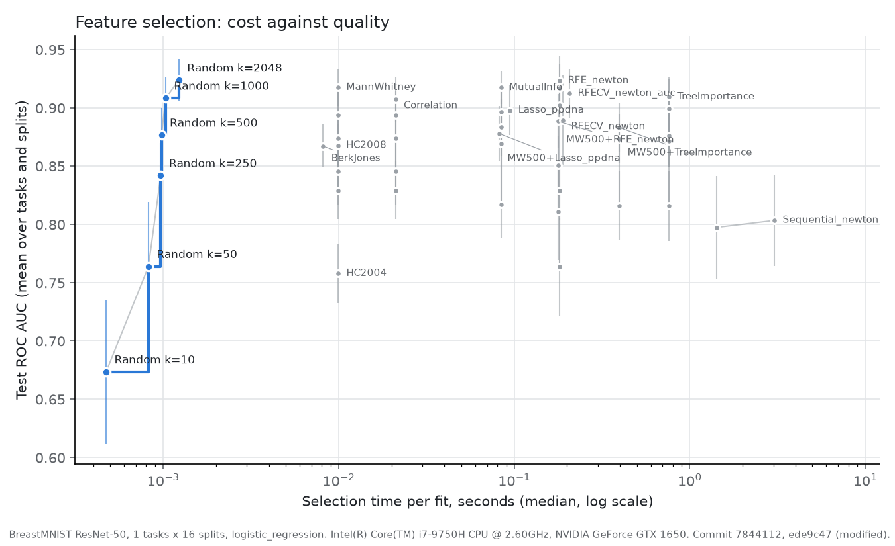
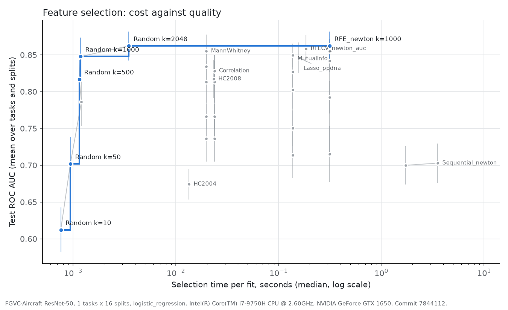

# 8. Results on image data: BreastMNIST and FGVC-Aircraft

[Back to contents](README.md) · Previous: [7. Results: SCAN-B](07_results_quality.md) · Next: [9. Conclusions](09_conclusions.md)

This chapter reports the two image datasets. Each image is a ResNet-50
embedding of 2,048 features (chapter 2). BreastMNIST is task 4. FGVC-Aircraft
is a dataset the pipeline never saw during its design.

Every run follows the protocol of chapter 3: 16 splits, 70% of the images
in the training set, `k` chosen on validation sets, ROC AUC on the test set.
`k` is 10, 50, 250, 500 or 1000; random selection also runs at 2,048, every
feature. All numbers are means over the 16 splits.

Random selection is the bar (section 3.4). A method has value at a given
`k` only if it beats random features at that `k`. Random's curve ends at
2,048, the all-features reference.

Sources: [`scripts/summarize_frontier.py`](../scripts/summarize_frontier.py)
wrote the `summary_*` tables in [`figures/`](figures/), and
[`scripts/paired_tests.py`](../scripts/paired_tests.py) the `paired_tests_*`
tables. Configs: `configs/frontier_breastmnist70_*.yaml` and
[`configs/aircraft70_gpu.yaml`](../configs/aircraft70_gpu.yaml).

## 8.1 BreastMNIST: what each method reaches

780 images, 546 in the training set and 234 in the test set. Malignant 210,
benign or normal 570.

*Each point is one method at one `k`: median selection time per fit, and
mean test AUC with one standard deviation over the splits. Table:
[`figures/frontier_breastmnist70_roc_auc.csv`](figures/frontier_breastmnist70_roc_auc.csv).*

Each method at the `k` it chose on validation sets:

| Method | Test AUC [Q1, Q3] | Features kept | Selection, s per fit | Search, s |
|---|---|---|---|---|
| All features | **0.924** [0.912, 0.936] | 2,048 | none | none |
| RFE | **0.923** [0.906, 0.938] | 1,000 | 0.18 | 0.9 |
| Mann-Whitney | 0.918 [0.906, 0.924] | 1,000 | 0.010 | 0.5 |
| Mutual information | 0.916 [0.908, 0.925] | 500 to 1,000 | 0.084 | 0.8 |
| RFECV, scored by AUC | 0.912 [0.898, 0.926] | 212 to 1,844 | 0.21 | 1.6 |
| Tree importance | 0.906 [0.895, 0.921] | 500 to 1,000 | 0.76 | 3.6 |
| Correlation (Spearman) | 0.905 [0.893, 0.915] | 500 to 742 | 0.021 | 0.5 |
| Lasso | 0.898 [0.880, 0.917] | 101 to 239 | 0.095 | 2.1 |
| RFECV, scored by accuracy | 0.889 [0.881, 0.905] | 8 to 212 | 0.19 | 1.1 |
| HC2008 | 0.868 [0.859, 0.884] | 204 | 0.010 | none |
| Berk-Jones | 0.867 [0.857, 0.884] | 189 to 204 | 0.008 | none |
| Sequential, `k` = 10 | 0.803 | 10 | 3.0 | none |
| HC2004 | 0.758 [0.739, 0.777] | 1 to 3 | 0.010 | none |

Search is the time to choose `k` on validation sets, or Lasso's C and
RFECV's count. Sequential does not choose `k` (section 3.11). At `k` = 5 it
scored 0.798. Table:
[`figures/summary_breastmnist70_chosen.csv`](figures/summary_breastmnist70_chosen.csv).

What it shows:

- **Every method chose the largest `k` it was offered, or close to it.**
  Validation AUC kept rising with `k`.
- **No method beat all features.** RFE came closest, 0.0007 below.
- **The GPU filters are the cheap choice.** Mann-Whitney reached 0.918 in
  0.010 s per fit. RFE gained 0.006 more for 18 times the time.
- **Correlation equals Mann-Whitney up to `k` = 500.** Spearman correlation
  with a binary label ranks features as the U test does. At `k` = 1000 it
  kept only about 700: its redundancy filter dropped the rest.

## 8.2 The bar: random features at each `k`

At small `k`, selection matters. At large `k`, random features catch up.
Mean test AUC at each `k`; random at 2,048 is all features, 0.924:

| Method | 10 | 50 | 250 | 500 | 1000 |
|---|---|---|---|---|---|
| Random | 0.674 | 0.764 | 0.842 | 0.877 | 0.908 |
| Mann-Whitney | 0.829 | 0.846 | 0.874 | 0.894 | 0.918 |
| Mutual information | 0.817 | 0.869 | 0.884 | 0.897 | 0.918 |
| Tree importance | 0.816 | 0.872 | 0.876 | 0.900 | 0.910 |
| RFE | 0.764 | 0.829 | 0.902 | 0.917 | 0.923 |

The corrected test (section 3.3) against random at the same `k`:

| `k` | Established gains (p < 0.05) |
|---|---|
| 10 | Mann-Whitney +0.156, mutual information +0.144, tree importance +0.142 |
| 50 | Mutual information +0.105, tree importance +0.108 |
| 250 | RFE +0.060 |
| 500 | RFE +0.040 |
| 1000 | none |

Every method won all 16 splits against random at `k` = 10 except RFE (14
of 16). At `k` = 1000 no gain is established. Table:
[`figures/paired_tests_breastmnist70.csv`](figures/paired_tests_breastmnist70.csv).

The order between methods turns with `k`. At `k` = 10 the filters beat RFE
(Mann-Whitney by 0.066, p = 0.04). From `k` = 250 on, RFE beats the
filters (Mann-Whitney by 0.029 at 250, p = 0.049; by 0.023 at 500,
p = 0.006). A filter scores each feature alone. RFE removes features while
it looks at all of them together, and that pays only once many are kept.

## 8.3 Selection against all features

Each method at its chosen `k`, against all 2,048 features, on the same
splits:

| Method | AUC difference [95% interval] | p | Splits won |
|---|---|---|---|
| RFE | −0.001 [−0.008, 0.007] | 0.85 | 7 of 16 |
| Mann-Whitney | −0.006 [−0.018, 0.005] | 0.26 | 3 |
| Mutual information | −0.008 [−0.029, 0.014] | 0.47 | 6 |
| RFECV, by AUC | −0.012 [−0.033, 0.010] | 0.28 | 3 |
| Tree importance | −0.018 [−0.041, 0.006] | 0.12 | 1 |
| Correlation | −0.019 [−0.035, −0.003] | 0.03 | 1 |
| Lasso | −0.026 [−0.047, −0.005] | 0.02 | 0 |
| HC2008 | −0.056 [−0.083, −0.029] | < 0.001 | 0 |
| Berk-Jones | −0.057 [−0.083, −0.030] | < 0.001 | 0 |
| HC2004 | −0.166 [−0.208, −0.124] | < 0.001 | 0 |

Table: [`figures/summary_breastmnist70_tests.csv`](figures/summary_breastmnist70_tests.csv).

The best methods tie all features. Lasso, correlation and the methods that
choose their own count lose. On these embeddings, selection buys a smaller
model, not a better one. A model on 1,000 features scores the same as one
on 2,048.

## 8.4 Stability

Nogueira's measure over the 16 splits, at the chosen `k` (section 3.6):

| Method | Stability |
|---|---|
| HC2008, Berk-Jones | 0.76 |
| Correlation | 0.71 |
| Mann-Whitney | 0.69 |
| HC2004 | 0.60 |
| Lasso | 0.34 |
| Tree importance | 0.32 |
| RFECV, by accuracy | 0.31 |
| RFE | 0.30 |
| Mutual information | 0.22 |
| RFECV, by AUC | 0.19 |

The filters that score each feature alone are the most stable. The methods
that look at features together pick a different set on each split, at the
same AUC. So many different sets serve equally well.

## 8.5 Higher Criticism and Berk-Jones

HC2008 kept 204 features on every split. That is the edge of its search,
0.1 × 2,048. Berk-Jones kept 189 to 204, so it behaves like HC2008, with
the same AUC and stability. Both lose to Mann-Whitney at 250 features by
about 0.006, and to all features by 0.056.

HC2004 kept 1 to 3 features. It scored 0.758, the lowest of all. Its
statistic peaks at the single strongest p-value (section 4.4).

Neither variant found the point where the signal ends. The signal is
spread wide: 24% to 28% of the dimensions pass the Benjamini-Hochberg test
(chapter 2). A rule built for rare signal has no edge to find there.

## 8.6 RFECV: accuracy against AUC

RFECV chooses its count by an inner cross-validation. Scored by accuracy,
its default, it kept 8 to 212 features and reached 0.889. Scored by AUC, it
kept 212 to 1,844 and reached 0.912. Accuracy rewards the majority class
and stops early; AUC does not. On these data, AUC is the better inner
score.

## 8.7 Two-stage selection

Mann-Whitney first keeps 500 features on the GPU. A slower method then
picks `k` of them, for `k` up to 250.

| Chain | Test AUC | Single method at its own chosen `k` |
|---|---|---|
| Mann-Whitney 500, then RFE | 0.889 | RFE 0.923 |
| Mann-Whitney 500, then tree importance | 0.879 | tree importance 0.906 |
| Mann-Whitney 500, then Lasso | 0.878 | Lasso 0.898 |

Every chain lost to all features (p < 0.004). Every chain also lost to its
second method run alone. The chains save little time here: every method
already runs in under a second on 2,048 features. The cap of 250 also
matters, since every method preferred larger `k`.

## 8.8 Without the copied images

BreastMNIST holds 150 groups of copied images (section 2.2). Without them,
585 images remain. The same protocol gives:

| Method | Test AUC | Features kept | Against all features (p) |
|---|---|---|---|
| All features | **0.895** | 2,048 | — |
| RFE | 0.891 | 500 to 1,000 | −0.003 (0.59) |
| Tree importance | 0.885 | 500 to 1,000 | −0.009 (0.30) |
| Mann-Whitney | 0.883 | 500 to 1,000 | −0.012 (0.09) |
| Lasso | 0.882 | 73 to 182 | −0.013 (0.28) |
| HC2008 | 0.848 | 204 | −0.047 (0.02) |
| Berk-Jones | 0.847 | 175 to 204 | −0.048 (0.02) |
| HC2004 | 0.772 | 1 to 2 | −0.123 (< 0.001) |

Without the copies, all features and the best
methods lost about 0.03 AUC; Lasso lost 0.016, and HC2004 gained 0.014.
The order changed little: tree importance moved above Mann-Whitney. So the
copies inflate the scores but do not change the conclusions. Table:
[`figures/summary_breastmnist70_nocopies_chosen.csv`](figures/summary_breastmnist70_nocopies_chosen.csv).

## 8.9 An unseen dataset: FGVC-Aircraft

1,200 photos, Boeing 737 against the Airbus A320 family (800 against 400).
840 in the training set, 360 in the test set. Every selector ran on the GPU.

| Method | Test AUC | Features kept | Against all features: difference (p) |
|---|---|---|---|
| All features | **0.862** | 2,048 | — |
| RFE | **0.862** | 500 to 1,000 | −0.000 (0.92) |
| RFECV, by AUC | 0.858 | 620 to 2,048 | −0.004 (0.36) |
| Mann-Whitney | 0.855 | 500 to 1,000 | −0.008 (0.34) |
| Mutual information | 0.847 | 500 to 1,000 | −0.015 (0.13) |
| Lasso | 0.846 | 132 to 336 | −0.016 (0.03) |
| Correlation | 0.824 | 250 to 465 | −0.038 (0.009) |
| HC2008 | 0.817 | 204 | −0.045 (< 0.001) |
| Sequential, `k` = 10 | 0.703 | 10 | — |
| HC2004 | 0.674 | 1 to 2 | −0.188 (< 0.001) |

Tables:
[`figures/summary_aircraft70_chosen.csv`](figures/summary_aircraft70_chosen.csv),
[`figures/summary_aircraft70_tests.csv`](figures/summary_aircraft70_tests.csv),
[`figures/paired_tests_aircraft70.csv`](figures/paired_tests_aircraft70.csv).

The pattern of BreastMNIST holds:

- All features score best; RFE ties them.
- At small `k`, selection beats random clearly: at `k` = 10, Mann-Whitney
  by 0.124 and RFE by 0.103, on all 16 splits.
- From `k` = 250, RFE leads the filters (by 0.029 over Mann-Whitney at
  250, p = 0.047).
- Correlation's redundancy filter costs AUC: it kept at most 465 features
  and lost 0.038.
- HC2008 stops at the edge of its search; HC2004 keeps one or two features.

## 8.10 Summary

- On both image datasets, no selection method beats all 2,048 features.
  RFE ties them; Mann-Whitney and mutual information come within 0.01.
- Selection helps at small budgets: at `k` = 10 it gains 0.10 to 0.16 AUC
  over random features.
- Filters lead at small `k`; RFE leads from `k` = 250.
- Every method chose the largest `k` it could. Methods that cap themselves
  lower (Lasso, Higher Criticism, Berk-Jones, chains) lose AUC.
- Filters are the most stable; RFE, mutual information and RFECV pick
  different features on each split at the same AUC.
- Every method runs in under a second per fit, except Sequential (1.4 to
  3.5 s). On these data, cost does not decide the choice.
