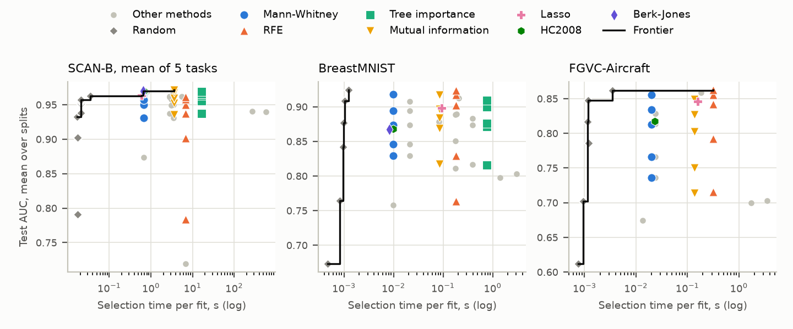
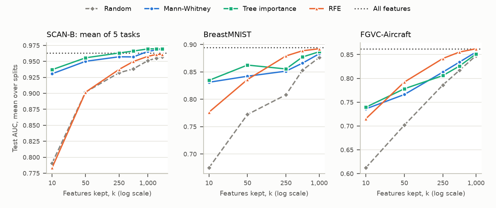

# Choosing Few Genes from Many: Feature Selection for High-Dimensional Data

OUTLINE, not the report text. Each section gives its page budget and the
claims it keeps. "D" means the detailed report
([`detailed_report/`](../detailed_report/README.md)); "D 7.2" is its
section 7.2. Every number in the report comes from a file named in D.

Budget: 18 pages, appendices included. About 8,000 words, 2 figures,
1 results table, a few short tables.

---

## Summary (1 page)

- The question: for a budget of `k` features, which selection method gives
  the best classifier, and by how much does it beat `k` random features?
  (D 1.4)
- What was built: `featsel`, 16 selectors that drop into scikit-learn,
  and a runner driven by one config file (D 9.1).
- The data: SCAN-B gene expression (2,976 patients, 28,541 genes, five
  PAM50 tasks), BreastMNIST embeddings, and FGVC-Aircraft embeddings,
  unseen during the design (D 2.4).
- The answer: at 10 features, selection beats random by 0.10 to 0.20 AUC.
  At the chosen `k`, the top methods cannot be told apart. Mann-Whitney is
  within 0.01 of the best on all three datasets, in under a second on a
  GPU (D 9.3 items 4, 7, 8).
- Selection rarely beats all the features: never on the image data, on
  one SCAN-B task of five (D 9.3 item 16).
- Speed: the GPU filters run 2.6 to 49 times faster (D 6.2).

## 1. Introduction (1.5 pages)

- The p ≫ n problem, in four sentences: overfitting, false discoveries,
  correlated features, cost (D 1.2).
- The four tasks of the specification (D 1.3).
- The main question and the cost question (D 1.4).
- Four known pitfalls and the answer to each, as a table (D 1.6).
- What this project adds: five items (D 1.7).

## 2. Data (1.5 pages)

- One table: the three datasets, their samples, features, tasks, label
  source and signal (D 2.4).
- SCAN-B choices, in one table: HiSeq only; one sample per patient,
  because 93 patients appear twice and would leak; flat genes dropped
  (D 2.1).
- Only the order of a gene's values means something, and about half the
  values sit at a floor. So genes are scored by the U test (D 2.1, D 4.3).
- PAM50 is computed from 50 known genes. Prediction partly re-learns a
  published classifier, and the right genes are known (D 2.1).
- Five binary tasks, one per subtype, with their class sizes (D 2.1).
- The signal is widespread and correlated: more than 10% of genes carry
  it (D 2.1).
- BreastMNIST: 150 groups of copied images, found by the loader (D 2.2).
- FGVC-Aircraft: ResNet-50 V1 weights, not V2: AUC 0.862 against 0.742
  (D 2.3, `results/aircraft_weights.csv`).

## 3. Protocol (1.5 pages)

- One table: splits, main score, control, choice of `k`, classifier,
  timing (D 3 intro).
- Selection inside each split. On pure noise, selection on all the data
  gave AUC 0.96 instead of 0.5 (D 3.2).
- 16 stratified Monte Carlo splits, not k-fold; why 16 is enough (D 3.3).
- The random control at every `k` (D 3.4).
- ROC AUC as the main score; why not accuracy (D 3.5).
- The corrected resampled t-test for overlapping splits (D 3.3).
- Stability by Nogueira's measure (D 3.6).
- `k` chosen on validation sets inside the training set (D 3.11).

## 4. Methods (2 pages)

- The three families, as a table (D 4.1).
- The 16 methods: one table, method, family and idea (D 4.2).
- Why the U test, not the F-test (D 4.3).
- Higher Criticism: the idea; our one change, i/(N+1); search kept at
  10%, so as not to tune to the answer (D 4.4).
- Berk-Jones: a test used here as a selector (D 4.5).
- Which methods the experiments ran (D 4.6).

## 5. Software and speed (2 pages)

- Two deliverables: drop-in selectors and a config-driven runner. One
  diagram (D 5.1).
- The selector contract: a scikit-learn estimator; tested to pick the
  same features as scikit-learn, and to be at most 5% slower (D 5.2, 5.6).
- The runner: rank once, cut every `k`; memory safety and resume, in one
  paragraph (D 5.4, 5.5).
- The runner against plain scikit-learn: 3.2 to 5.3 times faster, with
  identical scores. Measured before liblinear was dropped (D 6.1).
- Parallel work gains at most 1.8 times on this laptop; memory bandwidth
  is the likely limit (D 6.1).
- Each method, faster: one short table, GPU speed-ups (D 6.2).
- Exact solvers: liblinear stops before the solution. RFE became 8 times
  faster and repeatable, at the same AUC (D 6.2).
- Why the GPU does not always win: 64-bit speed, copying, 4 GB (D 6.2).

## 6. Results

Every result follows the protocol of section 3: 16 splits, 70% of the
samples in the training set, `k` chosen on validation sets, and ROC AUC on
the test set, as a mean over the splits. A difference is called
*established* when the corrected test gives p < 0.05. The detailed report
gives every task, every `k` and every test (D 7, D 8, D C).

*Figure 1. Cost against quality. Each point is one method at one `k`:
its median selection time per fit and its mean test AUC. The dark line is
the frontier: no point is both faster and better than a point on it.
SCAN-B is the mean of its five tasks. Sources: D 7.1, 8.1, 8.9.*

*Figure 2. Test AUC against the number of features kept, for one method
of each family and for random features. The gap to the gray dashed line
is what selection adds at that `k`. The dotted line is all the features.
Sources: D 7.2, 8.2.*

*Table 1. Each method at the `k` it chose on validation sets. SCAN-B
values are means over its five tasks; the time is the mean of each task's
median time per fit. Tree importance, RFE and RFECV ran on the CPU, also
as the second step of a chain; every other method ran on the GPU. "—":
not run on that dataset. Source: `figures/table1.csv`.*

| Method | SCAN-B AUC | BreastMNIST AUC | FGVC-Aircraft AUC | SCAN-B selection, s per fit | SCAN-B stability |
|---|---|---|---|---|---|
| Mutual information | 0.971 | 0.916 | 0.847 | 3.6 | 0.70 |
| Berk-Jones | 0.970 | 0.867 | — | 0.66 | 0.92 |
| HC2008 | 0.970 | 0.868 | 0.817 | 0.68 | 0.92 |
| Correlation (Spearman) | 0.969 | 0.905 | 0.824 | 3.6 | 0.78 |
| Mann-Whitney | 0.969 | 0.918 | 0.854 | 0.67 | 0.76 |
| Tree importance | 0.969 | 0.906 | — | 17 | 0.27 |
| Mann-Whitney, then Lasso | 0.968 | 0.878 | — | 0.79 | 0.46 |
| Mann-Whitney, then tree importance | 0.965 | 0.879 | — | 2.8 | 0.51 |
| Lasso | 0.964 | 0.898 | 0.846 | 0.59 | 0.36 |
| All features (no selection) | 0.963 | 0.924 | 0.862 | — | — |
| Mann-Whitney, then RFE | 0.962 | 0.889 | — | 3.0 | 0.42 |
| RFECV, scored by AUC | 0.962 | 0.912 | 0.858 | 5.7 | 0.23 |
| RFE | 0.961 | 0.923 | 0.862 | 6.9 | 0.33 |
| HC2004 | 0.874 | 0.758 | 0.674 | 0.68 | 0.67 |
| RFECV, scored by accuracy | 0.720 | 0.889 | — | 6.3 | 0.20 |

### 6.1 Selection against random features

Selection matters most when few features are allowed (Figure 2). At 10
genes on SCAN-B, every filter and tree importance beat random genes by
0.12 to 0.19 AUC, on every task. With the two-stage chains and Sequential
selection, the range is 0.11 to 0.20. At 10 features on the image data,
the filters and tree importance beat random features by 0.10 to 0.16. Each
of these gains is established and holds on all 16 splits (D 7.2, 8.2,
8.9).

As `k` grows, random features catch up. On Basal, no method beats random
genes from 250 genes on. On BreastMNIST, no gain is established at 1,000
features. On LumA and LumB, a gain of about 0.02 remains at 2,000 genes.
The reason is in the data: thousands of genes carry the signal, and they
move together (section 2). A large random set holds enough of them.

RFE alone is the exception at small `k` on SCAN-B. At 10 genes it scored
below random genes on LumA and Normal, though neither loss is
established (p = 0.30 and 0.06).

### 6.2 Selection against all features

On the image data, no method beats all 2,048 features. RFE ties them:
−0.001 AUC on BreastMNIST (p = 0.85) and −0.000 on FGVC-Aircraft
(p = 0.92). Lasso, correlation, HC2008, Berk-Jones and HC2004 lose to all
features (D 8.3, 8.9).

On SCAN-B, 20 of the 70 comparisons with all 28,541 genes are
established. All 10 gains are on one task, LumB: ten methods gain 0.014 to
0.023 AUC, each on all 16 splits. On the other four tasks no gain is
established, and the filters and tree importance show no established loss
(D 7.3).

So on these datasets, selection buys a smaller model more often than a
better one.

### 6.3 No single best method

At the `k` each method chose, the top methods cannot be told apart. On
SCAN-B, eleven methods lie within 0.01 of each other in mean AUC
(Table 1), and a different method leads on each task (D 7.1). On the
image data, RFE ties all features, and Mann-Whitney is within 0.01 of them
on both datasets.

The best method also changes with `k`. On BreastMNIST, Mann-Whitney beats
RFE by 0.066 at 10 features (p = 0.04), and RFE beats Mann-Whitney from
250 features on (p = 0.049 at 250, p = 0.006 at 500). FGVC-Aircraft shows
the same turn (D 8.2, 8.9). A filter scores each feature alone; RFE looks
at the features together, and that pays only once many are kept.

Stability separates methods that AUC does not. Tree importance reaches
the same mean AUC as Mann-Whitney on SCAN-B, 0.969, but its stability is
0.27 against 0.76: it picks a different gene set on each split. So many
different gene sets predict equally well, and a gene list from one split
is not a finding by itself.

### 6.4 Higher Criticism and Berk-Jones

HC2008 kept 2,854 or 2,855 genes on every split and task of SCAN-B. That
is the edge of its search: 10% of 28,541 genes. On both image datasets it
kept 204 features, again the edge. Berk-Jones stopped at or just before
the same edge (D 7.5, 8.5). These thresholds were built for rare signal.
Here the signal is widespread, so they find no point where it ends, and
they act as a top-10% filter.

As such a filter, HC2008 is good on SCAN-B: 0.970 mean AUC, 0.001 below
the best, with the highest stability (0.92) and no `k` to choose. On
BreastMNIST, 204 features are too few: HC2008 loses 0.056 AUC to all
features (p < 0.001). HC2004 keeps one to three features. It is the
weakest method on both image datasets, and on SCAN-B only RFECV scored
by accuracy is weaker.

### 6.5 Does selection find the PAM50 genes?

The PAM50 label is computed from 50 known genes (section 2). A side study
measured where these genes lie in each method's ranking, over 10 splits
(`results/pam50_recovery.md`). In their top 50 genes, the methods found on
average 12% of them (Mann-Whitney), 11% (tree importance), 9% (Lasso) and
3% (RFE). Mann-Whitney found half of the 50 by rank 1,031; random ranking
would need rank 14,271.

Yet at 50 genes these methods predict the subtypes well (Figure 2). Each
PAM50 gene moves with hundreds of others, and these predict just as well.
So a low share of PAM50 genes is not poor selection. It shows again that a
gene list is one of many equally good answers. Mann-Whitney's lead here is
partly built in: Parker et al. (2009) chose the 50 genes by testing each
gene alone.

### 6.6 Wrappers need care

RFECV chooses its count by an inner cross-validation. With its default
inner score, accuracy, it kept a single gene on every split of Her2, LumB
and Normal, and scored 0.51 to 0.58 AUC. These tasks are imbalanced, and
accuracy rewards predicting the larger class. Scored by AUC, RFECV reached
0.962 mean AUC (D 7.8).

RFE alone is weak at 10 genes on SCAN-B: 0.78 mean AUC. A Mann-Whitney
filter first, keeping 1,000 genes, raised it to 0.95, the best of all
methods at 10 genes on four tasks of five. Sequential selection beat
random genes on every task at 10 genes, but this chain beat it on all
five tasks, in 3 s per fit instead of 10 minutes (D 7.9, 7.10).

### 6.7 Without the copied images

BreastMNIST holds 150 groups of copied images (section 2). Without them,
585 images remain. All features and the best methods lose about 0.03 AUC:
all features fall from 0.924 to 0.895. The order of methods changes
little (D 8.8). So the copies inflate the scores but do not change the
conclusions.

### 6.8 Cost

The cheap end of Figure 1 wins. On SCAN-B, HC2008, Berk-Jones and
Mann-Whitney reach 0.969 to 0.970 mean AUC in under 0.7 s per fit on the
GPU. The best mean, mutual information at 0.971, takes 3.6 s, and tree
importance takes 17 s for 0.969 (Table 1). On the image data, every method
except Sequential selection runs in under a second per fit, so cost does
not decide the choice there.

Choosing `k` costs more than selecting. For Mann-Whitney on SCAN-B, the
search on 5 validation sets takes about 27 s per split, against 0.67 s for
one fit (D C.1). A method
that chooses its own count, such as HC2008, skips this search.

## 7. Discussion (2 pages)

- The answer to the main question (D 9.5).
- What holds on every dataset, and what changes (D 9.4).
- Key decisions: one table, decision, reason, effect (D 9.2).
- Limits (D 9.6).
- Open research questions: a rare-signal dataset for Higher Criticism;
  an exact test for floor-heavy genes; how often random sets beat a
  chosen set; correlated genes as one unit; stability selection; a
  measured target such as ER (D 10).

## References (1 page)

- Only works cited in this report (from D references).

## Appendix A. How to reproduce (1 page)

- Setup, the experiment commands, determinism, tests (D A).

## Appendix B. Engineering notes (1 page)

- Lasso's solver: why PPDNA, and its changes from the paper (D D.3).
- How the timings were checked (D D.1).
- The forest on a 4 GB GPU (D D.5).

---

Left out, kept in D: the classifier study (D 7.7), side scores and
memory (D 7.12, 8.10), Sequential selection in detail (D 7.10), the
per-task plots (D 7.1), data precision (D 3.12), the cost formulas
(D 4.7), the loader and rejected designs (D 5.2, 5.3), the full tables
(D C), the data plans (D B) and the glossary (D E).
